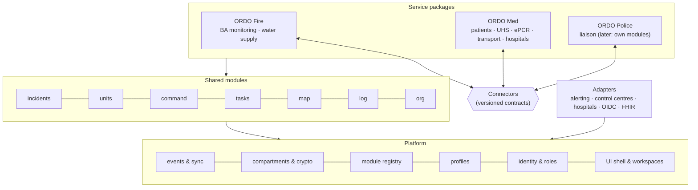
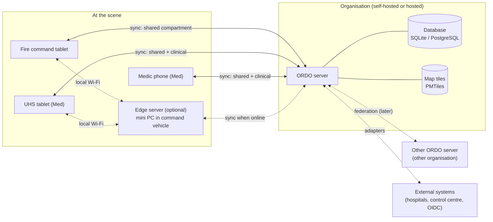
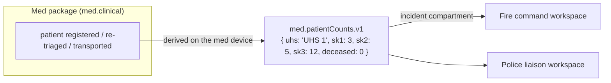
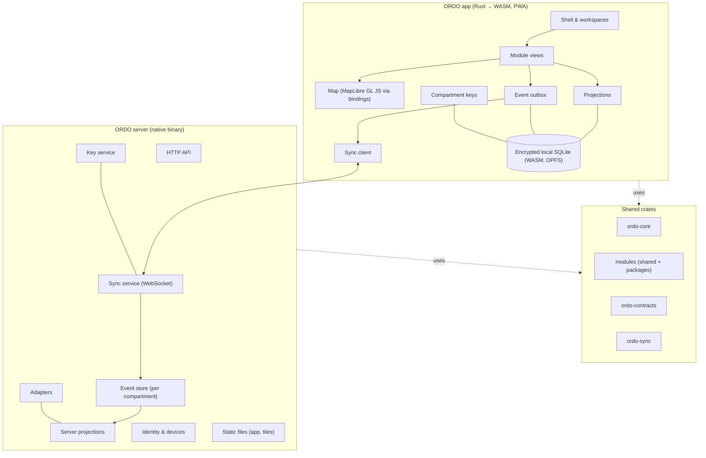
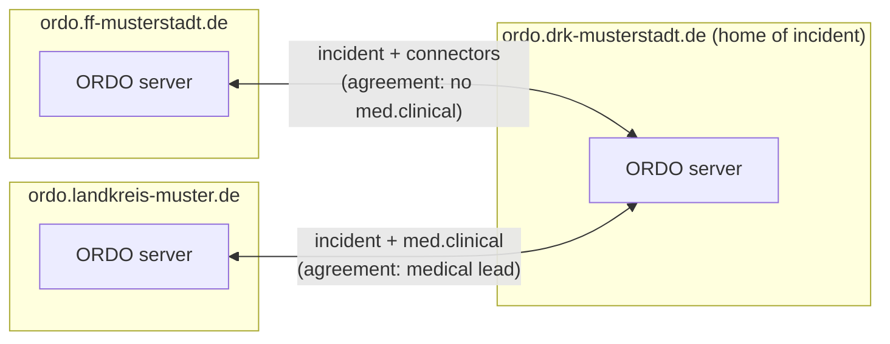

# ORDO — Architecture

> Status: **Draft v0.4** · 2026-11-08 · Based on [requirements.md](requirements.md)

## 1. Architecture drivers

These requirements shape the architecture the most:

| Driver | From | Consequence |
|---|---|---|
| Several services on one platform | MOD-1…5, CONN-1…5 | Layers: platform → shared modules → service packages; connectors between packages |
| Patient data must stay with medical staff | SEC-8…10, EPCR-7 | **Data compartments** with own keys, access rules, sync scope and retention |
| Works fully offline, devices sync later | OFF-1…5 | Local-first clients: every device has its own copy of the data it may see |
| Tamper-evident, append-only records | LOG-3, EPCR-4 | Store changes as **events**; logs and records are derived from them |
| Resource-efficient everywhere | PERF-1, PERF-4, PERF-5 | **Rust** on server and client (WebAssembly); compact wire format |
| Easy to run for volunteers | OPS-1, UX-9 | **One static binary**, SQLite by default, ready-made packages |
| Self-hosted *and* later hosted | OPS-4 | Multi-tenancy designed in from the start |
| Tablet, laptop, phone | UX-6 | One cross-platform client (installable web app, later native shell) |
| Small first, cloud-native later | OPS-1, OPS-5…11 | Modular monolith; stateless process; containers and Compose from day one; Helm later |
| Federation between organisations | FED-1…7 | Server-qualified IDs and signed events from day one; same sync protocol for devices and servers |
| Open interfaces | API-1…4 | Spec-first, published specifications with conformance tests |
| Regional profiles (DE first) | I18N-2, I18N-4…8 | Terminology, symbols, codes and forms are layered data packages |

## 2. Layers

ORDO is built in layers so that it is **composable**: organisations combine the
packages they need, and new packages can be added without touching existing ones.



| Layer | Contains | May depend on |
|---|---|---|
| **Platform** | Event envelope, sync, compartments and encryption, identities, roles, devices, module registry, profile loader, UI shell, design system, map engine | nothing above it |
| **Shared modules** | incidents, units, command, tasks, map, log, org | platform; other shared modules' public types |
| **Service packages** | Bundles of service-specific modules plus their workspaces, wording and default settings | platform, shared modules, **connectors** (never another package's internals) |
| **Connectors** | Versioned contracts for data that crosses package borders | platform |
| **Adapters** | Integrations with external systems | platform; the module they serve |

Rules that keep it modular:

1. Dependencies point **downwards only**. The platform knows nothing about fire or
   patients; shared modules know nothing about packages.
2. Packages never read each other's data. They talk **only through connectors**.
3. Everything country-specific lives in **profiles** (data), never in code.

## 3. Overview: devices and servers



- The **ORDO app** runs on every device and keeps a local copy of the incidents it
  takes part in — but only the **compartments** its user may read.
- The **ORDO server** receives changes, puts them in order, stores them and sends them
  to the devices entitled to them. It also serves the app itself, so one binary is a
  complete installation.
- The **edge server** (later) is the same binary on a small computer in the command
  vehicle, for scenes without internet.

## 4. Events

Every change is stored as an immutable **event**. Shown as JSON for readability; on the
wire and in storage it is **CBOR**.

```json
{
  "id": "01JC8Z6K4Q8M3N2P1R0S9T8V7W",
  "incident": "01JC8Z5…@ordo.drk-musterstadt.de",
  "origin": "ordo.drk-musterstadt.de",
  "compartment": "med.clinical",
  "module": "med.epcr",
  "type": "epcr.vitalsRecorded",
  "schemaVersion": 1,
  "author": { "user": "anna@ordo.drk-musterstadt.de", "device": "01JC7…" },
  "hlc": "2026-11-08T14:02:11.480Z-0001-device12",
  "payload": "<encrypted with the compartment key>",
  "signature": "<Ed25519 signature of origin>"
}
```

- The **envelope** (IDs, origin, compartment, module, type, author, clock) is small and
  readable by the server, so it can order, route and check permissions.
- Identifiers are **globally unique and qualified with their server**, and every event
  is **signed**, from day one, so that installations can federate later without
  migrating data (§11).
- The **payload** of protected compartments is encrypted with that compartment's key
  (§5).
- The current state is a **projection** of the events, built per module.

### 4.1 Ordering and conflicts

- Each event carries a **hybrid logical clock** (HLC): close to real time but
  consistently ordered even when device clocks differ.
- The incident's **home server** (§11) assigns a **sequence number** per incident and
  compartment. Clients replay
  their unconfirmed local events on top of it.

| Kind of data | Rule | Example |
|---|---|---|
| Log entries, radio messages, ePCR entries | Never conflict, all are kept | Two medics document at the same time |
| Simple fields | Last writer wins (by HLC), per field | Unit status changed on two tablets |
| Collections | Add and remove are separate events | Two units added to a sector at once |
| Critical changes | Last writer wins **and** a visible notice | Two people re-triage the same patient |

Events of modules a device doesn't know (older version, module switched off) are
stored and forwarded untouched, so mixed versions in the field never lose data.

## 5. Data compartments

A **compartment** is a separately protected part of an incident's data. Every event
belongs to exactly one.

| Compartment | Content | Who can read | Retention (default, DE) |
|---|---|---|---|
| `incident` | Units, sectors, tasks, map, log, connector data | Everyone taking part in the incident | Configurable (e.g. 1–3 years) |
| `med.clinical` | Patient identity, triage details, ePCR, transport details | Assigned medical staff, medical leads | ≥ 10 years (medical documentation) |
| `med.ops` | UHS staff planning, internal med logistics | Med package users | As `incident` |
| `police.restricted` | Police-only information (later) | Police users | Per police rules |
| `fire.ops` | Fire-internal data, e.g. BA monitoring details | Fire package users | As `incident` |

Each compartment has its own:

- **Access rules** — checked on the server for every event and every read.
- **Sync scope** — the server sends a device only the compartments its user may read.
  A fire tablet never receives, and therefore never stores, patient records.
- **Encryption key** — one data key per incident and compartment. Keys are given to
  authorised devices encrypted for that device's own key (X25519), and are removed when
  a device is revoked or a role ends.
- **Retention** — closed incidents are deleted or anonymised per compartment, so ePCR
  data can be kept 10 years while operational data is deleted earlier.

**Trust model (proposed, ADR 014):** the server is trusted and can decrypt (needed for
reports, PDF handover, FHIR export and backups), but keeps compartment keys separate
and logs every decryption. Full end-to-end encryption (server can't read clinical data)
is possible later with the same structure, at the cost of server-side features.

## 6. Modules, packages and workspaces

### 6.1 Modules

A module owns one functional area and declares:

| Part | Example (`med.uhs`) |
|---|---|
| **Events** in its own namespace | `uhs.created`, `uhs.patientAdmitted`, `uhs.patientDischarged` |
| **Compartments** it writes to | `med.clinical` (patient-related), `med.ops` (staffing) |
| **Projection** | UHS board: patients, status, waiting times |
| **Permissions** | Which roles may emit which events |
| **Profile catalogues** it reads | `triage-categories`, `discharge-outcomes` |
| **Views** for the app | UHS board, admission dialog |
| **Public types** others may reference | `UhsId`, `PatientId` |

Modules are Rust crates implementing a common `Module` trait and are compiled in.
Each organisation switches them on or off at runtime. Loading third-party modules at
runtime (e.g. as sandboxed WebAssembly components) is possible later, but not planned.

### 6.2 Service packages

A **service package** is a bundle: a set of modules, the **workspaces** for its roles,
its connectors, and default settings. Example:

```toml
# packages/med/package.toml
id = "med"
name = "ORDO Med"
modules = ["med.patients", "med.uhs", "med.epcr", "med.transport", "med.hospitals"]
uses_shared = ["incidents", "units", "command", "tasks", "map", "log"]
compartments = ["med.clinical", "med.ops"]
connectors_provided = ["med.patientCounts.v1", "med.transportStatus.v1"]
connectors_consumed = ["fire.responderInjured.v1", "command.dangerZones.v1"]
```

### 6.3 Workspaces

A **workspace** is what a role sees when it opens ORDO: a set of views, a layout and
the package's wording — similar to role-based launchpads in business software.

| Workspace | Package | Main views |
|---|---|---|
| Fire command | Fire | Units, sectors, tasks, map, log |
| Medical incident lead | Med | Patient counts, UHS load, transport board, map |
| UHS | Med | UHS board, patient admission, ePCR |
| Medic | Med | My patients, ePCR quick entry |
| Transport | Med | Transport requests, transport units, hospitals |
| Police liaison | Police | Map, cordons, shared information |

Workspaces are defined as data (package + profile), so organisations can adjust them
without code.

## 7. Connectors

A **connector** is a versioned contract for information that crosses a package border.
Technically, a connector is a set of **published events** in the shared `incident`
compartment:



- The **providing** package derives connector events from its own data, on the device
  where the change happens. So it also works offline at the scene.
- Connector events contain **only what the contract allows**: counts and statuses,
  never clinical details (CONN-3).
- **Consuming** packages depend only on the contract crate (`ordo-contracts`), never on
  the providing package.
- Contracts are **versioned** (`.v1`, `.v2`); a provider can publish several versions
  during a transition.
- Requests across services (e.g. Fire → Med "responder injured") are connector events
  that create a **task** visible to both sides (CONN-4).
- The list of all connectors with their fields and purpose is generated from the
  contract crate and shown to administrators (CONN-2).

First contracts:

| Contract | From → to | Content |
|---|---|---|
| `med.patientCounts.v1` | Med → all | Counts per triage category and location |
| `med.transportStatus.v1` | Med → all | Transports: unit, destination hospital, status — no patient data |
| `fire.responderInjured.v1` | Fire → Med | Request for care: location, unit, urgency |
| `command.dangerZones.v1` | Command → all | Danger zones, staging areas, sectors |
| `command.routes.v1` | Command/Police → all | Cordons, access and exit routes |

## 8. Components

One **Cargo workspace**. Platform, modules and contracts are written once in Rust and
compiled both natively (server) and to WebAssembly (app).



| Component | Responsibility |
|---|---|
| **ordo-core** | Event envelope, compartments, incident lifecycle, identities, permission framework, module and package registry. No I/O. |
| **ordo-sync** | Sync protocol: messages, HLC, outbox, replay, conflict rules, compartment-scoped subscriptions. |
| **ordo-crypto** | Compartment keys, device keys, payload encryption, hash chains. |
| **ordo-contracts** | All connector contracts, versioned. |
| **ordo-profiles** | Profile format, loader, layering, validation (no data). |
| **ordo-store** | Storage abstraction: SQLite (native and WASM), PostgreSQL. |
| **Modules** | Functional areas (§6). |
| **ordo-app** | Leptos app shell, workspaces, design system. |
| **ordo-map** | Bindings to MapLibre GL JS. |
| **ordo-server** | axum server: API, sync service, key service, adapters, static files, CLI. |

## 9. Technology choices

| Area | Proposal | Reasoning | Alternatives |
|---|---|---|---|
| Language | **Rust** everywhere | Fast, low memory, no GC; one codebase for client and server | — (decided) |
| Client UI | **Leptos** (client-side rendered, WASM) | Fine-grained reactivity, no virtual DOM | Dioxus; Yew |
| Client delivery | **PWA** | One codebase for tablet/laptop/phone; no app store | — |
| Native shell | **Tauri 2** (later) | Rust-native; Android/iOS/desktop; secure key storage, native SQLite | Capacitor |
| Client storage | **SQLite in WASM** (OPFS), encrypted payloads | Transactional; same SQL as server | IndexedDB |
| Map | **MapLibre GL JS** + **PMTiles** (OpenStreetMap) via `wasm-bindgen` | GPU vector maps; offline regions | maplibre-rs (experimental) |
| Server | **axum** on **tokio** | Small, fast, WebSocket built in | actix-web |
| Database | **sqlx**: SQLite default, PostgreSQL optional | One crate for both | rusqlite + tokio-postgres |
| Serialisation | **serde** + **CBOR**; JSON for export | Compact and evolvable | postcard |
| Cryptography | **RustCrypto** / **ring**: XChaCha20-Poly1305, X25519, BLAKE3, Argon2id | Audited, pure Rust or well-reviewed | libsodium bindings |
| Auth | Local accounts + **OpenID Connect** | Simple for volunteers, SSO for agencies | — |
| PDF | **Typst** as a library | Pure Rust; templates as data | HTML-to-PDF |
| Health data exchange | **HL7 FHIR** (later, adapter) | Standard for hospital interfaces | — |
| Packaging | **Single static binary** (musl, x86_64/aarch64); container optional | One-command install | — |

### 9.1 Resource budget

- **WASM size:** `opt-level = "z"`, LTO, `wasm-opt`; packages and rarely used views are
  loaded on demand, so a fire tablet never downloads the ePCR code. Initial load
  < 1 MB compressed.
- **DOM work:** fine-grained reactivity; long lists (patients, log) virtualised.
- **Battery:** no polling (WebSocket push), batched sync, GPS only when needed.
- **Server:** one async process; idle memory target < 50 MB.
- **Measured in CI:** benchmarks for projections, sync and encryption; budgets checked
  on the reference tablet.

## 10. Deployment and operations

ORDO stays **one program** (a modular monolith), but is built from the start to run
well in containers and orchestrators. Small setups get one file; large setups get the
same program, scaled out.

### 10.1 Cloud-ready by design

| Principle | How ORDO does it |
|---|---|
| Configuration | Environment variables or a config file; nothing baked into the image |
| State | Only in the database and file/object storage; the process itself is stateless |
| Logs | Structured JSON to stdout |
| Health | `/healthz` (alive), `/readyz` (database reachable, migrations done) |
| Observability | Prometheus metrics at `/metrics`; optional OpenTelemetry tracing |
| Shutdown | Graceful on `SIGTERM`: stop accepting, tell devices to reconnect elsewhere, finish writes |
| Migrations | Automatic on start (single instance) or as a separate `ordo migrate` job (cluster) |
| Files | Map tiles, attachments, backups: local directory **or** S3-compatible object storage |
| Secrets | Environment or mounted files (Docker / Kubernetes secrets); external key management later |

### 10.2 Container image

- Static binary in a minimal image (`scratch` / distroless): no shell, non-root,
  read-only file system, roughly 20–30 MB.
- Multi-architecture: `linux/amd64` and `linux/arm64` (Raspberry Pi, ARM servers).
- Published with every release, signed (cosign), with a software bill of materials.

### 10.3 Deployment options

| Option | Setup | Typical use |
|---|---|---|
| **Single binary** | `ordo serve` + SQLite file; systemd unit | One organisation, mini PC / Raspberry Pi |
| **Compose — minimal** | ORDO (SQLite on a volume) + Caddy for automatic TLS | One organisation or district |
| **Compose — full** | ORDO + PostgreSQL + Caddy | District / county, several organisations |
| **Kubernetes** (Helm, later) | Several ORDO replicas + PostgreSQL (e.g. CloudNativePG) + ingress + object storage | Hosted service, large regions |
| **Edge** (later) | Same binary on a mini PC in the command vehicle | Scenes without internet |

### 10.4 Scaling out

- **SQLite mode:** exactly one instance, by design.
- **PostgreSQL mode:** any number of stateless instances behind a load balancer.
  Devices connect to any instance. New events are passed between instances via
  PostgreSQL `LISTEN/NOTIFY`, so no extra message broker is needed. A broker (e.g. NATS)
  only if measurements ever show a need.
- **Ordering stays correct** with many instances: sequence numbers are assigned inside a
  database transaction per incident.
- **Splitting later without rewriting:** the binary can run selected roles
  (`ordo serve --roles api,sync`, `ordo worker` for reports, retention, adapters). We
  split into separate services only if measurements show it is worth it.

Every record carries an `organisation_id` from day one (multi-tenancy).

## 11. Federation

**Goal:** ORDO installations run by different organisations work together on the same
incident, without a central server — in the spirit of Matrix, but focused on what
emergency services need.

### 11.1 Why not build directly on Matrix?

Matrix is a serious option: proven, federated, end-to-end encrypted, with Rust server
implementations; in Germany it is the basis of the health sector's TI-Messenger and of
the Bundeswehr's BwMessenger. But for ORDO's core data the fit is poor:

| Aspect | Matrix | ORDO needs |
|---|---|---|
| Who can federate | Open by default | Closed: only explicitly trusted partners |
| Ordering | Event graph with state resolution, no single authority | A simple, clear order per incident — an incident has a lead organisation anyway |
| Data model | Rooms and messages; app data as custom events | Compartments, projections, retention per compartment, offline-first devices |
| Resources | Homeservers are comparatively heavy | Must run on a Raspberry Pi in a vehicle |

**Proposal (ADR 016):** an own, focused federation protocol that borrows Matrix's good
ideas (server identity via domain names, signed events, open specification). Plus a
**Matrix adapter** later for messaging with TI-Messenger, BwMessenger or Element — where
Matrix is strongest.

### 11.2 Model



- **Server identity:** each installation has a domain name and a signing key pair
  (Ed25519), published at `https://<domain>/.well-known/ordo`.
- **Global identifiers:** users and organisations are qualified with their server
  (e.g. `anna@ordo.drk-musterstadt.de`); incidents and events have globally unique IDs.
- **Signed events:** every event is signed by its origin, so every installation can
  verify where an event comes from and that it is unchanged — even when relayed.
- **Home per incident:** the leading organisation's server is the incident's *home* and
  assigns the order. Other servers replicate the incident for the compartments their
  users may read. The home can be handed over (e.g. the county takes over command);
  the handover is an event like any other.
- **Same protocol as devices:** to the home, a partner server behaves like a large
  client — with an outbox, continuing to work when the home is unreachable and catching
  up later. A network split between organisations is the same case as a tablet without
  coverage, which ORDO handles anyway.
- **Closed by default:** a federation agreement per partner states which compartments
  and roles may cross. Compartment keys are given only to partner servers that host
  authorised users; `med.clinical` normally stays with medical organisations.

### 11.3 Now vs later

| Built now (cheap, avoids migrations later) | Built later (phase 4) |
|---|---|
| Globally unique, server-qualified identifiers | Server discovery and key exchange |
| Server signing keys; signed events | Federation agreements (admin UI) |
| "Home" concept in the sync protocol | Server-to-server endpoints |
| Sync protocol that doesn't distinguish device vs server peers | Home handover; conformance tests |

## 12. Open specifications

All of ORDO's interfaces are published as **open, versioned specifications**,
separate from the code — like the Matrix specification — so other systems, including
commercial control-centre or hospital software, can talk to ORDO.

| Specification | Covers | Format |
|---|---|---|
| Client–server API | Login, master data, admin (HTTP) | OpenAPI 3.1 |
| Sync protocol | WebSocket messages, event envelope | AsyncAPI 3 + CDDL (RFC 8610) for the CBOR structures |
| Federation API | Discovery, keys, server-to-server sync | OpenAPI 3.1 + AsyncAPI 3 |
| Connector contracts | Data crossing package borders | CDDL; JSON Schema generated |
| Profile format | Regional profiles | JSON Schema (validates the TOML files) |

- **Spec-first** for the sync protocol, federation and connectors: the spec is the
  contract, the Rust code implements it, and CI checks that they match.
- **Conformance test suite** in the repository that any implementation can run.
- **Versioning:** each specification has its own semantic version; servers announce
  supported versions in `/.well-known/ordo`.
- **Licence:** CC BY 4.0 for spec texts, Apache-2.0 for schemas and the
  conformance suite. Permissive on purpose: anyone may implement the interfaces, while
  ORDO's own code stays AGPL.

## 13. Security

- **Transport:** TLS everywhere (rustls); ACME / Let's Encrypt or local certificates.
- **Compartments:** separate access rules, sync scope, keys and retention (§5).
- **Devices:** own key pair per device, paired via QR code; revocation removes keys and
  stops sync. Devices with clinical data lock automatically (PIN / biometrics).
- **Permissions** are checked on the server for every event; the client checks them only
  for quick feedback.
- **Guests** get a time-limited link for one incident, `incident` compartment only.
- **Integrity:** events hash-chained per incident and compartment (BLAKE3).
- **Access logging:** every read of a clinical record is an audit event.
- **Memory safety:** no `unsafe` in ORDO's own code except reviewed FFI; `cargo audit`
  and `cargo deny` in CI.

## 14. Regional profiles

Everything country- or organisation-specific is **configuration data**, packaged as a
profile. Core, modules and packages contain no regional data (I18N-4).

### 14.1 Profile packages

```
profiles/de/
├── profile.toml               # manifest
├── unit-types.toml
├── status-codes.toml
├── command-structure.toml
├── incident-keywords.csv
├── task-templates.toml
├── med/
│   ├── triage-categories.toml
│   ├── discharge-outcomes.toml
│   ├── epcr-forms/            # DIVI MIND-based forms
│   └── hospital-types.toml
├── terminology/
│   ├── de.ftl                 # UI wording (Fluent)
│   └── en.ftl
└── symbols/                   # tactical symbols (SVG)
```

```toml
# profiles/de/profile.toml
id = "de"
name = "Deutschland"
version = "1.0.0"   # content version
format = 1          # profile format version (I18N-8)
extends = []        # a state profile would say: extends = ["de"]
languages = ["de", "en"]
```

```toml
# profiles/de/med/triage-categories.toml
[[category]]
id = "de.triage.sk1"
label = "SK I"
colour = "red"
meaning = "immediate"      # core meaning used by the software
```

### 14.2 Catalogues are the extension points

Each catalogue type is defined (schema + meaning) by the module that uses it. A new
module brings its own catalogue types; the loader doesn't change.

| Catalogue | Module | Core meaning |
|---|---|---|
| `unit-types` | units | unit category (fire, EMS, police, technical, command, …) |
| `status-codes` | units | available, en_route, on_scene, deployed, unavailable, … |
| `command-structure` | command | level and role names |
| `incident-keywords` | incidents | incident category |
| `task-templates` | tasks | — |
| `symbols` | map | symbol per unit type, status, map object |
| `triage-categories` | med.patients | immediate, urgent, minor, expectant, deceased |
| `discharge-outcomes` | med.uhs | released, transported, refused, deceased |
| `epcr-forms` | med.epcr | form fields mapped to record fields |
| `hospital-types` | med.hospitals | capabilities (trauma centre, paediatrics, burns, …) |
| `terminology` | app | UI wording |
| `workspaces` | app | role → views and layout |

The software works with the core meaning (`immediate`); users see the regional label
("SK I", "T1", "P1", …). That is what lets one codebase serve many countries.

### 14.3 Layering

```
de  →  de-by (Bavaria)  →  org: e.g. a local medical service
```

- Every entry has a stable ID. A child layer can **add**, **override** or **hide**
  entries.
- The organisation layer is edited in the admin UI and stored as a profile layer.
- The resolver produces a versioned **effective profile** with a content hash; incidents
  record the hash they started with.
- `ordo profile validate` / `ordo profile resolve` check profiles locally and in CI.

### 14.4 First profile: Germany (DE)

| Item | DE profile |
|---|---|
| Command structure | FwDV 100: Einsatzleitung, Einsatzabschnitte, Untereinsatzabschnitte |
| Tactical symbols | DV 102 / *Taktische Zeichen* (open-licensed set to be identified) |
| Unit types | HLF, LF, TLF, DLK, ELW, RTW, NEF, KTW, … |
| Status codes | Status 1–9 (FMS/TMS) |
| Crew strength | Tactical notation, e.g. 1/8/**9** |
| Triage | *Sichtungskategorien* SK I–IV, plus deceased |
| Patient record | Based on DIVI MIND |
| Language | German (English UI available) |

## 15. Repository structure

```
ordo/
├── Cargo.toml                 # workspace
├── platform/
│   ├── ordo-core/             # envelope, compartments, identities, registry
│   ├── ordo-sync/             # sync protocol, HLC, outbox
│   ├── ordo-crypto/           # keys, encryption, hash chains
│   ├── ordo-store/            # SQLite (native/WASM), PostgreSQL
│   ├── ordo-profiles/         # profile format, loader, layering, validation
│   ├── ordo-contracts/        # connector contracts (versioned)
│   ├── ordo-app/              # Leptos shell, workspaces, design system
│   ├── ordo-map/              # MapLibre bindings
│   └── ordo-server/           # axum server, CLI
├── modules/                   # shared modules
│   ├── incidents/ units/ command/ tasks/ map/ log/ org/
├── packages/
│   ├── fire/                  # package.toml + modules: ba/, water/
│   ├── med/                   # package.toml + modules: patients/, uhs/, epcr/, transport/, hospitals/
│   └── police/                # package.toml (liaison workspace first)
├── adapters/                  # alerting, OIDC, FHIR, IVENA, EMSI, …
├── profiles/
│   └── de/                    # data only
├── spec/                      # open specifications (CC BY 4.0 / Apache-2.0)
│   ├── client-server/         # OpenAPI
│   ├── sync/                  # AsyncAPI + CDDL
│   ├── federation/            # OpenAPI + AsyncAPI
│   ├── connectors/            # CDDL
│   ├── profiles/              # JSON Schema
│   └── conformance/           # test suite
├── docs/
│   ├── requirements.md
│   ├── architecture.md
│   └── adr/
└── deploy/
    ├── Containerfile          # multi-arch, minimal image
    ├── compose/
    │   ├── minimal/           # ORDO + Caddy (SQLite)
    │   └── full/              # ORDO + PostgreSQL + Caddy
    ├── systemd/
    └── helm/                  # later
```

## 16. Decisions (ADRs)

| # | Decision | Status |
|---|---|---|
| 001 | Local-first with event sourcing | Proposed |
| 002 | Rust for server and client; shared crates compiled to native and WASM | **Accepted** |
| 003 | Leptos as UI framework; PWA first | Proposed |
| 004 | SQLite default, PostgreSQL optional (sqlx) | Proposed |
| 005 | Own sync protocol on WebSocket with CBOR | Proposed |
| 006 | MapLibre GL JS + PMTiles for offline maps | Proposed |
| 007 | Licence: AGPL-3.0-or-later | **Accepted** |
| 008 | German (DE) profile first | **Accepted** |
| 009 | Regional profiles as layered data packages mapped to core meanings | Proposed |
| 010 | Platform → shared modules → service packages; compiled-in modules | Proposed |
| 011 | Service packages with role-based workspaces defined as data | Proposed |
| 012 | Data compartments with own keys, access, sync scope and retention | Proposed |
| 013 | Connectors as versioned published events in the shared compartment | Proposed |
| 014 | Trust model for clinical data: server-trusted encryption first, end-to-end later | Open |
| 015 | Modular monolith, twelve-factor, container image and Compose from day one, Helm later | Proposed |
| 016 | Own incident-scoped federation protocol inspired by Matrix; Matrix only as messaging adapter | Proposed |
| 017 | Server-qualified global IDs and signed events from day one | Proposed |
| 018 | Spec-first open specifications (OpenAPI, AsyncAPI, CDDL) under CC BY 4.0 (texts) / Apache-2.0 (schemas, conformance) | **Accepted** |
| 019 | Med package first in the MVP (without ePCR) | **Accepted** |

## 17. Risks

| Risk | Mitigation |
|---|---|
| **Building a platform instead of a product** (over-engineering) | Extract the platform from real modules, not the other way round; keep the module API internal until two packages use it; field-test early |
| Offline sync with compartments is complex | Prototype first, with two compartments from day one |
| ePCR brings legal duties (GDPR Art. 9, retention, confidentiality) | Compartments from the start; data-protection review before field use; ePCR in its own phase |
| Feature creep into medical-device territory | Hard rule: document and organise, no decision support (requirements §6) |
| Rust + WASM has fewer UI contributors than JS | Small design system; good build docs |
| SQLite in WASM / browser storage limits (iOS) | Verify in prototype; persistent storage; Tauri shell later |
| Map is JavaScript, not Rust | Thin binding layer (`ordo-map`) |
| Federation is a large undertaking | Only the foundations now (IDs, signatures, home concept); the rest in phase 4 |
| Maintaining open specs costs time | Spec-first only for sync, federation and connectors; the admin API spec is generated from code |
| Volunteer project, limited time | Small MVP; planned operations (events) as low-risk field tests |
| Safety-critical features (BA monitoring) | Own requirements and tests; never the only safeguard |

## 18. Next steps

1. Phase 0: set up the Cargo workspace, CI (build, tests, multi-arch container image)
   and the minimal Compose setup; write ADRs 001–019.
2. Draft the event envelope and sync protocol as the first specs (CDDL + AsyncAPI).
3. Sync prototype covering the risky parts: `ordo-core` + `ordo-sync` + `ordo-crypto`,
   **two compartments** (`incident`, `med.clinical`), signed events with qualified IDs,
   one shared module (`units`), one package module (`med.patients`), one connector
   (`med.patientCounts.v1`), a minimal DE profile, minimal server and Leptos app, run
   via Docker Compose. Test: a command tablet sees counts but never receives patient
   data; network on/off; conflicting edits; two server instances on PostgreSQL. Measure
   size and memory.
4. Design the main tablet screens for the Med MVP (patient registration, UHS board,
   transport board) with volunteers.
