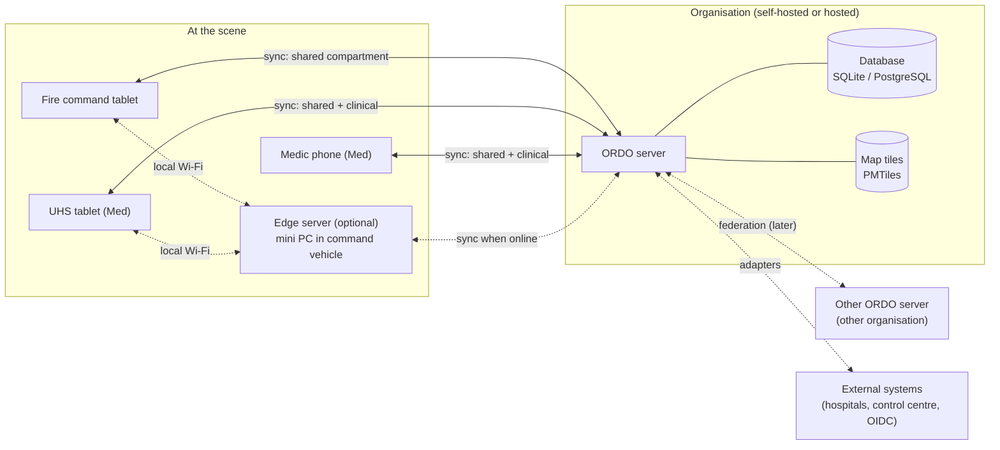

# 3. Context and scope

> Part of the [ORDO architecture](README.md) (arc42).

## 3.1 Business context

| Partner | Exchange with ORDO | When |
|---|---|---|
| Responders' devices (tablet, laptop, phone) | Events, workspaces, maps | MVP |
| Other ORDO installations (other organisations) | Shared incidents via federation | Phase 4 |
| Alerting systems, control centres | Incoming alerts; exchange via EMSI / CAP | Later |
| Hospitals | Capacity, pre-notification (IVENA eHealth), handover (HL7 FHIR) | Later |
| Identity providers | Login via OpenID Connect | Later |
| Messaging (TI-Messenger, BwMessenger, Element) | Matrix adapter | Later |
| Map data | OpenStreetMap-based PMTiles regions | MVP |

## 3.2 Technical context: devices and servers

- The **ORDO app** runs on every device and keeps a local copy of the incidents it
  takes part in — but only the **compartments** its user may read.
- The **ORDO server** receives changes, puts them in order, stores them and sends them
  to the devices entitled to them. It also serves the app itself, so one binary is a
  complete installation.
- The **edge server** (later) is the same binary on a small computer in the command
  vehicle, for scenes without internet.
