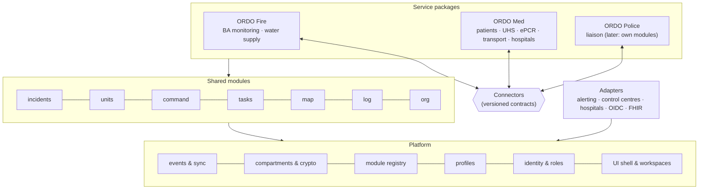
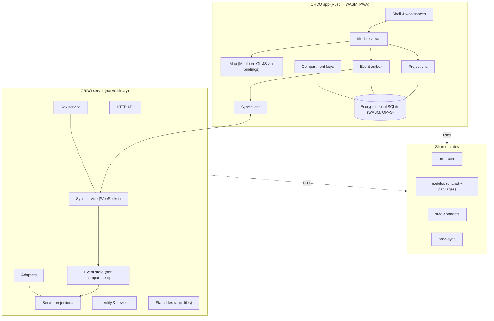

# 5. Building block view

> Part of the [ORDO architecture](README.md) (arc42).

## 5.1 Level 1: layers

ORDO is built in layers so that it is **composable**: organisations combine the
packages they need, and new packages can be added without touching existing ones.



| Layer | Contains | May depend on |
|---|---|---|
| **Platform** | Event envelope, sync, compartments and encryption, identities, roles, devices, module registry, profile loader, UI shell, design system, map engine | nothing above it |
| **Shared modules** | incidents, units, command, tasks, map, log, org | platform; other shared modules' public types |
| **Service packages** | Bundles of service-specific modules plus their workspaces, wording and default settings | platform, shared modules, **connectors** (never another package's internals) |
| **Connectors** | Versioned contracts for data that crosses package borders | platform |
| **Adapters** | Integrations with external systems | platform; the module they serve |

Rules that keep it modular:

1. Dependencies point **downwards only**. The platform knows nothing about fire or
   patients; shared modules know nothing about packages.
2. Packages never read each other's data. They talk **only through connectors**.
3. Everything country-specific lives in **profiles** (data), never in code.

## 5.2 Level 2: components

One **Cargo workspace**. Platform, modules and contracts are written once in Rust and
compiled both natively (server) and to WebAssembly (app).



| Component | Responsibility |
|---|---|
| **ordo-core** | Event envelope, compartments, incident lifecycle, identities, permission framework, module and package registry. No I/O. |
| **ordo-sync** | Sync protocol: messages, HLC, outbox, replay, conflict rules, compartment-scoped subscriptions. |
| **ordo-crypto** | Compartment keys, device keys, payload encryption, hash chains. |
| **ordo-contracts** | All connector contracts, versioned. |
| **ordo-profiles** | Profile format, loader, layering, validation (no data). |
| **ordo-store** | Storage abstraction: SQLite (native and WASM), PostgreSQL. |
| **Modules** | Functional areas ([5.3](#53-service-packages-and-workspaces)). |
| **ordo-app** | Leptos app shell, workspaces, design system. |
| **ordo-map** | Bindings to MapLibre GL JS. |
| **ordo-server** | axum server: API, sync service, key service, adapters, static files, CLI. |

## 5.3 Service packages and workspaces

### 5.3.1 Modules

A module owns one functional area and declares:

| Part | Example (`med.uhs`) |
|---|---|
| **Events** in its own namespace | `uhs.created`, `uhs.patientAdmitted`, `uhs.patientDischarged` |
| **Compartments** it writes to | `med.clinical` (patient-related), `med.ops` (staffing) |
| **Projection** | UHS board: patients, status, waiting times |
| **Permissions** | Which roles may emit which events |
| **Profile catalogues** it reads | `triage-categories`, `discharge-outcomes` |
| **Views** for the app | UHS board, admission dialog |
| **Public types** others may reference | `UhsId`, `PatientId` |

Modules are Rust crates implementing a common `Module` trait and are compiled in.
Each organisation switches them on or off at runtime. Loading third-party modules at
runtime (e.g. as sandboxed WebAssembly components) is possible later, but not planned.

### 5.3.2 Service packages

A **service package** is a bundle: a set of modules, the **workspaces** for its roles,
its connectors, and default settings. Example:

```toml
# packages/med/package.toml
id = "med"
name = "ORDO Med"
modules = ["med.patients", "med.uhs", "med.epcr", "med.transport", "med.hospitals"]
uses_shared = ["incidents", "units", "command", "tasks", "map", "log"]
compartments = ["med.clinical", "med.ops"]
connectors_provided = ["med.patientCounts.v1", "med.transportStatus.v1"]
connectors_consumed = ["fire.responderInjured.v1", "command.dangerZones.v1"]
```

### 5.3.3 Workspaces

A **workspace** is what a role sees when it opens ORDO: a set of views, a layout and
the package's wording — similar to role-based launchpads in business software.

| Workspace | Package | Main views |
|---|---|---|
| Fire command | Fire | Units, sectors, tasks, map, log |
| Medical incident lead | Med | Patient counts, UHS load, transport board, map |
| UHS | Med | UHS board, patient admission, ePCR |
| Medic | Med | My patients, ePCR quick entry |
| Transport | Med | Transport requests, transport units, hospitals |
| Police liaison | Police | Map, cordons, shared information |

Workspaces are defined as data (package + profile), so organisations can adjust them
without code.

### 5.3.4 Design items

#### Package registry
`dsn~package-registry~1`

Shared code knows no package by name ([ADR-0010](../adr/0010-layered-modular-platform.md),
[ADR-0011](../adr/0011-workspaces-as-data.md)):

* **Event kinds.** Every module declares the kinds of event it writes in a module `kinds`:
  an `ordo_sync::EventKind` with compartment, module, event type and the payload's schema
  version. The app records an event by its kind; the schema version is never chosen at
  the call. A payload change bumps the one constant next to the payload.
* **App packages.** Each package (and the shared modules, as one) is an entry of the app's
  registry (`shell::registry`): its workspaces and views as data, the page of each view,
  its quick actions, its bell items, its log lines. The launcher, the navigation, the
  routes, the palette, the bell and the incident log loop over the entries. The source is
  in folders: `shell/` (the frame and its building blocks), `shared/` (shared modules) and
  one folder per package (`med/`).
* **Server packages.** Each package gives the server its Cedar policy files, its derivers
  and its write guards in one entry (`ServerPackage`); the server loops over them.

Covers:

* [req~mod-2~1](../requirements/07-quality.md#mod-2--modules)
* [req~mod-3~1](../requirements/07-quality.md#mod-3--extensible-without-changes)

Needs: impl, utest

Tags: must, m66

## 5.4 Repository structure

```
ordo/
├── Cargo.toml                 # workspace
├── platform/
│   ├── ordo-core/             # envelope, compartments, identities, registry
│   ├── ordo-sync/             # sync protocol, HLC, outbox
│   ├── ordo-crypto/           # keys, encryption, hash chains
│   ├── ordo-store/            # SQLite (native/WASM), PostgreSQL
│   ├── ordo-profiles/         # profile format, loader, layering, validation
│   ├── ordo-contracts/        # connector contracts (versioned)
│   ├── ordo-app/              # Leptos shell, workspaces
│   ├── ordo-ui/               # design system: accessible components
│   ├── ordo-tokens/           # DTCG tokens → CSS, contrast checks
│   ├── ordo-map/              # MapLibre bindings + accessible list view
│   └── ordo-server/           # axum server, CLI
├── modules/                   # shared modules
│   ├── incidents/ units/ command/ tasks/ map/ log/ org/
├── packages/
│   ├── fire/                  # package.toml + modules: ba/, water/
│   ├── med/                   # package.toml + modules: patients/, uhs/, epcr/, transport/, hospitals/
│   └── police/                # package.toml (liaison workspace first)
├── adapters/                  # alerting, OIDC, FHIR, IVENA, EMSI, …
├── profiles/
│   └── de/                    # data only
├── design/
│   ├── tokens/                # primitive, semantic, component tokens (DTCG JSON)
│   ├── themes/                # day, night, high-contrast (DTCG JSON)
│   └── assets/                # fonts (OFL), icons (ISC), with licence files
├── spec/                      # open specifications (CC BY 4.0 / Apache-2.0)
│   ├── client-server/         # OpenAPI
│   ├── sync/                  # AsyncAPI + CDDL
│   ├── federation/            # OpenAPI + AsyncAPI
│   ├── connectors/            # CDDL
│   ├── profiles/              # JSON Schema
│   └── conformance/           # test suite
├── docs/
│   ├── requirements/          # OpenFastTrace items (req), EARS; acceptance/ (Gherkin)
│   ├── architecture/          # arc42 chapters; design items (dsn)
│   ├── adr/                   # decisions (MADR 4)
│   ├── glossary.md
│   └── roadmap.md
├── AGENTS.md                  # instructions for AI agents (CLAUDE.md imports it)
└── deploy/
    ├── Containerfile          # multi-arch, minimal image
    ├── compose/
    │   ├── minimal/           # ORDO + Caddy (SQLite)
    │   └── full/              # ORDO + PostgreSQL + Caddy
    ├── systemd/
    └── helm/                  # later
```

## 5.5 Module designs

### 5.5.1 Shared module `units`

#### Crew workspace
`dsn~crew-workspace~3`

*Sanität – Besatzung* ([ADR-0079](../adr/0079-crew-workspace.md)) opens with the
incident permission `crew_work` (medical roles, `med.cedar`) and shows the units present
whose crew names the person's account (`UnitRegister::crewed_by`). View *Aufträge*: first
the open Aufträge that name the person ([Tasks](#tasks)), then per unit its status since
when and the status select (`units.statusChanged`) and its open Aufträge, one card each
([ADR-0081](../adr/0081-one-einsatzauftrag.md)): kind, place and description, a small map
and the link for the maps app where it has a pin, the next steps (`tasks.updated`; giving,
cancelling and the follow-up stay with the command, so the crew sees neither *Abbrechen*
nor *In 10 Minuten nachfragen*, and the status select offers no "Status setzen" once a
status is set) and, on a patient Auftrag the unit has not taken a patient from yet,
"Patient aufnehmen", which opens *UHS – Patienten* with the Auftrag in the registration.
"Meinen Standort zeigen" under the small map follows the device's position (browser
geolocation, asked for only then) as a dot named "Ich" and fits the map to it and the pin;
the position is never sent. View *Transporte*: the open
transports assigned to the unit, from which UHS, with type, priority, needs and
destination, and their next steps (`transport.updated`). Without a crew, each view says so.
Cedar lets medical roles write `units.statusChanged`, `tasks.updated` and
`tasks.patientRegistered`; the server does not check that it is their own unit.

Covers:

* [req~unit-9~1](../requirements/02-shared.md#unit-9--the-crews-own-workspace)
* [req~rep-3~2](../requirements/02-shared.md#rep-3--patient-from-a-patient-case)
* [req~rep-4~3](../requirements/02-shared.md#rep-4--place-on-the-map)

Needs: impl, utest, itest

Tags: should, m62

#### Lost-update detection
`dsn~lost-update-detection~1`

Unit status uses *last writer wins* by hybrid logical clock. Every status change records the timestamp of the change it replaces, as its author knew it. When the changes of a unit are sorted by timestamp and a change does not replace its predecessor, the predecessor was overwritten without being seen: ORDO keeps the later value and reports a lost update. The result depends only on the set of events, not on the order of arrival, so all devices reach the same state.

Covers:

* [req~off-4~1](../requirements/07-quality.md#off-4--no-lost-changes)

Needs: impl, itest

Tags: must, m1

#### Unit register
`dsn~unit-register~3`

Units (vehicles, teams, other resources) are events of the module `units` in the shared
`incident` compartment; every device computes the same register from them.

* **Join** (`units.added`, schema version 2): call sign, type, organisation, service and
  crew strength (Führer, Unterführer, Mannschaft; the total is computed, shown in
  tactical notation as 0/1/8/9). Schema version 3 adds leaders of formations and special
  functions (*Detailed strength*). Services come from the profile (`units/catalogue.toml`).
  Version 1 payloads decode without service and strength.
* **No vehicle list:** units are entered per incident; the add form offers the types and
  organisations of the incident's units as choices. ORDO keeps no list of an
  installation's vehicles, neither as master data
  ([ADR-0070](../adr/0070-units-planned-in-preparation-led-in-command.md)) nor as a file
  ([ADR-0074](../adr/0074-no-vehicles-file.md)).
* **Status:** status codes from the profile, set in *Führung – Disposition*
  ([ADR-0070](../adr/0070-units-planned-in-preparation-led-in-command.md)); the
  lost-update-aware board keeps when and by whom each status was set, and the cards show
  since when.
* **Crew** (`units.crewSet`, the whole list): names (suggesting the incident's people) and
  qualifications from the profile; the latest list counts.
* **Release** (`units.released`): the unit leaves the incident and is no longer counted;
  it stays in the history. Adding it again brings it back, with its attributes as given.
* **Strength on scene:** the units present, and their strength in total, per organisation
  and per service.

Covers:

* [req~unit-1~2](../requirements/02-shared.md#unit-1--add-units)
* [req~unit-2~1](../requirements/02-shared.md#unit-2--unit-attributes)
* [req~unit-3~1](../requirements/02-shared.md#unit-3--unit-status)
* [req~unit-4~1](../requirements/02-shared.md#unit-4--strength-on-scene)
* [req~unit-5~1](../requirements/02-shared.md#unit-5--crew-members)
* [req~unit-6~1](../requirements/02-shared.md#unit-6--release-units)

Needs: impl, utest, itest

Tags: must, m29

### 5.5.1a Shared module `tasks`

#### Tasks
`dsn~tasks~8`

Crate `ordo-tasks`, module `tasks`, in the shared `incident` compartment
([ADR-0081](../adr/0081-one-einsatzauftrag.md)). `tasks.given` (schema version 3) gives
an Auftrag a new ID (ULID): to a unit (call sign), a position of the command structure
(CMD-1) or a person (`person`, an account), as free text, optionally from a template of
the profile (`tasks/templates.toml`), and optionally with a time to follow up. A report
([Reports](#reports)) is an Auftrag with a kind (`event` or `patient`), a place and the
time it came in; it may come without anyone and waits for its unit. `tasks.assigned`
(schema version 2) adds a unit to an open Auftrag, never twice
([ADR-0085](../adr/0085-several-units-on-one-einsatzauftrag.md)); version 1 named the
one unit of an Auftrag that had not started. `tasks.updated` moves it on (open → in
progress → done, or cancelled; never back) and may set a new follow-up time; with `unit`
(schema version 2) the step is that unit's only. An Auftrag with units is in progress once
one unit is and done once every unit is; a step without a unit is the whole Auftrag's
(an Auftrag for a position or a person, the command's cancel, which ends every unit's
part, and version 1). Updates apply in hybrid logical clock order, every step stays in its
history with who and when. Shown states: *Eingegangen* (open, nobody), *Zugewiesen*
(open, someone), *In Arbeit*, *Erledigt*, *Abgebrochen*; with more than one unit, the
card lists each unit with its state and steps. A follow-up is due once its time has passed and the task is open; until
then the task card shows the time and counts the minutes and seconds left down (not
announced to screen readers each second).

Only the incident command gives, assigns and cancels Aufträge (Cedar: medical roles write
only `tasks.updated` and `tasks.patientRegistered`). The page *Disposition*
(*Einsatzleitung – Führung*) lists the open Aufträge, due follow-ups first, then by age,
one card each with kind, place, description, unit, state and next steps, and has one form
"Neuer Auftrag" for reports and tasks alike. The overview's
*Disposition* tile shows them in short (TASK-3); the other pages carry no extra line about
them (feedback of 2026-11-14 and 2026-11-17). On every page, everyone in an incident has a
bell in the header (since 2026-11-18 for every role). For the command (`view_situation`)
it counts what needs attention now: follow-ups that are due, Aufträge without anyone and
open staff requests, each linked to *Disposition*, and transports requested without a
unit, linked to *Transporte* (feedback of 2026-11-22: everything important and
time-critical). The overview's *Transporte* tile lists those requests in short, by
priority, with the open transports under way. For everyone else it counts the
Aufträge given to them, or whose part for a unit whose crew names them has not started,
each linked to *Sanität – Besatzung*. Its number is text, its name says it
("Hinweise: 2"), and its panel lists each item.
Each unit card lists its open tasks. "Due" is shown in words and with an icon, not by
colour alone.

Covers:

* [req~task-1~2](../requirements/02-shared.md#task-1--give-tasks)
* [req~task-2~3](../requirements/02-shared.md#task-2--task-status)
* [req~task-3~5](../requirements/02-shared.md#task-3--open-tasks-always-visible)
* [req~task-4~1](../requirements/02-shared.md#task-4--reminders)

Needs: impl, utest, itest

Tags: must, m31

### 5.5.1b Shared module `command`

#### Command structure
`dsn~command-structure~1`

Crate `ordo-command`, module `command`, in the shared `incident` compartment, following
[ADR-0031](../adr/0031-command-structure-from-doctrine.md). Positions grow with the incident:
`command.positionCreated` (new ID, a kind from the profile file `command/structure.toml`,
name, parent position, optionally service and organisation) and `command.positionClosed`.
Kinds carry a core meaning after ISO 22320 (command, sector, staff, liaison); the DE
profile names them after FwDV 100 and the medical response (*Einsatzleitung*,
*Einsatzabschnitt*, *Unterabschnitt*, *Sanitätseinsatzleitung*, *Patientenablage*,
*Behandlungsplatz*, *Transportorganisation*, staff functions S1–S6, *Verbindungsperson*).
`command.leaderSet` names the leader; each one after the first is a handover, kept with
time and both people (CMD-4). `command.assigned` puts a unit (call sign) or a UHS under a
position, or takes it out; the latest assignment counts. Everything is ordered by hybrid
logical clock, so every device computes the same tree.

The command workspace's view *Führung* shows the tree as nested lists with the leader,
units and UHS of each position (drawn as an org chart, *Org chart*), and the roster below; it points out a position with more
than five direct subordinates (span of control) without enforcing anything. Each unit
card offers its position in one choice (two taps, CMD-2); tasks can go to a position.
Only the command writes the module (Cedar). Positions giving roles, and so access, follow
in a later step (ADR-0031).

Covers:

* [req~cmd-1~1](../requirements/02-shared.md#cmd-1--sectors)
* [req~cmd-2~1](../requirements/02-shared.md#cmd-2--assign-units-to-sectors)
* [req~cmd-3~1](../requirements/02-shared.md#cmd-3--command-structure-view)
* [req~cmd-4~1](../requirements/02-shared.md#cmd-4--hand-over-leadership)

Needs: impl, utest, itest

Tags: must, m32

#### Org chart
`dsn~org-chart~2`

The command structure is drawn as an org chart from the same nested lists, by CSS alone:
where the card is at least 40rem wide (container query), positions under one stand side by
side below it, joined by lines in the border colour, and the chart takes the card's
width, siblings sharing it; each position is a compact card (title, leader, the handovers
collapsed). The units and UHS under a position are the next level of the tree, below it,
each a smaller card with its kind in words. A wide chart scrolls within its own
region, which takes keyboard focus. Where the card is narrower, the chart falls back to the
indented tree. The lists stay the semantics, so screen readers hear a nested list, as
before. Org chart libraries (d3-org-chart, OrgChart.js) were not needed: they draw from
JSON with scripts and add nothing a list does not already give.

Covers:

* [req~cmd-3~1](../requirements/02-shared.md#cmd-3--command-structure-view)

Needs: impl, itest

Tags: must, m57

#### Führung & Raum
`dsn~command-and-space~2`

*Vorbereitung – Führung & Raum* (`command.prepare/map`; `command.prepare/structure` lands
there too) holds the command structure with its forms, then the map editor, then the map
region ([ADR-0095](../adr/0095-command-and-space-on-one-page.md)). A grid of two columns
where the page is at least 84rem wide (container query), the region below them; narrower,
the three are tabs (*Führungsstruktur*, *Lagekarte*, *Kartengrundlage*, the last only for
those who may prepare the map; [ADR-0097](../adr/0097-command-and-space-in-tabs-when-narrow.md)),
opened on the structure, or on the map when the page was opened to place something. The
map follows its element's size, so a map made in a hidden tab gets its size when shown. For
those who may edit, each position's card offers *Auf der Karte setzen*, or *Auf der Karte
zeigen* when the map has it. The page shares a signal for such a request (Leptos context):
setting opens the editor's place panel with the kind *position* and that position chosen;
showing chooses the object, as *Bearbeiten* in the list does, and centres the map on it.
Either shows the map's tab, brings the editor into view and moves focus to its panel heading, whose status
line says what to do next. Nothing new is stored: placing writes `map.objectPlaced` as
before.

Covers:

* [req~cmd-5~1](../requirements/02-shared.md#cmd-5--command-structure-and-map-together)

Needs: impl, itest

Tags: should, m72

### 5.5.1c Shared module `map`

#### Situation map
`dsn~situation-map~5`

Crate `ordo-map`, module `map`, in the shared `incident` compartment
([ADR-0006](../adr/0006-maplibre-pmtiles.md)). `map.objectPlaced` puts an object on the
map: the incident location, a unit, a UHS or a position (one object each, so placing it
again moves it; its ID is the kind and the reference), with a label and a GeoJSON
geometry (RFC 7946: point, line or area, longitude first); `map.objectRemoved` takes it
off. The latest event of an object counts (hybrid logical clock). Drawn objects (lines and
areas, MAP-4) use the same events with their own IDs.

The view *Führung – Lagekarte* shows the map with the objects and, below it, the list of
objects (A11Y-5); it does not edit. The overview's map tile shows the same map; within
the page it moves with two fingers, or Ctrl (⌘) and the wheel, and says so when tried with
one, so one finger and the wheel scroll the page (MapLibre's cooperative gestures).
Those who may edit prepare the map on *Vorbereitung – Führung & Raum*
(`command.prepare/map`, [ADR-0095](../adr/0095-command-and-space-on-one-page.md)), with
the command structure, in the editor ([ADR-0064](../adr/0064-map-editor-with-terra-draw.md)),
the map region last: the map
fills the page, a toolbar above it offers *Auswählen*, *Symbol setzen*, *Fläche* and
*Linie*, and the list stays below. *Symbol setzen* takes the incident location, a unit, a
UHS or a position and places it where the next tap is, or at the map's centre (the
keyboard moves the map, a crosshair marks the centre). *Auswählen* chooses an object by a
tap on the map or *Bearbeiten* in the list; a chosen symbol moves to the next tap or to
the centre, and every object can be removed. The map opens on the incident location, else
on the objects, else on the map region. The command can move the map to the device's own
position (browser geolocation, only when asked). Only the command writes the module
(Cedar).

Offline (MAP-2): the server serves each incident's PMTiles region file at
`/tiles/<incident ULID>.pmtiles` with range requests and a ticket (*Map region from the
server*). The first time a device opens the map of an incident whose region the server
has and the device does not keep, it saves the incident's whole file in the device's
Cache Storage by itself (private to ORDO's origin; Safari cannot write OPFS files from the
page), one per incident, and asks the browser for persistent storage; the map reads from
there when it is present. There is nothing to press: a line says while it is saved or if
saving failed, and the map's state line says where the region comes from
([ADR-0065](../adr/0065-map-editing-in-preparation.md),
[ADR-0067](../adr/0067-command-overview-tiles-and-map-preparation.md)). Map code, fonts and glue are
cached with the app shell; without a region file, the objects are shown on a plain
background and the view says that no map region was prepared.

Covers:

* [req~map-1~1](../requirements/02-shared.md#map-1--situation-map)
* [req~map-2~2](../requirements/02-shared.md#map-2--offline-map)

Needs: impl, utest, itest

Tags: must, m33, m54, m55, m56

#### Map object cards
`dsn~map-object-cards~4`

*Führung – Lagekarte* tells what each object is, without leaving the map (MAP-11,
proposal agreed with the product owner on 2026-11-18, card at the object since the demo
feedback of the same day). The card hangs at its object like a pin, with an arrow
pointing there (feedback of 2026-11-20): above it, else below, right or left of it. Where
it fits on no side, it takes the larger space above or below and scrolls inside; only on
a map too small even for that does it sit at the bottom of the map. It follows the map
while it moves (glue `pinCard`), and a ring marks the object.

* **Pointing** (mouse only; the glue tells the page which object the mouse is on), for
  forces only, units and UHS: their cards hold what the map does not show (feedback of
  2026-11-19); other objects, areas and drawings above all, open by tap or click. The
  card opens at once. It stays while the pointer is on the object or on the card, and
  closes 0.3 s after it left both, or with Escape (WCAG 1.4.13). A click on the card or
  the object keeps it open.
* **Tap or click:** the card opens and stays until it is closed (×, Escape, or a tap on
  the empty map).
* **The list** *Auf der Karte* opens the same card for each object ("Details"), so
  keyboard and screen-reader users reach everything (WCAG 2.1.1).

The card shows, for an **Auftrag**: kind, place, description, state and unit, and
"Auftrag öffnen" or, while nobody is on it, "Einsatzmittel zuweisen", both leading to its
card in *Disposition*. For a **unit**: its symbol, status since when, its first open
Auftrag, the strength (leaders / sub-leaders / crew / total) and the crew's
qualifications as abbreviations with their count; the names fold out. A pencil links to
the unit in *Vorbereitung – Einsatzmittel*; "Status setzen" is the status select, and
"Auftrag geben" opens the form in *Disposition* for the unit. For a **UHS**: its patients
per triage category, in words and numbers (from the counts the command reads, never
clinical data), "UHS öffnen" for those who work with patients (the incident command has
no access to them) and a pencil to its place and staff in *Vorbereitung – Einsatzmittel*
for those who may edit units. For anything
else: its name and kind. The abbreviations come from the profile (`short` next to each
qualification in `units/catalogue.toml`); the full term is the accessible name and the
tooltip. Only those who may edit units (`edit_units`) see the actions.

Covers:

* [req~map-11~2](../requirements/02-shared.md#map-11--what-an-object-on-the-map-is)

Needs: impl, utest, itest

Tags: should, m64

#### Address search
`dsn~address-search~1`

On *Vorbereitung – Einsatz*, above the centre of a new map region, and on the map editor
page, a search form (`role="search"`) takes an address. Only "Suchen" starts the search,
never typing. The app sends `geocode` with the incident and the query over the sync
connection (protocol 1.2); the server checks `manage_map` or `edit_units` in the
incident (else `refused`) and asks its geocoder, a Nominatim-compatible API
(`ORDO_GEOCODER`, default the OpenStreetMap Foundation's public Nominatim; `off`: answer
`off`), with `format=jsonv2`, `limit=5` and, if set, `countrycodes`
(`ORDO_GEOCODER_COUNTRIES`). Requests queue so that at most one per second leaves the
server; each names ORDO, its version and the installation's address in the User-Agent.
Answers are kept for 24 hours (up to 1,000 queries, folded to lower case and single
spaces), so the same question is not asked twice. The query is not logged. The answer
`geocoded` carries the query, a status (`found`, `off`, `refused`, `failed`) and up to
five places (name, degrees × 10⁷). The app lists them as buttons, credited to
OpenStreetMap; a chosen place fills the region's centre or moves the editor's map there
([ADR-0066](../adr/0066-address-search-with-nominatim.md)). Without connection the form
says the search needs the server.

Covers:

* [req~map-9~1](../requirements/02-shared.md#map-9--address-search)

Needs: impl, utest, itest

Tags: should, m55

#### Drawing on the map
`dsn~map-drawing~2`

The profile file `map/drawings.toml` lists what can be drawn (DE: incident area, sector,
hazard zone, staging area, cordon, hose line): ID, label, area or line, and a line pattern
(solid, dashed, dotted). On the editor page, the tools *Fläche* and *Linie* take a
category and a name, then the corners: each tap on the map sets one, and so does *Ecke in
Kartenmitte setzen* at the crosshair, which the keyboard moves. The map previews the
shape. *Letzte Ecke entfernen* undoes, *Abbrechen* discards; *Fertig* saves once an area
has three corners, a line two. Saving writes `map.objectPlaced` with kind `drawing`, the
category as reference and a GeoJSON polygon (closed ring) or line.

A drawing chosen with *Auswählen* can be reshaped with Terra Draw's select mode: its
corners dragged, a corner added from the middle of a side, the whole shape moved.
*Übernehmen* writes one `map.objectPlaced` with the same object ID and the new geometry;
*Verwerfen* restores it. *Neu zeichnen* sets its corners again by tap or at the centre,
the way without dragging. The map draws each drawing's outline with its category's
pattern, so categories differ without colour; the list names the category
([ADR-0064](../adr/0064-map-editor-with-terra-draw.md)).

Covers:

* [req~map-4~1](../requirements/02-shared.md#map-4--drawing-on-the-map)

Needs: impl, utest, itest

Tags: must, m40, m54

#### Map region from the server
`dsn~map-region~2`

Each incident has its own region ([ADR-0062](../adr/0062-map-region-per-incident.md)).
The incident command (incident permission `manage_map`; DE default: role
*Einsatzleitung*, and planners) opens *Vorbereitung – Einsatz*, enters a centre (the
incident location, if it has one) and a radius of 1–50 km. The app sends `cutMapRegion`
with the incident over the sync connection (protocol 1.2) and asks for `mapRegion` until
the state is `ready` or `failed`, showing the progress. The server cuts the region with
pmtiles-rs from the world map `ORDO_MAP_SOURCE` (a URL, read with range requests, or a
file; default the Protomaps build of the day before). It takes every tile from the
source's lowest to highest zoom that touches the square around the circle, fetching 16 at
a time with the directories cached. It writes them in tile order to a new file, which then
replaces `<ORDO_MAP_DIR>/<incident ULID>.pmtiles` (default directory `maps` in the data
directory). One region is cut at a time on a server; a cut for another incident meanwhile
fails with a message. The centre, radius and time are kept next to the file, so a
restarted server still reports the region. Others asking learn nothing (state `none`).

Reading: after every welcome the device asks for `mapTicket` with its incident; the server
gives a ticket (32 random bytes, valid for 12 hours) to those who may read the incident's
shared compartment. The map reads `/tiles/<incident ULID>.pmtiles` with
`Authorization: Bearer <ticket>`; without a valid ticket for that incident the server
answers 403. [ADR-0057](../adr/0057-map-region-cut-on-the-server.md).

Covers:

* [req~map-8~2](../requirements/02-shared.md#map-8--map-region-from-the-server)

Needs: impl, utest, itest

Tags: must, m38, m51

#### Tactical symbols
`dsn~tactical-symbols~2`

Symbols are profile data (rule 6: German doctrine stays out of the platform). The profile
file `symbols/symbols.json` describes each symbol by the parameters of DV 102 (base
symbol, organisation, specialist task, unit size, short text) and says which symbol a map
object gets: by unit type, else by the unit's service; by UHS kind; by position kind; and
one for the incident location. The tool `tools/symbols` generates the SVG files from the
descriptions with `@taktische-zeichen/core` (MIT, pinned), without an embedded font, and
CI checks that the files in the profile are what it generates; each file carries the
library's licence notice ([ADR-0054](../adr/0054-tactical-symbols-generated.md)). A
symbol without a description is drawn by hand where the library cannot follow the BBK's
2024 edition; the profile records that comparison. The app embeds the symbols at build
time; the map shows each object with its symbol and its label (never the symbol alone),
and the list beside the map shows the symbol too, named by its label. Symbols are drawn
black on white, as on paper, in every theme. Objects without a symbol keep the plain
marker. Another profile can ship other files.

Each symbol may name a topic of the profile's `groups` (e.g. *Personen*, *Gefahren und
Schäden*, *Stellen und Einrichtungen*); the map editor offers every symbol with a topic as
an object of its own (MAP-10): kind *Taktisches Zeichen*, a menu grouped by topic in the
profile's order, and an optional label, else the symbol's. Each placement has an ID of its
own (`symbol:<ULID>`, `map.objectPlaced` schema version 3), so one symbol can stand many
times on the map; the list names it by its label and the symbol.

Covers:

* [req~map-3~1](../requirements/02-shared.md#map-3--tactical-symbols)
* [req~map-10~1](../requirements/02-shared.md#map-10--placing-tactical-symbols)

Needs: impl, utest, itest

Tags: must, m34, m62

#### Incident log
`dsn~incident-log~1`

The automatic incident log (*Einsatztagebuch*) is a view over the events a device holds,
not a store of its own ([ADR-0001](../adr/0001-local-first-event-sourcing.md)). Every
change is an event with its time (hybrid logical clock), author and device, so the log is
complete by construction (LOG-1). Events are never changed or deleted; a correction is a
new event naming the one it corrects, and the log shows that link (LOG-3). A device holds
only the compartments its user may read, so each person's log shows only those entries,
and the command's log has no clinical details (LOG-6).

`ordo_sync::log` orders the events of all compartments of the incident by their clock,
newest first, and marks those still waiting in the outbox. The app describes each event
in words from the event's own data, using the profile's labels where it has them; an
event type it does not know is shown with its module and type, never left out. The log is
its own workspace, *Einsatztagebuch*, open to everyone in the incident, grouped by day.

Covers:

* [req~log-1~1](../requirements/02-shared.md#log-1--automatic-log)
* [req~log-3~1](../requirements/02-shared.md#log-3--append-only-log)
* [req~log-6~1](../requirements/02-shared.md#log-6--log-respects-compartments)

Needs: impl, utest, itest

Tags: must, m36

### 5.5.1d Shared module `helpers`

#### Helper register
`dsn~helper-register~3`

The helpers of an incident are events of the module `helpers` in the compartment `people`
([ADR-0071](../adr/0071-helper-register-in-its-own-compartment.md)), sealed and read only by
the incident command (`commander` in `command.cedar`).

* **Register** (`helpers.registered`): a new helper ID (ULID) and the name; where given,
  date of birth, address as street, postcode and town, phone, organisation, qualifications
  from the profile (`units/catalogue.toml`), diet, start and end of duty, and the ORDO
  account. Schema version 2 adds the diet, version 3 street, postcode and town; older
  versions decode without them, and an address kept in one text is shown as it is.
* **Checks** from the profile (`helpers/register.toml`): a phone number is kept in the
  international form of E.164 (`+`, country code, 7 to 15 digits; a leading `0` gets the
  profile's calling code, separators and an `(0)` go), and refused without an area code;
  a postcode must match the profile's pattern (`9` a digit, `A` a letter). The diet is one
  of the profile's list or typed in; a registration card's wording of a diet is mapped to
  the list where the card format says so.
* **Change** (`helpers.updated`): the helper ID and only the changed fields; an empty
  field clears it. The latest value per field counts, by hybrid logical clock, whatever
  order the events arrive in.
* **Page** ([ADR-0076](../adr/0076-people-and-roles-in-one-list.md)): *Vorbereitung –
  Personal* starts with the incident's people, then the form to take someone in, then the
  command structure, and the devices last. The list holds every helper, then everyone with
  a role who is not in the register, with "Angaben ergänzen"; each a card of short lines:
  name and account; duty and organisation; qualifications and roles as chips that wrap.
  The form follows the order of use: the ORDO account, chosen from the people the server
  knows, which fills in the name, or a Meldekarte; then what is still missing; then a role
  in the incident, granted with the registration. A
  role needs an account. Without access to the register (e.g. a planner of another
  incident) the list holds the roles and the form asks only for account and role. On duty
  means: started and not ended. The name is required; everything else may come later. For
  catering, a line above the list counts the diets of those whose duty has not ended
  (spelling as first seen, without case), and those without one.

Covers:

* [req~help-1~3](../requirements/02-shared.md#help-1--helper-register)
* [req~help-2~1](../requirements/02-shared.md#help-2--helpers-linked-to-accounts)
* [req~help-6~1](../requirements/02-shared.md#help-6--people-and-roles-in-one-list)

Needs: impl, utest, itest

Tags: should, m59, m61

#### Duty pause
`dsn~duty-pause~1`

While a helper is on duty, their card in *Vorbereitung – Personal* offers "Dienst
pausieren", then "Dienst fortsetzen" (HELP-8). The field `paused` of the helper (start of
the pause, ms; schema version 4 of `helpers.registered` and `helpers.updated`) is set, and
cleared with 0 on resuming, ending the duty or starting a new one. A pause counts only
while on duty and if it started within the current duty. The card's duty line says "in
Pause seit …" instead of "im Dienst seit …"; the helper stays on duty and keeps their
access.

Covers:

* [req~help-8~1](../requirements/02-shared.md#help-8--pause-a-duty)

Needs: impl, utest, itest

Tags: should, m65

#### Crews from the register
`dsn~crews-from-register~2`

Where a device reads the helper register (the incident command), a unit's crew is taken
from it: the crew form suggests the registered helpers by name and accepts a name or an
account of the register. A name not in it is offered "Erfassen und hinzufügen", which
registers a helper with that name alone (and, if it is a user ID, as their account) and then
adds them. `units.crewSet` schema version 2 gives a member the helper's ID besides the name,
version 3 the helper's ORDO account, so a crew member's own device knows its units
([Reports](#reports)); nothing else leaves `people`, and devices without the register show
the name. With no
qualifications chosen, the member gets the helper's. Double bookings
([Double booking](#double-booking)) are matched by helper where a member is linked, and a
UHS staff entry that is a helper's account counts as that helper; unlinked entries are
matched by name, as before. Devices that do not read the register add names as before.

Covers:

* [req~help-3~1](../requirements/02-shared.md#help-3--crews-from-the-register)

Needs: impl, utest, itest

Tags: should, m59

#### Retention of helpers' data
`dsn~helper-retention~1`

The helpers' data is deleted as a whole stream once its retention period has passed since
the incident was closed ([ADR-0071](../adr/0071-helper-register-in-its-own-compartment.md)):
90 days by default, `ORDO_PEOPLE_RETENTION_DAYS` per installation. The incident registry
keeps when an incident was closed (the clock of its `incidents.stateChanged`; reopened, it
counts again from the next close). Every hour the server asks the hub for expired streams
(`HubConfig::retention`, per compartment) and deletes them: the events, the data key and
attachment records go from the database (crypto-shredding for backups), a row in
`deleted_streams` (migration 0007) stays. The hub stores this before it ends every
connection reading the stream with `refused: rolesChanged`; from then on it lists the
stream as `denied`, so devices delete their copy and key, and rejects writes to it as
`forbidden`, so an offline outbox cannot create it again
([protocol](../../spec/sync/protocol.md)). This is retention per compartment as planned in
[8.2](08-concepts.md#82-data-compartments), not a change of history: crews in `incident`
keep the names under that compartment's retention.

Covers:

* [req~help-4~1](../requirements/02-shared.md#help-4--helpers-data-deleted-after-the-incident)

Needs: impl, utest, itest

Tags: should, m59

#### Registration cards
`dsn~registration-card~2`

A helper's registration card is read from a photo
([ADR-0072](../adr/0072-registration-cards-read-with-rqrr.md),
[ADR-0073](../adr/0073-registration-cards-read-in-attempts-diet-kept.md)). The profile's
`helpers/registration-cards.toml` lists card formats: an ID, a label, the separator, the
number of fields, and for each field of the register a template (`{n}` is field n,
counted from 1 as on the card) or a field with a date pattern (`DD`, `MM`, `YYYY`, `hh`,
`mm`). The module `helpers` reads a text with any of them, conservatively: the first
format whose field count matches and that gives a name with a letter wins; a card with
another count (a field holding the separator, a changed format) is not taken at all.
Templates whose fields are all empty give nothing; separators left over are trimmed. A
single value that does not fit is left out and the rest taken: a date in another form, a
value longer than the register keeps, control characters. Dates become `YYYY-MM-DD`,
dates with time local `YYYY-MM-DDThh:mm`. The app checks the catalogue at build time.

On *Vorbereitung – Personal*, "Karte fotografieren" opens the camera (a file input with
`capture`). The app takes the photo from a canvas at full size, a strip of rows at a time
(within any browser's canvas limits), and averages blocks of k × k pixels into grey
values, k the smallest whole number that brings the longer edge to at most 3000 pixels: a
browser shrinking the photo itself samples pixels and turns a screen's pixel grid into
moiré. rqrr then reads it in up to five attempts, each at another size (averaged when
smaller, interpolated when larger) and blur (a box blur against the pixel grid), until one
finds a code; the page stays responsive between them. The result fills the empty form, or says the card was not recognised; the command
checks and saves. The photo is neither stored nor sent.

Covers:

* [req~help-5~1](../requirements/02-shared.md#help-5--registration-card-read-by-camera)

Needs: impl, utest, itest

Tags: should, m59

### 5.5.1e Shared module `reports`

#### Reports
`dsn~reports~3`

Reports are Aufträge of the module `tasks` ([Tasks](#tasks),
[ADR-0081](../adr/0081-one-einsatzauftrag.md)). No clinical data.

* **Record:** the form "Neuer Auftrag" in *Führung – Disposition* takes the kind
  (*Patient* or *Ereignis*, word and icon), the place as text, a short description (its
  hint says to leave out medical details), the time it came in (default: now), optionally
  the unit, and optionally a pin: an address search (ADR-0066) or a tap on a small map
  sets it, "Pin in Kartenmitte setzen" sets it from the keyboard, and it can be removed
  before saving.
* **Pin:** a map object of the kind `task` (`map.objectPlaced`, schema version 4,
  `reference` the Auftrag's ID). The card moves it in place, with the same small map.
  "Weiteres Einsatzmittel schicken" adds a unit to the Auftrag (ADR-0085), offering only
  units not on it yet; a linked Auftrag of an older incident (`follows`) uses the first
  one's pin. The situation map shows a pin while one of its Aufträge is open; the map
  event stays.
* **Patient from a patient Auftrag** (`tasks.patientRegistered`: Auftrag and unit):
  written by the device of a crew member when they register the patient;
  `patients.registered` (schema version 5) names the Auftrag in `task`, in `med.clinical`.
  The incident event carries neither the triage tag nor the category.
* **End:** the "Erledigt" of the last unit still working, or the command's "Abbrechen",
  ends it; it is no longer listed as open and its pin leaves the map. A unit that is done
  leaves its crew's list while the others work on.
* **Old incidents:** the events of the module `reports` (ADR-0075) are still read. Each
  task that names a report shows with the report's kind, place and description and its
  pin of the kind `report`; an open report no task names shows as *Eingegangen*, and
  assigning it gives an Auftrag that names it; "Abbrechen" closes it
  (`reports.closed`).

A crew member (by ORDO account in a unit's crew, UNIT-5) sees the open Aufträge of their
units in *Sanität – Besatzung* ([Crew workspace](#crew-workspace)): place, description,
time, a small map centred on the pin and a link for the device's maps app: Apple Maps on
Apple devices (iOS does not open `geo:`), else a `geo:` link (RFC 5870); and on a patient
Auftrag "Patient aufnehmen", which opens the registration with the Auftrag linked. The UHS
offered first is one under the unit's position in the command structure, else under the
nearest position above it.

The incident log names each report event in words.

Covers:

* [req~rep-1~2](../requirements/02-shared.md#rep-1--record-reports)
* [req~rep-2~3](../requirements/02-shared.md#rep-2--assign-reports-to-units)
* [req~rep-3~2](../requirements/02-shared.md#rep-3--patient-from-a-patient-case)
* [req~rep-4~3](../requirements/02-shared.md#rep-4--place-on-the-map)
* [req~rep-5~3](../requirements/02-shared.md#rep-5--close-reports)

Needs: impl, utest, itest

Tags: must, m60

### 5.5.2 Med module `med.patients`

#### UHS staff
`dsn~uhs-staff~3`

The UHS module starts with *Meine UHS*: the person chooses the UHS they work at, or all;
the device remembers it, and without a choice it starts with the UHS whose staff list
names the person. The patient list shows the chosen UHS's patients, and registration
offers only the UHS where the person may write, starting with the chosen one (UHS-9).

A UHS's patients are written by its staff only (UHS-10,
[ADR-0056](../adr/0056-uhs-staff-write-guard.md),
[ADR-0082](../adr/0082-only-a-uhss-staff-writes-it.md),
[ADR-0086](../adr/0086-the-incident-command-sets-up-the-uhs.md)). The server's hub asks
the packages' write guards after the role check; the Med guard keeps each UHS's staff
lists and each patient's UHS over time and judges an event by the list valid at its
clock. Clinical events need the author on the list; an empty list names nobody. Roles
allowed at every UHS (`all_uhs`; DE: physicians) pass, and so do events about a patient
or a UHS the guard does not know yet. A move is judged by the UHS the patient leaves. A
UHS's settings and staff list (`uhs.updated`, `uhs.placesSet`) need `edit_units`, the
incident command; the Med policy does not let medical roles write the module `med.uhs`.

The app offers nothing the guard would refuse: the patient record of a UHS the person may
not write says so at the top, and its sections are in a disabled fieldset whose controls
are hidden; registration lists only writable UHS; the UHS module has no form for a UHS's
settings. A refusal by the server stays the exception.

Covers:

* [req~uhs-9~1](../requirements/04-med.md#uhs-9--working-uhs)
* [req~uhs-10~3](../requirements/04-med.md#uhs-10--only-a-uhss-staff-writes-its-patients)

Needs: impl, utest, itest

Tags: must, m37

#### UHS staff requests
`dsn~uhs-staff-request~2`

Module `med.staffing` in the shared `incident` compartment (no patient data):
`staffing.requested` (request ID, UHS, need: physician or paramedic) and `staffing.closed`
(the person sent, or none: withdrawn). The register is computed in clock order; the first
close counts. Only a person on the UHS's staff list at the request's clock may ask: the
server's write guard ([UHS staff](#uhs-staff)) refuses anyone else, also roles allowed at
every UHS. *UHS – Patienten* shows, for the UHS the person works at, "Arzt/Ärztin
anfordern" and "Notfallsanitäter/in anfordern" and the latest requests with who comes;
without a chosen UHS ("Alle UHS"), or for someone not on its staff list, the buttons are
shown but off (greyed out, dashed border, a "not allowed" cursor) with a hint saying why.
*Führung – Disposition* lists the open requests above the Aufträge; the command names the
person (suggesting the incident's people), the app puts them on the UHS's staff list
(`uhs.updated`, allowed to the command by [UHS staff](#uhs-staff)), gives them an Auftrag
"Zur UHS … als …" ([Tasks](#tasks)) and closes the request;
"Zurücknehmen" closes it without anyone. Open requests ring the bell in the header
([Tasks](#tasks)), and the incident log names each step.

Covers:

* [req~uhs-15~2](../requirements/04-med.md#uhs-15--request-a-physician-or-a-paramedic)

Needs: impl, utest, itest

Tags: should, m62

#### UHS among the resources
`dsn~uhs-resources~2`

The view *Einsatzmittel* of the incident command lists, after the units, every UHS as a card
with its staff count and its details panel ([UHS details](#uhs-details)): location,
capacity and staff, the staff added from the incident's people. Below the cards, a form
sets up a new UHS with name and capacity. This is the only place where a UHS is set up or
changed ([ADR-0086](../adr/0086-the-incident-command-sets-up-the-uhs.md)). Assigning staff
is `uhs.updated` with the whole list in the shared compartment. The command changes every
UHS through its permission `edit_units` (see UHS staff), but it reads and writes no
clinical data.

Covers:

* [req~uhs-11~1](../requirements/04-med.md#uhs-11--uhs-among-the-resources)

Needs: impl, itest

Tags: must, m39

#### Detailed strength
`dsn~detailed-strength~1`

The strength notation follows the BBK recommendation "Taktische Zeichen im
Bevölkerungsschutz" (2024, section 5.3) where the incident command chooses it on
*Vorbereitung – Einsatz* (`incidents.detailsChanged` schema version 2, `strengthDetailed`).
A strength keeps leaders of formations (*Führer von Verbänden*, `unit_leaders`, 0 if not
given) apart from the other leaders; `units.added` schema version 3 and `uhs.updated`
schema version 5 add them and the special functions of the people (`special`: count per ID
from the profile's `[[special_function]]` in `units/catalogue.toml`, e.g. physicians,
respirator wearers), which count as "davon", not on top. In the detailed notation the
forms ask for *Führer von Verbänden / Zugführer / Unterführer / Einsatzkräfte* and the
special functions, and strengths read 1/1/6/40/48 with the total underlined and "(davon
2 × Ärzte, 6 × AGT)" after it. Otherwise they read 2/6/40/48: both kinds of leaders as
*Führer*. The data is the same in both, so the choice can change at any time.

Covers:

* [req~unit-7~1](../requirements/02-shared.md#unit-7--detailed-strength-as-an-option)

Needs: impl, utest, itest

Tags: should, m57

#### Double booking
`dsn~double-booking~1`

The strength on scene also records where each person is assigned (`Assignments` in the
module `units`): the crews of the units present, at the post `unit:<call sign>`, and, from
the Med package, every UHS's staff list at `uhs:<ID>`. Names are matched as entered,
ignoring case and spaces around them; the helper register (roadmap item 9) will match
people by record instead. Adding a person to a crew or a staff list first looks them up.
If they are on other posts, the form says where and offers "Hierher umsetzen", which
writes the other lists without them (`units.crewSet`, `uhs.updated`) and then adds them.
Nothing is refused, because two devices can do it offline at the same time: when a person
is on several posts anyway, *Einsatzmittel* marks the total strength with an asterisk and
names them and their posts below it ("Mehrfach eingeteilt, eventuell doppelt gezählt").
The asterisk is hidden from screen readers; the line below says it in words.

Covers:

* [req~unit-8~1](../requirements/02-shared.md#unit-8--one-post-per-person)

Needs: impl, utest, itest

Tags: should, m57

#### UHS as a unit
`dsn~uhs-as-unit~1`

A UHS counts as a unit on scene ([ADR-0069](../adr/0069-uhs-counts-as-a-unit.md)).
`uhs.updated` schema version 3 adds its organisation, its service from the profile and its
strength (Führer, Unterführer, Mannschaft; null clears it), set in the same details panel as
name and capacity; only changed fields are sent. The Med package adds every UHS to the
strength on scene of the units register (`strength_on_scene`): one unit with its
organisation and service, counted with its strength, or without one with its staff list
as Mannschaft, or as unreported if both are missing. *Einsatzmittel* and the command's
overview show this sum. A UHS is not also written as `units.added`, so it has one place
in the data and its people are counted once, as long as they are not added as a unit too.

Covers:

* [req~uhs-12~1](../requirements/04-med.md#uhs-12--uhs-count-as-units-on-scene)

Needs: impl, utest, itest

Tags: must, m57

#### UHS registry
`dsn~uhs-registry~2`

On-site care units are set up with `uhs.created` events (module `med.uhs`: ID, name,
kind, capacity) in the shared `incident` compartment, because they are not clinical and
command needs names and capacities next to the patient counts. Patients and the
`med.patientCounts.v1` connector refer to the UHS by ID. The incident command sets them up
on *Vorbereitung – Einsatzmittel* ([UHS among the resources](#uhs-among-the-resources));
the Med workspace lists every UHS with its places
([UHS overview](#uhs-overview)); registration asks for the UHS explicitly; the command
workspace shows counts and load per UHS.

Covers:

* [req~uhs-4~1](../requirements/04-med.md#uhs-4--several-uhs)

Needs: impl, itest

Tags: must, m4

#### Closing a UHS
`dsn~uhs-closing~1`

`uhs.closed` (module `med.uhs`, shared `incident` compartment, payload: the ID) closes a
unit. `uhs_list` leaves closed units out, so lists, places, the map and the counts drop
them; the log still names them. On *Vorbereitung – Einsatzmittel* the command closes a
unit from its edit dialog, after a confirmation; the button is off while the counts show
patients in it. The Med write guard allows `uhs.closed` only with `edit_units` and only
while no patient is in the unit at the event's clock (discharged patients do not count),
and refuses registering or moving a patient into a closed unit.

Covers:

* [req~uhs-17~1](../requirements/04-med.md#uhs-17--close-a-uhs)

Needs: impl, utest, itest

Tags: must, m67

#### UHS details
`dsn~uhs-details~4`

A unit is set up with name, kind and capacity (`uhs.created`). `uhs.updated` (module
`med.uhs`, shared `incident` compartment, no clinical data) changes its name (schema
version 2; the log shows the renaming), its organisation, service and strength (schema
version 3, *UHS as a unit*), its capacity and its assigned staff (names or user
IDs, the whole list); a field left out keeps its value, and the latest change of each field
counts (hybrid logical clock). The incident command changes them in a details panel on
*Vorbereitung – Einsatzmittel*, with the incident's people suggested
([ADR-0086](../adr/0086-the-incident-command-sets-up-the-uhs.md)); the overview and the
command's counts use the current capacity. A changed capacity sets the places again: one
per patient without a capacity per category, else per category
([Treatment places](08-concepts.md#treatment-places)).

The place of a unit is the UHS on the situation map (`map.objectPlaced`, kind `uhs`), not a
text field ([ADR-0064](../adr/0064-map-editor-with-terra-draw.md)). The details panel
shows its coordinates, or that it is not placed yet, and offers those who may edit the map
*Auf der Karte setzen*: the editor page opens with *Symbol setzen* and this unit chosen. A
location text written before (the field `location` of `uhs.updated`) is still shown;
`uhs.updated` keeps the field for those events, and the app no longer writes it.

Covers:

* [req~uhs-1~2](../requirements/04-med.md#uhs-1--on-site-care-units)

Needs: impl, utest, itest

Tags: must, m30, m54

#### UHS overview
`dsn~uhs-overview~3`

The Med workspace's view *Behandlungsplätze* shows every on-site care unit the person
may read, computed on the device from what it already holds (clinical and shared
incident events), with the treatment-place strips of
[Treatment places for the command](#treatment-places-for-the-command): free and all
places per triage category, and the patients without a place. A line per unit adds its
open orders and its open and planned transports. All units added up come first, so the
medical lead sees the whole incident at a glance (MANV). The Med package computes the
summary (`overview`) and the occupancy (`occupancy`), so the numbers are tested apart
from the page. It shows numbers only and ranks nothing.

Covers:

* [req~uhs-8~3](../requirements/04-med.md#uhs-8--treatment-places-of-every-uhs)

Needs: impl, utest, itest

Tags: should, m22

#### Treatment places for the command
`dsn~command-treatment-places~1`

*Führung – Übersicht* shows the tile *Behandlungsplätze* across the width: first all
units added up, then one row per unit with places. A row names the unit and its free and
all places in large figures ("7 frei von 15") and the patients without a place. Then comes
one strip per triage category the places are kept for, places without one last. A strip
starts with the category's badge (shape and text, never colour alone) and has one box per
place: filled when taken, dashed when free. The free count follows; a full category says
"voll", hatched and outlined. Each strip is an image with a text alternative ("SK II:
4 von 4 belegt, voll"). On phones the boxes wrap under the badge. A unit without places
shows its load against its capacity instead.

The numbers come from the shared incident compartment only: the places
(`uhs.placesSet`, with their categories) and the latest `med.patientCounts.v1` of each
unit, which names its taken places and its patients without a place
([Server-derived connectors](08-concepts.md#server-derived-connectors)). The Med package
computes the strips (`occupancy`) for the command and for the Med workspace alike, so both
show the same numbers.

Covers:

* [req~uhs-16~1](../requirements/04-med.md#uhs-16--free-treatment-places-for-the-incident-command)

Needs: impl, utest, itest

Tags: should, m66

#### Patient triage history
`dsn~patient-triage-history~1`

Registration and re-triage are separate events in `med.clinical`, never overwritten. The register sorts them by timestamp: the first registration of a triage tag creates the patient, every later decision is appended to the history with category, time and author, and the current category is the latest entry. A second registration of the same tag and a re-triage of an unknown tag are reported as notices.

Covers:

* [req~pat-3~1](../requirements/04-med.md#pat-3--re-triage-with-history)

Needs: impl, itest

Tags: must, m1

#### Patient care record
`dsn~patient-care-record~1`

Module `med.epcr` in the same package. The forms come from the profile catalogue
`epcr-forms`, an HL7 FHIR Questionnaire in a documented subset, checked at build time
([ADR-0027](../adr/0027-epcr-forms-from-the-profile.md), [ADR-0037](../adr/0037-epcr-forms-as-fhir-questionnaire.md)).
Saving a form records one `epcr.entryRecorded` event in `med.clinical` with the triage
tag number, the form ID and the checked values. Snapshot forms show the latest value per
field and keep earlier ones; series forms list timed entries, and a correction names the
entry it replaces, which stays visible as corrected. The only calculation is a sum of
documented values defined by the profile (e.g. GCS). In the app, the record is a page with
its own address; forms open in place, unsaved input survives switching views
([ADR-0029](../adr/0029-edit-records-in-place.md)).

Covers:

* [req~epcr-1~1](../requirements/04-med.md#epcr-1--one-record-per-patient)
* [req~epcr-2~1](../requirements/04-med.md#epcr-2--record-structure-from-profile)
* [req~epcr-3~1](../requirements/04-med.md#epcr-3--quick-entry)
* [req~epcr-4~1](../requirements/04-med.md#epcr-4--append-only-record)

Needs: impl, utest, itest

Tags: must, m6

#### Record overview
`dsn~record-overview~3`

The record page ([concept](https://claude.ai/artifact/DuACJqM6EXsZKuXRh81xd6), agreed with
the product owner on 2026-11-20, [ADR-0088](../adr/0088-record-overview-from-the-profile.md))
has a header, a bar of quick actions and four tabs (WAI-ARIA tabs pattern,
`shell::ui::TabList`). The header does not stick to the top of the screen: a bar over the
page would hide focused controls (WCAG 2.4.11); the tabs keep each part short instead.

* **Header:** tag and triage category (badge with colour, label and shape) on one line,
  the fields the profile marks for the header (`header`, e.g. name, age, allergies), who
  holds the patient (a UHS and place, or a unit) and since when, the transport, and an
  open handover ([Patient handover](#patient-handover)).
* **Quick actions:** one button per form the profile marks `quick`, plus *Sichtung*,
  *Foto* and *Übergeben*; each opens that input in *Dokumentation*, or the tab *Übergabe*.
  On phones the app's bottom bar stays as on every page (views and *Menü*; feedback of
  2026-11-22). A floating button *Erfassen* above it, on the thumb's side (left for
  left-handed use), opens a sheet with the forms and *Übergeben*; choosing one, Escape or
  the button again closes it, and the focus returns to the button. The page keeps as much
  space free below the bar and the button, and as scroll padding, so they never cover the
  end of the page or a focused control.
* **Übersicht** (opens first): one tile per form the profile marks `tile` with its latest
  entry (series) or its current values (snapshot), short labels from the SDC `shortText`
  extension, the time with how long ago it was ("14:31 (vor 59 Min.)", updated every
  30 seconds, `shell::ui::Ago`), plus open orders and the patient's way. The person's tile
  (the first form with header fields) shows the photo's preview, if there is one. On phones
  the tiles stand in one column and number values two per row.
* **Verlauf:** the timeline ([Record timeline](#record-timeline)).
* **Dokumentation** ("Doku" where the record is narrow: on phones, or beside the list;
  a container query): place, photo, triage, orders and every form.
* **Übergabe:** the way and the handover ([Patient handover](#patient-handover)), the
  discharge and the transport request.

Anything that opens or focuses an input inside a hidden tab (a quick action, the command
palette) first shows that tab.

Covers:

* [req~epcr-14~1](../requirements/04-med.md#epcr-14--record-overview)

Needs: impl, utest, itest

Tags: must, m67

#### Patient holder
`dsn~patient-holder~1`

A patient is with one holder at a time ([ADR-0087](../adr/0087-patients-travel-between-units.md)):
a UHS, written by its staff list, or a unit, written by its crew (UNIT-5). Registration
names it (`patients.registered` schema 6: `uhs`, or `unit` with its call sign); the app
offers the UHS the person may write and the units whose crew names them, and from a
patient Auftrag the crew's own unit first. The register keeps the holder (`Patient::holder`,
the UHS empty while a unit holds the patient); the Med write guard keeps each unit's crew
over time next to the staff lists and judges every clinical event by the holder valid at
its clock. The counts list the patients with units' crews under an empty UHS (*Bei
Einsatzmitteln*), without naming the units, and the command's overview shows them so under
the treatment places; a holder whose last patient left is counted again with zero.

Covers:

* [req~epcr-16~1](../requirements/04-med.md#epcr-16--patient-with-a-units-crew)

Needs: impl, utest, itest

Tags: must, m68

#### Patient handover
`dsn~patient-handover~1`

The holder's people hand the patient over on the tab *Übergabe* (concept, 2026-11-19): the
patient's way as steps, then four choices as cards (a UHS, a unit, a transport's unit, or
outside ORDO), the receiver, an optional note, what the receiver gets and what follows.
`patients.handedOver` names the handover (ULID), the holder or the receiver outside ORDO,
the transport and the note. Within ORDO the patient stays with the holder, who keeps
writing, until the receiver takes them with `patients.taken`; until then the record's
header shows *Übergabe an … offen* on both sides with "Übernehmen" for the receiver and
"Übergabe zurücknehmen" for the holder (a taking by the holder itself). Patients handed
over to someone the person writes for appear under *Übergaben an Sie* and in the bell. The
guard accepts a taking from the people of the holder named, or of the patient's holder.
Outside ORDO the patient leaves at once, as at a discharge, and may be readmitted. A move
between UHS is a handover to that UHS; `patients.moved` of earlier events is still read.

Covers:

* [req~epcr-17~1](../requirements/04-med.md#epcr-17--handover-within-the-incident)
* [req~epcr-19~1](../requirements/04-med.md#epcr-19--handover-outside-ordo)

Needs: impl, utest, itest

Tags: must, m68

#### Quick handover
`dsn~quick-handover~1`

*Schnellübergabe* records a handover that names no holder and shows a QR code that the
device draws itself (`qrcode`, offline too). The code is the address of the patient's
record in the app with `?handover=` and the handover's ID: no clinical data, and it grants
nothing by itself. Any camera opens it; *Übergabe scannen* reads a photo of it in ORDO
(rqrr, [ADR-0073](../adr/0073-registration-cards-read-in-attempts-diet-kept.md)). Either way the take dialog asks
where the patient goes among the holders the person writes, and records `patients.taken`;
if the record or the handover has not reached the device yet, it says so. The guard
accepts a quick handover's taking for any holder its author writes.

Covers:

* [req~epcr-18~1](../requirements/04-med.md#epcr-18--quick-handover-by-qr-code)

Needs: impl, utest, itest

Tags: must, m68

#### Handover document
`dsn~handover-document~1`

The server makes the document ([ADR-0089](../adr/0089-handover-document-from-typst-templates.md)).
The app's *Übergabedokument* on the tab *Übergabe* asks for a ticket with `documentTicket`
(sync protocol 1.5); the server gives one to people who read the incident's
`med.clinical`, for one fetch within two minutes. `GET /documents/handover` (HTTP API 1.2)
checks the access again, decrypts the incident's clinical and shared events in the hub,
logs that it did ([ADR-0014](../adr/0014-clinical-trust-model.md)) and hands them to the
crate `ordo-med-handover`. It gathers the data (IDs, the profile's labels, what people
wrote, display names, times in the device's time zone) as JSON, builds an HL7 FHIR R4
Bundle of type `document` (a Composition, the Patient with the triage tag number, a
QuestionnaireResponse per entry of the record against the profile's Questionnaire),
compiles the profile's `med/handover/handover.typ` with its fonts in Typst and writes
PDF/A-3a and PDF/UA-1, always attaching the bundle (relationship `Data`). Nothing is read
from the disk or the network while compiling. The app saves the PDF; without a connection
it says that the server makes it.

Covers:

* [req~epcr-20~1](../requirements/04-med.md#epcr-20--handover-document)

Needs: impl, utest, itest

Tags: must, m69

#### Crew patients
`dsn~crew-patients~1`

The crew's workspace (*Besatzung*, shared package) has a view *Patienten* that needs read
access to `med.clinical`; the Med package fills it with the patients page in the scope
*Crew* ([ADR-0093](../adr/0093-patients-apart-from-the-uhs.md)): no UHS to choose, no staff
requests, the register form offers only the person's units, and list and record show only
the patients for which `Patient::seen_by_crew` holds: present, and held by one of the
person's units or handed over to one and not taken yet. A record that stops being the
crew's closes and says why. "Patient aufnehmen" on an Auftrag opens this view.

Covers:

* [req~epcr-21~1](../requirements/04-med.md#epcr-21--patients-in-the-crews-workspace)

Needs: impl, utest, itest

Tags: must, m70

#### Free places for crews
`dsn~crew-places~1`

The crew's *Patienten* view shows *Freie Behandlungsplätze* with the component of the
command's overview (*Behandlungsplätze*): every UHS with its strips per triage category,
built from the shared compartment only (the places and the patient-count connector, as
in *Command treatment places*), without the orders and transports the UHS sees. The
handover form names the free places of each UHS as well.

Covers:

* [req~uhs-19~1](../requirements/04-med.md#uhs-19--free-places-for-crews)

Needs: impl, itest

Tags: should, m70

#### Patient address
`dsn~patient-address~1`

Every link to a patient (lists, bell, handovers, quick handover codes) is
`/patient/<tag>`. The shell places it in the workspace shown last, if that workspace has a
view *Patienten* the person may open, else in the first one that has; the address stays
in the browser. Old addresses (`/med.uhs/patients/<tag>`) still work. The record's back
link leads to the patients view of its workspace.

Covers:

* [req~epcr-21~1](../requirements/04-med.md#epcr-21--patients-in-the-crews-workspace)

Needs: impl, utest, itest

Tags: must, m70

#### Taking a patient onto a place
`dsn~take-with-place~1`

Every place where a patient is taken (the record's notice, the quick handover's dialog,
*Übergaben an Sie*) uses one control: for whom, where the person writes for several
holders; the free places of the chosen UHS by the category they are kept for, with *Kein
Platz*; and "Übernehmen". The first free place kept for the patient's category, else one
kept for any, is proposed, as at registration. Taking records `patients.taken`, then
`patients.placeAssigned` for the place chosen; both are the receiver's, so the guard
accepts them in this order.

Covers:

* [req~uhs-18~1](../requirements/04-med.md#uhs-18--treatment-place-when-taking-a-patient)

Needs: impl, itest

Tags: should, m69

#### Unique triage tag
`dsn~unique-triage-tag~2`

The register form looks the number up among all patients of the incident on the device
(`PatientRegister::patient_with_card`, comparing letters and digits only, without case).
A number found is not registered: the field is marked invalid and says where the patient is
and since when, with a link to the record. Registrations that still meet (devices offline)
keep the first one by clock; each later one stays in the patient's triage history and in
`Patient::registered_again` with its event ID, time, person and holder. The card in the
list and the record's header then say *Karte zweimal registriert*, with an icon and words.
Whoever made a later registration (or the people of its holder) gets *Nummer der neuen
Karte* and *Nummer ändern* there, which records `patients.retagged` (the old number, the
registration's event ID, the new number;
[ADR-0092](../adr/0092-a-card-registered-twice-is-renumbered-by-the-later-registration.md)).
Every reader of the clinical compartment (register, records, orders, transports) first
passes the events through `retag::read`: the registration, and the events its device
recorded about the old number from the registration until the change, are read with the
new number; stored events stay as they are. The Med write guard lets only the
registration's author or its holder's people change the number and follows the change in
its holders.

Covers:

* [req~pat-12~2](../requirements/04-med.md#pat-12--unique-triage-tag-numbers)

Needs: impl, utest, itest

Tags: must, m69

#### Patient flow chart
`dsn~patient-flow~1`

The patient's way on the record's overview and on the tab *Übergabe* is a flow chart: a
box per station (the unit's crew, a UHS, the discharge, the receiver outside ORDO), with
its icon (truck, tent, log-out), what happened there (registered, taken, transports, a
handover taken back), and an arrow into it that says how the patient got there and when
(*Übergabe*, *Schnellübergabe per QR-Code*, *Verlegt*, *Entlassen*). The station where the
patient is now has a thick border and *Jetzt*; an open handover ends in a dashed box *Noch
nicht übernommen*, and on the tab a dashed "?" box asks where next. The boxes stand in a row
where the column is wide and one below the other where it is narrow (container query). It
is an ordered list, so a screen reader reads the way in order; the arrows are drawn and not
read, their words are.

Covers:

* [req~pat-5~1](../requirements/04-med.md#pat-5--patient-pathway)

Needs: impl, utest, itest

Tags: must, m69

#### Record timeline
`dsn~record-timeline~1`

*Verlauf* lists, newest first, every form entry (series entries one by one, snapshot
changes grouped by the event that made them), the triage decisions, admission, moves and
discharge, orders, transport requests and photos, each with time, kind and person.
Filter chips (*Alles*, one per kind) narrow it; a corrected entry shows struck through
with a link to its correction. The list is computed from the record, the register,
orders and transports this device holds, so it shows only what the person may read.

Covers:

* [req~epcr-15~1](../requirements/04-med.md#epcr-15--timeline-of-the-record)

Needs: impl, itest

Tags: must, m67

#### Diagnosis in the record
`dsn~epcr-diagnosis~1`

The DE profile has a series form *Diagnose* (`diagnosis`): the time, how certain it is
(`working` Arbeitsdiagnose, `suspected` Verdachtsdiagnose, `confirmed` gesichert; for the
FHIR handover `provisional`, `unconfirmed` and `confirmed` of
`Condition.verificationStatus`) and the diagnosis as text (`Condition.code.text`).
Several entries are several diagnoses or a later view; a correction replaces an entry. Like
every record entry it is an `epcr.entryRecorded` event in `med.clinical`, so only those who
read the record see it. Nothing copies it elsewhere: `transport.requested` carries no
patient data ([Transport requests](08-concepts.md#transport-requests)),
and connectors carry counts. Those who carry the patient get it with the handover
(EPCR-6, roadmap) and, later, in the vehicles' workspace (roadmap item 11). ORDO
suggests no diagnosis (EPCR-9).

Covers:

* [req~epcr-11~1](../requirements/04-med.md#epcr-11--diagnosis)

Needs: impl, utest, itest

Tags: should, m58

#### Open choices
`dsn~open-choice~1`

A repeating question of type `open-choice` (FHIR R4) is a choice with one more answer as
free text ([subset](../../spec/profiles/questionnaire-subset.md)). The free text is kept
after the chosen options in the same list of values; it is trimmed, at most as long as
any text, and only one is kept. A text that is an option's code counts as that option. The
form shows the options as chips and a text field "Sonstiges" below them; the record shows
the free text after the options' labels. The DE profile makes *Atmung* and *Haut* open
choices.

Covers:

* [req~epcr-12~1](../requirements/04-med.md#epcr-12--other-answers-as-free-text)

Needs: impl, utest, itest

Tags: should, m58

#### Pupils
`dsn~pupil-findings~1`

The findings of the DE profile ask for the pupils as DIVI MIND records them: equal or not
(`pupils_equal`: isokor, anisokor), size per side (`pupil_size_right`,
`pupil_size_left`: eng, mittel, weit, entrundet), reaction to light per side
(`pupil_light_right`, `pupil_light_left`: prompt, träge, keine) and the consensual
reaction (`pupil_consensual`: vorhanden, fehlt). The free-text field `pupils` stays as
"Pupillen, Bemerkung", so entries made before keep their meaning. This is profile data
only; the platform shows the choices like any other. ORDO draws no conclusion from them
(EPCR-9).

Covers:

* [req~epcr-13~1](../requirements/04-med.md#epcr-13--pupils-as-choices)

Needs: utest, itest

Tags: should, m58

#### Patient photo
`dsn~patient-photo~3`

The device takes a photo with HTML media capture or reads an uploaded image, downscales
it and re-encodes it as JPEG, which drops camera and location metadata: the full photo
(longest side at most 1600 px, at most 1 MiB) and a preview (at most 240 px, 16 KiB). An
`epcr.photoAttached` event in `med.clinical` carries the preview and refers to the full
photo, an encrypted attachment (design item "Attachment transfer", chapter 8;
[ADR-0033](../adr/0033-attachments-in-an-object-store.md)). The module rejects larger
photos and other media types. The record shows the latest photo: the full photo once the
device has it, the preview with a note until then. Removing a photo is an
`epcr.photoRemoved` event naming the attaching event; the record then shows the photo
before it, if any. The attaching event and the attachment stay until the record's
retention ends (events are immutable).

Covers:

* [req~pat-8~2](../requirements/04-med.md#pat-8--photo-for-identification)

Needs: impl, utest, itest

Tags: should, m6

### 5.5.3 Web app `ordo-app`

Leptos, client-side rendered, compiled to WebAssembly with Trunk and served by `ordo serve`
(`ORDO_APP_DIR`). Prototype workspaces: Med (registration, UHS board) and command
(patient counts), resources, the patient care record (`patients.rs`) and the command
palette (`palette.rs`). Texts are Fluent files per part (*UI texts*); each part's
`text.rs` holds the functions the build writes for its messages and re-exports the layer
below (so a package writes `text::…` for all it may use).

#### UI texts
`dsn~ui-texts~1`

The app's texts are Fluent files, one per part of the app and language:
`platform/ordo-app/locales/<language>/<part>.ftl` (`shell`, then `shared`, `med`, `admin`),
German first ([ADR-0096](../adr/0096-ui-texts-in-fluent-files.md)). The build script
(`build/fluent.rs`) parses every file with `fluent-syntax` and writes, for each German
file, one function per message into the part's `text` module: `text::pair_title()` for a
message without variables, `text::pending(n)` with them (in the order of a `Variables:`
comment, else as they appear). A missing message is a compile error. At run time
`fluent-bundle` formats messages in the language chosen at start: the first of the
browser's languages with texts, else German; the page's `lang` follows. A message without
variables is formatted once and kept, so it can be a `&'static str`; workspaces and views
name their labels as functions (`nav::Label`). Plurals and other forms are Fluent
selectors; values of ORDO's types (triage categories, states, durations) map to messages in
`text.rs`. Tests check that every other language has the same messages with the same
variables, and that every message formats without errors.

Covers:

* [req~i18n-1~1](../requirements/07-quality.md#i18n-1--german-and-english)

Needs: impl, utest

Tags: must, m73

#### Local persistence
`dsn~local-persistence~2`

The app saves the replica state (ordered events, outbox, data keys, and the permissions of the last welcome, so a reload without a connection shows the same views) after every change and loads it on start; hash chains are checked again when loading. New input goes into the outbox and is shown at once; the connection reconnects automatically every few seconds and then sends the outbox. Storage is encrypted (ADR-0041) and kept in the device database (design item "Device storage", chapter 8). The stored state names its format (`REPLICA_FORMAT`), which is read before anything else. A state written by a newer version, or one that cannot be read, stops the start with a message and is left untouched: the device never starts empty over stored data. An older format is upgraded when it is read. The device's pairing data (its user, device ID and key) names its format (`PAIRING_FORMAT`) in the same way; pairing data written by a newer version stops the start too, so it is neither taken for none nor overwritten by pairing again. Data kept only until it is used (attachments waiting for upload, a pairing waiting for its login) carries no format: a change in its form gets a new storage name.

Covers:

* [req~ux-5~1](../requirements/07-quality.md#ux-5--no-lost-input)

Needs: impl, utest, itest

Tags: must, m3

#### Triage badge
`dsn~triage-badge~1`

Every triage category is shown as a badge with colour (safety tokens), the profile label as text and a distinct shape (diamond, triangle, circle, square, cross); a visually hidden description gives screen-reader users the meaning. The connection status combines a coloured dot with text. In forced-colours mode the shape and border remain.

Covers:

* [req~a11y-3~1](../requirements/07-quality.md#a11y-3--not-colour-alone)

Needs: impl, itest

Tags: must, m3

#### Offline app shell
`dsn~offline-app-shell~2`

A service worker keeps the app shell on the device: on installation and after each page
load it stores `index.html`, every file it references (Trunk's content-hashed assets) and
the storage worker, map and font files, in one cache per version of the app (named after
its `index.html`). A version's cache is complete only once all its files are in; then the
caches of other versions are removed. Page loads go to the network first and fall back to
the stored shell. Hashed files come from the store first. Every other file comes from the
network first and from the store only when the network fails or takes longer than four
seconds, so after a server update an old stored file never runs with the new app. So ORDO starts and shows the locally stored data even when the server is
unreachable, e.g. after the browser was restarted at the scene. Sync traffic (WebSocket)
and health endpoints are not intercepted. A web app manifest makes the app installable.

Covers:

* [req~ux-5~1](../requirements/07-quality.md#ux-5--no-lost-input)

Needs: impl, itest

Tags: must, m3, m55

#### Workspace navigation
`dsn~workspace-navigation~3`

Workspaces (package, label, required compartments, views) are defined as data. A menu
(launcher) switches workspaces; it lists every workspace of the packages in use and keeps
unavailable ones in place, disabled, with the reason. On wide screens the menu button sits
in the header and a rail on the left holds the views of the current workspace; on phones
and tablets in portrait, one bar at the bottom holds the views and the menu, which opens
upwards; the content never lies beneath the bar. The header shows the workspace as page
heading, the incident, search, connection and the signed-in person (see "Header and
profile menu"). The route (workspace, view, record) is the URL path, handled by Leptos'
router, so the back button works; a device opens the last used workspace, or the first
one the user may use ([ADR-0025](../adr/0025-workspace-navigation.md),
[ADR-0026](../adr/0026-navigation-at-the-bottom-on-phones.md),
[ADR-0049](../adr/0049-header-layout-and-handedness.md)).

Covers:

* [req~ux-8~1](../requirements/07-quality.md#ux-8--role-workspaces)

Needs: impl, itest

Tags: must, m5

#### Header and profile menu
`dsn~header-layout~2`

The header is a grid of three columns: menu button, page heading and incident on the left,
the search in the middle column, connection state and the person's button on the right;
the outer columns share the remaining width equally, so the search stays centred. Up to
48 rem the heading, connection and person share the first row and the search takes the
second; the menu button of the header is hidden and the one in the bottom bar shown. Both
buttons control the same panel (`aria-controls`, `aria-expanded`), and only the visible
one is in the accessibility tree. The person's button (picture and name, disclosure)
opens the profile menu with who is signed in, profile picture, appearance, handedness,
change incident and unpair. Escape closes either menu and returns the focus to its
button; a click or tap anywhere outside a menu, its buttons and its panel closes it too and
leaves the focus where the click put it. The connection state's menu behaves the same. Handedness ("right" by default, or "left") is kept on the device like the theme
and set as `data-hand` on `<html>`; with "left", the bottom bar puts the menu first.

Covers:

* [req~ux-11~1](../requirements/07-quality.md#ux-11--header-and-reach-for-both-hands)

Needs: impl, itest

Tags: should, m16, m55

#### Compact navigation
`dsn~compact-navigation~2`

Every view has an icon (Lucide, `design/assets/icons/lucide`, ISC) next to its label in the
rail and above a short label in the bottom bar, as on the platforms people know (Material
navigation bar and rail, iOS tab bar): the same icon in both places, never an icon alone.
A workspace has at most four views, so the bar holds five places with the menu; a unit
test checks every workspace. On every screen the connection state is a disclosure button:
an icon whose shape differs per state and whose colour repeats it — connected and all
sent (green), sending or connecting (blue), offline (amber: inputs are kept, not lost) —
and the number of unsent inputs; it opens the full state. The colours are the feedback
tokens, checked at 3:1 against the button (WCAG 1.4.11). Error messages stay outside the
disclosure, always visible. The profile menu shows the person's roles in this
incident. Menus, profile menu and connection share one disclosure component (`ui.rs`), as
do icons, history lists, action buttons and choice chips.

Covers:

* [req~ux-12~2](../requirements/07-quality.md#ux-12--compact-navigation-on-phones)

Needs: impl, utest, itest

Tags: should, m16

#### Person suggestions
`dsn~person-suggestions~1`

A form field that names a member of the crew is, in the profile's questionnaire, a
`reference` item limited to `Practitioner` (extension `questionnaire-referenceResource`,
[subset](../../spec/profiles/questionnaire-subset.md)); the DE forms mark "Durchgeführt
von", "Angeordnet durch" and "Verabreicht durch" so. The answer stays text, as typed or
chosen; only who ordered a medication is not typed but taken from the order (design item
*Order documentation*). Such a field suggests the people on the incident's roster, the person using the
device first: data every participant's device already has. Granting a role suggests the
people the installation knows (with a paired device or a role in any incident): the device
asks the server (`listPeople`), which answers only those who may grant roles somewhere and
sends others an empty list. Suggestions are a native `datalist` behind one shared input
component (`ui.rs`); any other name is accepted, and the server still decides on the grant.

Covers:

* [req~ux-13~1](../requirements/07-quality.md#ux-13--suggest-people-in-person-fields)

Needs: impl, utest, itest

Tags: should, m20

#### List keys
`dsn~list-keys~1`

Lists whose items people move through are marked `data-keys="list"` (patients,
discharged patients, orders, transports, hospitals, units, roster, devices, incidents).
One window key handler (`ui.rs`) moves the focus to the first link, button or summary of
the next or previous item on `j`/Arrow Down or `k`/Arrow Up, but only when the focus is
on such an element inside an item and no modifier is held; at either end the focus stays.
The palette's own key handler adds Ctrl+J and Ctrl+K (⌘ on Apple devices) to its arrow
keys; the window handler opens the palette with Ctrl+K only while it is closed
([ADR-0051](../adr/0051-vim-movement-keys.md)).

Covers:

* [req~ux-14~1](../requirements/07-quality.md#ux-14--move-through-lists-with-the-keyboard)

Needs: impl, utest, itest

Tags: should, m23

#### Vim keys
`dsn~vim-keys~3`

The menu's setting *Tastatur* stores `vim` on the device and sets `data-keymap` on the
page ([ADR-0090](../adr/0090-vim-keys-for-the-whole-app.md)). The window key handler
(`shell/keys.rs`) runs before the list keys: a small state machine knows the `g` prefix
(one second) and returns a command; it ignores keys in text fields and editable areas,
with Ctrl, Alt or Meta, while composing and while a dialog is open. `h`, `j`, `k` and `l`
move spatially ([ADR-0091](../adr/0091-vim-keys-move-across-the-whole-page.md)): from the
boxes of the shown targets of `#main` (links, buttons, summaries, choices, selects,
focusable areas; no text fields) the nearest beyond the focused one that way wins, the
distance across weighed more; `gg` and `G` take the first and the last. On a select, `o`
opens its list (the browser's picker; arrows and Enter choose), as it opens a link or
presses a button elsewhere (feedback of 2026-11-22). `gv` goes to the current view in the
rail (the views at the side, or the bottom bar on phones); there `j` and `k` move between
the views, `o` opens one, and `l` or Escape returns to the page. The target is scrolled
to the middle and gets the class `keys-flash` for 0.9 s (an outline that settles, no
motion with reduced motion); inside a tab row, which scrolls, the outline stays within
the tab, so it is not cut off. The other commands act on the page as a person would: the
next tab of the tab row the focus works in, the n-th view, the palette, the menu, the
first search field, scrolling. The key help is a dialog with a table of the keys and a
switch, opened by `?` and from the menu.

Covers:

* [req~ux-15~2](../requirements/07-quality.md#ux-15--vim-keys)

Needs: impl, utest, itest

Tags: should, m69

#### Page tabs
`dsn~page-tabs~4`

One component, `shell::ui::Parts`, shows a page's parts in tabs (WAI-ARIA tabs,
`shell::ui::TabList`: arrow keys, Home and End; the vim keys `gt` and `gT` switch the first
row of tabs on the page). It has two modes, after the rules in chapter 8.6.5 (*Tabs*):
*always* tabs, or *columns from* 60 or 84rem, where the parts stand side by side (each
part at the start, at the end, or below both) and become tabs where the container is
narrower (container query). Hidden parts stay in the page (`display: none`), so their
input survives. A tab may name a short label for where the tabs share a phone's width.

A view declares its tabs as data (`nav::View::tabs`, `nav::View::columns`): a key, a
label, a short label, the first section place each holds, and its column. The shell puts
every package's sections into the last tab that starts at or before their place, leaves
out tabs without sections, and offers the chosen tab to the sections as a context
(`shell::ui::PageTabs`), so an action can show another part (*Auf der Karte setzen*) and
a page opened for one part starts on it. Components may use `Parts` within a page, as the
patient list does.

| View | Mode | Tabs |
|---|---|---|
| *Vorbereitung – Personal* | always | Helfende · Geräte (admin package, place 30) |
| *Vorbereitung – Einsatzmittel* | always | Einsatzmittel · Kliniken (Med package, place 40) |
| *Vorbereitung – Führung & Raum* | columns from 84rem | Führungsstruktur (start) · Lagekarte (end) · Kartengrundlage (below) |
| *Führung – Transporte* | columns from 60rem | Transporte (start) · Freie Transportmittel · Kliniken (end) |
| *Sanität – Patienten*, *Besatzung – Patienten* (list column) | always | Patienten · Registrieren · Personal anfordern (UHS only) |
| Patient record | always | its own tabs ([Record overview](#record-overview)) |

Covers:

* [req~ux-16~2](../requirements/07-quality.md#ux-16--pages-in-parts)

Needs: impl, itest

Tags: should, m69

#### Command palette
`dsn~command-palette~1`

Ctrl+K or ⌘K, or the search button, opens a modal dialog with a combobox and a listbox
(WAI-ARIA Authoring Practices). Entries are views, commands, patients (by triage tag
number only) and units (by call sign), built from the current state; matching ignores
case and umlauts and ranks word starts first. Choosing a patient or unit shows its quick
actions (open the record, new entry, photo, re-triage; unit status). Entries the user may
not use are disabled with the reason. Arrow keys, Enter, Backspace and Escape work as
expected; focus returns to where it was; the number of results is announced
([ADR-0030](../adr/0030-command-palette.md)).

Covers:

* [req~ux-10~1](../requirements/07-quality.md#ux-10--keyboard-command-palette)

Needs: impl, utest, itest

Tags: should, m6
