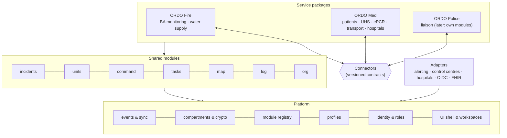
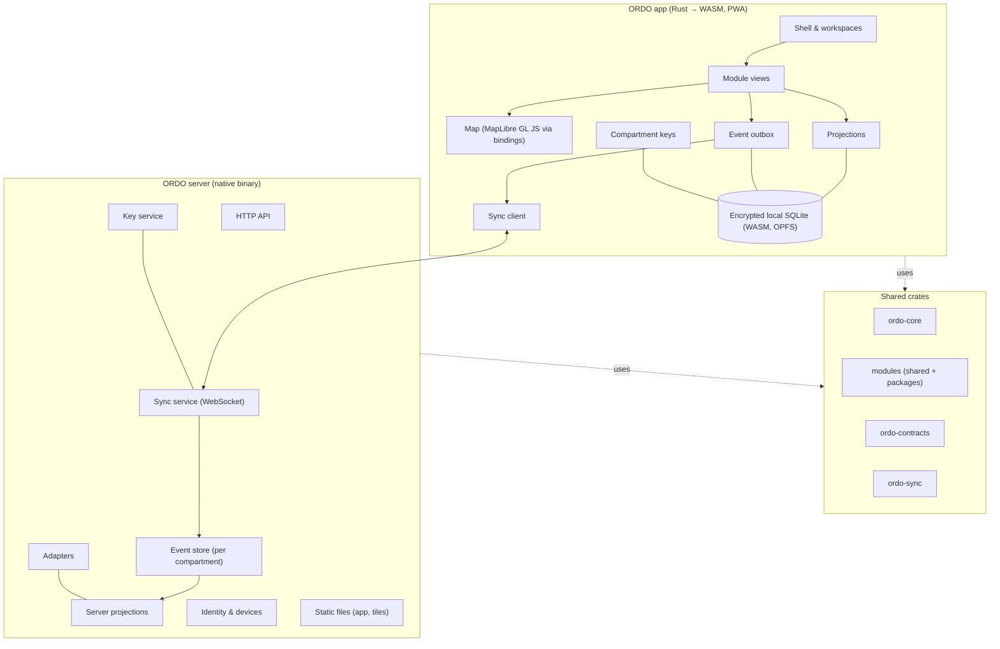

# 5. Building block view

> Part of the [ORDO architecture](README.md) (arc42).

## 5.1 Level 1: layers

ORDO is built in layers so that it is **composable**: organisations combine the
packages they need, and new packages can be added without touching existing ones.



| Layer | Contains | May depend on |
|---|---|---|
| **Platform** | Event envelope, sync, compartments and encryption, identities, roles, devices, module registry, profile loader, UI shell, design system, map engine | nothing above it |
| **Shared modules** | incidents, units, command, tasks, map, log, org | platform; other shared modules' public types |
| **Service packages** | Bundles of service-specific modules plus their workspaces, wording and default settings | platform, shared modules, **connectors** (never another package's internals) |
| **Connectors** | Versioned contracts for data that crosses package borders | platform |
| **Adapters** | Integrations with external systems | platform; the module they serve |

Rules that keep it modular:

1. Dependencies point **downwards only**. The platform knows nothing about fire or
   patients; shared modules know nothing about packages.
2. Packages never read each other's data. They talk **only through connectors**.
3. Everything country-specific lives in **profiles** (data), never in code.

## 5.2 Level 2: components

One **Cargo workspace**. Platform, modules and contracts are written once in Rust and
compiled both natively (server) and to WebAssembly (app).



| Component | Responsibility |
|---|---|
| **ordo-core** | Event envelope, compartments, incident lifecycle, identities, permission framework, module and package registry. No I/O. |
| **ordo-sync** | Sync protocol: messages, HLC, outbox, replay, conflict rules, compartment-scoped subscriptions. |
| **ordo-crypto** | Compartment keys, device keys, payload encryption, hash chains. |
| **ordo-contracts** | All connector contracts, versioned. |
| **ordo-profiles** | Profile format, loader, layering, validation (no data). |
| **ordo-store** | Storage abstraction: SQLite (native and WASM), PostgreSQL. |
| **Modules** | Functional areas ([5.3](#53-service-packages-and-workspaces)). |
| **ordo-app** | Leptos app shell, workspaces, design system. |
| **ordo-map** | Bindings to MapLibre GL JS. |
| **ordo-server** | axum server: API, sync service, key service, adapters, static files, CLI. |

## 5.3 Service packages and workspaces

### 5.3.1 Modules

A module owns one functional area and declares:

| Part | Example (`med.uhs`) |
|---|---|
| **Events** in its own namespace | `uhs.created`, `uhs.patientAdmitted`, `uhs.patientDischarged` |
| **Compartments** it writes to | `med.clinical` (patient-related), `med.ops` (staffing) |
| **Projection** | UHS board: patients, status, waiting times |
| **Permissions** | Which roles may emit which events |
| **Profile catalogues** it reads | `triage-categories`, `discharge-outcomes` |
| **Views** for the app | UHS board, admission dialog |
| **Public types** others may reference | `UhsId`, `PatientId` |

Modules are Rust crates implementing a common `Module` trait and are compiled in.
Each organisation switches them on or off at runtime. Loading third-party modules at
runtime (e.g. as sandboxed WebAssembly components) is possible later, but not planned.

### 5.3.2 Service packages

A **service package** is a bundle: a set of modules, the **workspaces** for its roles,
its connectors, and default settings. Example:

```toml
# packages/med/package.toml
id = "med"
name = "ORDO Med"
modules = ["med.patients", "med.uhs", "med.epcr", "med.transport", "med.hospitals"]
uses_shared = ["incidents", "units", "command", "tasks", "map", "log"]
compartments = ["med.clinical", "med.ops"]
connectors_provided = ["med.patientCounts.v1", "med.transportStatus.v1"]
connectors_consumed = ["fire.responderInjured.v1", "command.dangerZones.v1"]
```

### 5.3.3 Workspaces

A **workspace** is what a role sees when it opens ORDO: a set of views, a layout and
the package's wording — similar to role-based launchpads in business software.

| Workspace | Package | Main views |
|---|---|---|
| Fire command | Fire | Units, sectors, tasks, map, log |
| Medical incident lead | Med | Patient counts, UHS load, transport board, map |
| UHS | Med | UHS board, patient admission, ePCR |
| Medic | Med | My patients, ePCR quick entry |
| Transport | Med | Transport requests, transport units, hospitals |
| Police liaison | Police | Map, cordons, shared information |

Workspaces are defined as data (package + profile), so organisations can adjust them
without code.

## 5.4 Repository structure

```
ordo/
├── Cargo.toml                 # workspace
├── platform/
│   ├── ordo-core/             # envelope, compartments, identities, registry
│   ├── ordo-sync/             # sync protocol, HLC, outbox
│   ├── ordo-crypto/           # keys, encryption, hash chains
│   ├── ordo-store/            # SQLite (native/WASM), PostgreSQL
│   ├── ordo-profiles/         # profile format, loader, layering, validation
│   ├── ordo-contracts/        # connector contracts (versioned)
│   ├── ordo-app/              # Leptos shell, workspaces
│   ├── ordo-ui/               # design system: accessible components
│   ├── ordo-tokens/           # DTCG tokens → CSS, contrast checks
│   ├── ordo-map/              # MapLibre bindings + accessible list view
│   └── ordo-server/           # axum server, CLI
├── modules/                   # shared modules
│   ├── incidents/ units/ command/ tasks/ map/ log/ org/
├── packages/
│   ├── fire/                  # package.toml + modules: ba/, water/
│   ├── med/                   # package.toml + modules: patients/, uhs/, epcr/, transport/, hospitals/
│   └── police/                # package.toml (liaison workspace first)
├── adapters/                  # alerting, OIDC, FHIR, IVENA, EMSI, …
├── profiles/
│   └── de/                    # data only
├── design/
│   ├── tokens/                # primitive, semantic, component tokens (DTCG JSON)
│   ├── themes/                # day, night, high-contrast (DTCG JSON)
│   └── assets/                # fonts (OFL), icons (ISC), with licence files
├── spec/                      # open specifications (CC BY 4.0 / Apache-2.0)
│   ├── client-server/         # OpenAPI
│   ├── sync/                  # AsyncAPI + CDDL
│   ├── federation/            # OpenAPI + AsyncAPI
│   ├── connectors/            # CDDL
│   ├── profiles/              # JSON Schema
│   └── conformance/           # test suite
├── docs/
│   ├── requirements/          # OpenFastTrace items (req), EARS; acceptance/ (Gherkin)
│   ├── architecture/          # arc42 chapters; design items (dsn)
│   ├── adr/                   # decisions (MADR 4)
│   ├── glossary.md
│   └── roadmap.md
├── AGENTS.md                  # instructions for AI agents (CLAUDE.md imports it)
└── deploy/
    ├── Containerfile          # multi-arch, minimal image
    ├── compose/
    │   ├── minimal/           # ORDO + Caddy (SQLite)
    │   └── full/              # ORDO + PostgreSQL + Caddy
    ├── systemd/
    └── helm/                  # later
```

## 5.5 Module designs

### 5.5.1 Shared module `units`

#### Lost-update detection
`dsn~lost-update-detection~1`

Unit status uses *last writer wins* by hybrid logical clock. Every status change records the timestamp of the change it replaces, as its author knew it. When the changes of a unit are sorted by timestamp and a change does not replace its predecessor, the predecessor was overwritten without being seen: ORDO keeps the later value and reports a lost update. The result depends only on the set of events, not on the order of arrival, so all devices reach the same state.

Covers:

* [req~off-4~1](../requirements/07-quality.md#off-4--no-lost-changes)

Needs: impl, itest

Tags: must, m1

#### Unit register
`dsn~unit-register~2`

Units (vehicles, teams, other resources) are events of the module `units` in the shared
`incident` compartment; every device computes the same register from them.

* **Join** (`units.added`, schema version 2): call sign, type, organisation, service and
  crew strength (Führer, Unterführer, Mannschaft; the total is computed, shown in
  tactical notation as 0/1/8/9). Schema version 3 adds leaders of formations and special
  functions (*Detailed strength*). Services come from the profile (`units/catalogue.toml`).
  Version 1 payloads decode without service and strength.
* **Suggested vehicles:** an installation may list its vehicles (call sign, type,
  organisation, service, default strength) in a server file (`ORDO_VEHICLES_FILE`); ORDO
  keeps no organisation-wide vehicle master data of its own
  ([ADR-0070](../adr/0070-units-planned-in-preparation-led-in-command.md)). Devices ask with `listVehicles` (sync protocol 1.1); the server answers
  planners and those who may edit units, others get an empty list. The add form suggests
  the call signs and fills in the rest; units can still be added ad hoc.
* **Status:** status codes from the profile, set in *Führung – Disposition*
  ([ADR-0070](../adr/0070-units-planned-in-preparation-led-in-command.md)); the
  lost-update-aware board keeps when and by whom each status was set, and the cards show
  since when.
* **Crew** (`units.crewSet`, the whole list): names (suggesting the incident's people) and
  qualifications from the profile; the latest list counts.
* **Release** (`units.released`): the unit leaves the incident and is no longer counted;
  it stays in the history. Adding it again brings it back, with its attributes as given.
* **Strength on scene:** the units present, and their strength in total, per organisation
  and per service.

Covers:

* [req~unit-1~1](../requirements/02-shared.md#unit-1--add-units)
* [req~unit-2~1](../requirements/02-shared.md#unit-2--unit-attributes)
* [req~unit-3~1](../requirements/02-shared.md#unit-3--unit-status)
* [req~unit-4~1](../requirements/02-shared.md#unit-4--strength-on-scene)
* [req~unit-5~1](../requirements/02-shared.md#unit-5--crew-members)
* [req~unit-6~1](../requirements/02-shared.md#unit-6--release-units)

Needs: impl, utest, itest

Tags: must, m29

### 5.5.1a Shared module `tasks`

#### Tasks
`dsn~tasks~2`

Crate `ordo-tasks`, module `tasks`, in the shared `incident` compartment. `tasks.given`
gives a task a new ID (ULID): to a unit (call sign; sectors follow with the command
structure, CMD-1), as free text, optionally from a template of the profile
(`tasks/templates.toml`), and optionally with a time to follow up. `tasks.updated` moves
it on (open → in progress → done, or cancelled; never back) and may set a new follow-up
time; the latest update by hybrid logical clock counts, every update stays in its history
with who and when. A follow-up is due once its time has passed and the task is open.

Only the incident command gives and updates tasks (Cedar: medical roles may not write the
module). The page *Disposition* (*Einsatzleitung – Führung*) lists the open tasks, due follow-ups
first, then by age, each with its unit and next steps, and gives new tasks. Every other
view of the incident command shows them in short at the top (TASK-3): how many are open,
which are due, linked to the page. Each unit card lists its open tasks.
"Due" is shown in words and with an icon, not by colour alone.

Covers:

* [req~task-1~1](../requirements/02-shared.md#task-1--give-tasks)
* [req~task-2~1](../requirements/02-shared.md#task-2--task-status)
* [req~task-3~1](../requirements/02-shared.md#task-3--open-tasks-always-visible)
* [req~task-4~1](../requirements/02-shared.md#task-4--reminders)

Needs: impl, utest, itest

Tags: must, m31

### 5.5.1b Shared module `command`

#### Command structure
`dsn~command-structure~1`

Crate `ordo-command`, module `command`, in the shared `incident` compartment, following
[ADR-0031](../adr/0031-command-structure-from-doctrine.md). Positions grow with the incident:
`command.positionCreated` (new ID, a kind from the profile file `command/structure.toml`,
name, parent position, optionally service and organisation) and `command.positionClosed`.
Kinds carry a core meaning after ISO 22320 (command, sector, staff, liaison); the DE
profile names them after FwDV 100 and the medical response (*Einsatzleitung*,
*Einsatzabschnitt*, *Unterabschnitt*, *Sanitätseinsatzleitung*, *Patientenablage*,
*Behandlungsplatz*, *Transportorganisation*, staff functions S1–S6, *Verbindungsperson*).
`command.leaderSet` names the leader; each one after the first is a handover, kept with
time and both people (CMD-4). `command.assigned` puts a unit (call sign) or a UHS under a
position, or takes it out; the latest assignment counts. Everything is ordered by hybrid
logical clock, so every device computes the same tree.

The command workspace's view *Führung* shows the tree as nested lists with the leader,
units and UHS of each position (drawn as an org chart, *Org chart*), and the roster below; it points out a position with more
than five direct subordinates (span of control) without enforcing anything. Each unit
card offers its position in one choice (two taps, CMD-2); tasks can go to a position.
Only the command writes the module (Cedar). Positions giving roles, and so access, follow
in a later step (ADR-0031).

Covers:

* [req~cmd-1~1](../requirements/02-shared.md#cmd-1--sectors)
* [req~cmd-2~1](../requirements/02-shared.md#cmd-2--assign-units-to-sectors)
* [req~cmd-3~1](../requirements/02-shared.md#cmd-3--command-structure-view)
* [req~cmd-4~1](../requirements/02-shared.md#cmd-4--hand-over-leadership)

Needs: impl, utest, itest

Tags: must, m32

#### Org chart
`dsn~org-chart~1`

The command structure is drawn as an org chart from the same nested lists, by CSS alone:
where the card is at least 40rem wide (container query), positions under one stand side by
side below it, joined by lines in the border colour; each position is a compact card
(title, leader, units, UHS, the handovers collapsed). A wide chart scrolls within its own
region, which takes keyboard focus. Where the card is narrower, the chart falls back to the
indented tree. The lists stay the semantics, so screen readers hear a nested list, as
before. Org chart libraries (d3-org-chart, OrgChart.js) were not needed: they draw from
JSON with scripts and add nothing a list does not already give.

Covers:

* [req~cmd-3~1](../requirements/02-shared.md#cmd-3--command-structure-view)

Needs: impl, itest

Tags: must, m57

### 5.5.1c Shared module `map`

#### Situation map
`dsn~situation-map~4`

Crate `ordo-map`, module `map`, in the shared `incident` compartment
([ADR-0006](../adr/0006-maplibre-pmtiles.md)). `map.objectPlaced` puts an object on the
map: the incident location, a unit, a UHS or a position (one object each, so placing it
again moves it; its ID is the kind and the reference), with a label and a GeoJSON
geometry (RFC 7946: point, line or area, longitude first); `map.objectRemoved` takes it
off. The latest event of an object counts (hybrid logical clock). Drawn objects (lines and
areas, MAP-4) use the same events with their own IDs.

The view *Führung – Lagekarte* shows the map with the objects and, below it, the list of
objects (A11Y-5); it does not edit. The overview's map tile shows the same map, which does
not move. Those who may edit prepare the map on *Vorbereitung – Lagekarte*
(`command.prepare/map`, [ADR-0067](../adr/0067-command-overview-tiles-and-map-preparation.md)):
the map region on top, then the editor ([ADR-0064](../adr/0064-map-editor-with-terra-draw.md)): the map
fills the page, a toolbar above it offers *Auswählen*, *Symbol setzen*, *Fläche* and
*Linie*, and the list stays below. *Symbol setzen* takes the incident location, a unit, a
UHS or a position and places it where the next tap is, or at the map's centre (the
keyboard moves the map, a crosshair marks the centre). *Auswählen* chooses an object by a
tap on the map or *Bearbeiten* in the list; a chosen symbol moves to the next tap or to
the centre, and every object can be removed. The map opens on the incident location, else
on the objects, else on the map region. The command can move the map to the device's own
position (browser geolocation, only when asked). Only the command writes the module
(Cedar).

Offline (MAP-2): the server serves each incident's PMTiles region file at
`/tiles/<incident ULID>.pmtiles` with range requests and a ticket (*Map region from the
server*). The first time a device opens the map of an incident whose region the server
has and the device does not keep, it saves the incident's whole file in the device's
Cache Storage by itself (private to ORDO's origin; Safari cannot write OPFS files from the
page), one per incident, and asks the browser for persistent storage; the map reads from
there when it is present. There is nothing to press: a line says while it is saved or if
saving failed, and the map's state line says where the region comes from
([ADR-0065](../adr/0065-map-editing-in-preparation.md),
[ADR-0067](../adr/0067-command-overview-tiles-and-map-preparation.md)). Map code, fonts and glue are
cached with the app shell; without a region file, the objects are shown on a plain
background and the view says that no map region was prepared.

Covers:

* [req~map-1~1](../requirements/02-shared.md#map-1--situation-map)
* [req~map-2~2](../requirements/02-shared.md#map-2--offline-map)

Needs: impl, utest, itest

Tags: must, m33, m54, m55, m56

#### Address search
`dsn~address-search~1`

On *Vorbereitung – Einsatz*, above the centre of a new map region, and on the map editor
page, a search form (`role="search"`) takes an address. Only "Suchen" starts the search,
never typing. The app sends `geocode` with the incident and the query over the sync
connection (protocol 1.2); the server checks `manage_map` or `edit_units` in the
incident (else `refused`) and asks its geocoder, a Nominatim-compatible API
(`ORDO_GEOCODER`, default the OpenStreetMap Foundation's public Nominatim; `off`: answer
`off`), with `format=jsonv2`, `limit=5` and, if set, `countrycodes`
(`ORDO_GEOCODER_COUNTRIES`). Requests queue so that at most one per second leaves the
server; each names ORDO, its version and the installation's address in the User-Agent.
Answers are kept for 24 hours (up to 1,000 queries, folded to lower case and single
spaces), so the same question is not asked twice. The query is not logged. The answer
`geocoded` carries the query, a status (`found`, `off`, `refused`, `failed`) and up to
five places (name, degrees × 10⁷). The app lists them as buttons, credited to
OpenStreetMap; a chosen place fills the region's centre or moves the editor's map there
([ADR-0066](../adr/0066-address-search-with-nominatim.md)). Without connection the form
says the search needs the server.

Covers:

* [req~map-9~1](../requirements/02-shared.md#map-9--address-search)

Needs: impl, utest, itest

Tags: should, m55

#### Drawing on the map
`dsn~map-drawing~2`

The profile file `map/drawings.toml` lists what can be drawn (DE: incident area, sector,
hazard zone, staging area, cordon, hose line): ID, label, area or line, and a line pattern
(solid, dashed, dotted). On the editor page, the tools *Fläche* and *Linie* take a
category and a name, then the corners: each tap on the map sets one, and so does *Ecke in
Kartenmitte setzen* at the crosshair, which the keyboard moves. The map previews the
shape. *Letzte Ecke entfernen* undoes, *Abbrechen* discards; *Fertig* saves once an area
has three corners, a line two. Saving writes `map.objectPlaced` with kind `drawing`, the
category as reference and a GeoJSON polygon (closed ring) or line.

A drawing chosen with *Auswählen* can be reshaped with Terra Draw's select mode: its
corners dragged, a corner added from the middle of a side, the whole shape moved.
*Übernehmen* writes one `map.objectPlaced` with the same object ID and the new geometry;
*Verwerfen* restores it. *Neu zeichnen* sets its corners again by tap or at the centre,
the way without dragging. The map draws each drawing's outline with its category's
pattern, so categories differ without colour; the list names the category
([ADR-0064](../adr/0064-map-editor-with-terra-draw.md)).

Covers:

* [req~map-4~1](../requirements/02-shared.md#map-4--drawing-on-the-map)

Needs: impl, utest, itest

Tags: must, m40, m54

#### Map region from the server
`dsn~map-region~2`

Each incident has its own region ([ADR-0062](../adr/0062-map-region-per-incident.md)).
The incident command (incident permission `manage_map`; DE default: role
*Einsatzleitung*, and planners) opens *Vorbereitung – Einsatz*, enters a centre (the
incident location, if it has one) and a radius of 1–50 km. The app sends `cutMapRegion`
with the incident over the sync connection (protocol 1.2) and asks for `mapRegion` until
the state is `ready` or `failed`, showing the progress. The server cuts the region with
pmtiles-rs from the world map `ORDO_MAP_SOURCE` (a URL, read with range requests, or a
file; default the Protomaps build of the day before). It takes every tile from the
source's lowest to highest zoom that touches the square around the circle, fetching 16 at
a time with the directories cached. It writes them in tile order to a new file, which then
replaces `<ORDO_MAP_DIR>/<incident ULID>.pmtiles` (default directory `maps` in the data
directory). One region is cut at a time on a server; a cut for another incident meanwhile
fails with a message. The centre, radius and time are kept next to the file, so a
restarted server still reports the region. Others asking learn nothing (state `none`).

Reading: after every welcome the device asks for `mapTicket` with its incident; the server
gives a ticket (32 random bytes, valid for 12 hours) to those who may read the incident's
shared compartment. The map reads `/tiles/<incident ULID>.pmtiles` with
`Authorization: Bearer <ticket>`; without a valid ticket for that incident the server
answers 403. [ADR-0057](../adr/0057-map-region-cut-on-the-server.md).

Covers:

* [req~map-8~2](../requirements/02-shared.md#map-8--map-region-from-the-server)

Needs: impl, utest, itest

Tags: must, m38, m51

#### Tactical symbols
`dsn~tactical-symbols~1`

Symbols are profile data (rule 6: German doctrine stays out of the platform). The profile
file `symbols/symbols.json` describes each symbol by the parameters of DV 102 (base
symbol, organisation, specialist task, unit size, short text) and says which symbol a map
object gets: by unit type, else by the unit's service; by UHS kind; by position kind; and
one for the incident location. The tool `tools/symbols` generates the SVG files from the
descriptions with `@taktische-zeichen/core` (MIT, pinned), without an embedded font, and
CI checks that the files in the profile are what it generates; each file carries the
library's licence notice ([ADR-0054](../adr/0054-tactical-symbols-generated.md)). A
symbol without a description is drawn by hand where the library cannot follow the BBK's
2024 edition; the profile records that comparison. The app embeds the symbols at build
time; the map shows each object with its symbol and its label (never the symbol alone),
and the list beside the map shows the symbol too, named by its label. Symbols are drawn
black on white, as on paper, in every theme. Objects without a symbol keep the plain
marker. Another profile can ship other files.

Covers:

* [req~map-3~1](../requirements/02-shared.md#map-3--tactical-symbols)

Needs: impl, utest, itest

Tags: must, m34

#### Incident log
`dsn~incident-log~1`

The automatic incident log (*Einsatztagebuch*) is a view over the events a device holds,
not a store of its own ([ADR-0001](../adr/0001-local-first-event-sourcing.md)). Every
change is an event with its time (hybrid logical clock), author and device, so the log is
complete by construction (LOG-1). Events are never changed or deleted; a correction is a
new event naming the one it corrects, and the log shows that link (LOG-3). A device holds
only the compartments its user may read, so each person's log shows only those entries,
and the command's log has no clinical details (LOG-6).

`ordo_sync::log` orders the events of all compartments of the incident by their clock,
newest first, and marks those still waiting in the outbox. The app describes each event
in words from the event's own data, using the profile's labels where it has them; an
event type it does not know is shown with its module and type, never left out. The log is
its own workspace, *Einsatztagebuch*, open to everyone in the incident, grouped by day.

Covers:

* [req~log-1~1](../requirements/02-shared.md#log-1--automatic-log)
* [req~log-3~1](../requirements/02-shared.md#log-3--append-only-log)
* [req~log-6~1](../requirements/02-shared.md#log-6--log-respects-compartments)

Needs: impl, utest, itest

Tags: must, m36

### 5.5.1d Shared module `helpers`

#### Helper register
`dsn~helper-register~1`

The helpers of an incident are events of the module `helpers` in the compartment `people`
([ADR-0071](../adr/0071-helper-register-in-its-own-compartment.md)), sealed and read only by
the incident command (`commander` in `command.cedar`).

* **Register** (`helpers.registered`): a new helper ID (ULID) and the name; where given,
  date of birth, address, phone, organisation, qualifications from the profile
  (`units/catalogue.toml`), start and end of duty, and the ORDO account.
* **Change** (`helpers.updated`): the helper ID and only the changed fields; an empty
  field clears it. The latest value per field counts, by hybrid logical clock, whatever
  order the events arrive in.
* **Page:** *Vorbereitung – Personal* lists the helpers by name with organisation,
  qualifications and duty, and a form to register one or change one. On duty means:
  started and not ended. The name is required; everything else may come later.

Covers:

* [req~help-1~1](../requirements/02-shared.md#help-1--helper-register)
* [req~help-2~1](../requirements/02-shared.md#help-2--helpers-linked-to-accounts)

Needs: impl, utest, itest

Tags: should, m59

### 5.5.2 Med module `med.patients`

#### UHS staff
`dsn~uhs-staff~1`

The UHS module starts with *Meine UHS*: the person chooses the UHS they work at, or all;
the device remembers it, and without a choice it starts with the UHS whose staff list
names the person. The patient list shows the chosen UHS's patients, and registration
offers only the UHS where the person may write, starting with the chosen one (UHS-9).

A UHS with a staff list (`uhs.updated`) is written by its staff only (UHS-10,
[ADR-0056](../adr/0056-uhs-staff-write-guard.md)). The server's hub asks the packages'
write guards after the role check; the Med guard keeps each UHS's staff lists and each
patient's UHS over time and judges an event by the list valid at its clock. It accepts
events about patients it does not know yet, events of UHS without a list, and events of
people whose roles allow every UHS (`all_uhs`; DE: physicians). A move is judged by the
UHS the patient leaves; a staff list, once set, is changed by its staff and by those who
manage the incident's resources (`edit_units`). The app shows
UHS where the person may not write as read-only and does not offer them for
registration, so the server's refusal stays the exception.

Covers:

* [req~uhs-9~1](../requirements/04-med.md#uhs-9--working-uhs)
* [req~uhs-10~1](../requirements/04-med.md#uhs-10--only-a-uhss-staff-writes-its-patients)

Needs: impl, utest, itest

Tags: must, m37

#### UHS among the resources
`dsn~uhs-resources~1`

The view *Einsatzmittel* of the incident command lists, after the units, every UHS as a card
with its staff count and the same panel as in *UHS verwalten*: location, capacity and
staff, the staff added from the incident's people. Assigning staff is `uhs.updated` with
the whole list in the shared compartment. The command may change every UHS's staff list
through its permission `edit_units` (see UHS staff), but it reads and writes no clinical
data.

Covers:

* [req~uhs-11~1](../requirements/04-med.md#uhs-11--uhs-among-the-resources)

Needs: impl, itest

Tags: must, m39

#### Detailed strength
`dsn~detailed-strength~1`

The strength notation follows the BBK recommendation "Taktische Zeichen im
Bevölkerungsschutz" (2024, section 5.3) where the incident command chooses it on
*Vorbereitung – Einsatz* (`incidents.detailsChanged` schema version 2, `strengthDetailed`).
A strength keeps leaders of formations (*Führer von Verbänden*, `unit_leaders`, 0 if not
given) apart from the other leaders; `units.added` schema version 3 and `uhs.updated`
schema version 5 add them and the special functions of the people (`special`: count per ID
from the profile's `[[special_function]]` in `units/catalogue.toml`, e.g. physicians,
respirator wearers), which count as "davon", not on top. In the detailed notation the
forms ask for *Führer von Verbänden / Zugführer / Unterführer / Einsatzkräfte* and the
special functions, and strengths read 1/1/6/40/48 with the total underlined and "(davon
2 × Ärzte, 6 × AGT)" after it. Otherwise they read 2/6/40/48: both kinds of leaders as
*Führer*. The data is the same in both, so the choice can change at any time. The
installation's vehicle file keeps the three-part strength.

Covers:

* [req~unit-7~1](../requirements/02-shared.md#unit-7--detailed-strength-as-an-option)

Needs: impl, utest, itest

Tags: should, m57

#### Double booking
`dsn~double-booking~1`

The strength on scene also records where each person is assigned (`Assignments` in the
module `units`): the crews of the units present, at the post `unit:<call sign>`, and, from
the Med package, every UHS's staff list at `uhs:<ID>`. Names are matched as entered,
ignoring case and spaces around them; the helper register (roadmap item 9) will match
people by record instead. Adding a person to a crew or a staff list first looks them up.
If they are on other posts, the form says where and offers "Hierher umsetzen", which
writes the other lists without them (`units.crewSet`, `uhs.updated`) and then adds them.
Nothing is refused, because two devices can do it offline at the same time: when a person
is on several posts anyway, *Einsatzmittel* marks the total strength with an asterisk and
names them and their posts below it ("Mehrfach eingeteilt, eventuell doppelt gezählt").
The asterisk is hidden from screen readers; the line below says it in words.

Covers:

* [req~unit-8~1](../requirements/02-shared.md#unit-8--one-post-per-person)

Needs: impl, utest, itest

Tags: should, m57

#### UHS as a unit
`dsn~uhs-as-unit~1`

A UHS counts as a unit on scene ([ADR-0069](../adr/0069-uhs-counts-as-a-unit.md)).
`uhs.updated` schema version 3 adds its organisation, its service from the profile and its
strength (Führer, Unterführer, Mannschaft; null clears it), set in the same details panel as
name and capacity; only changed fields are sent. The Med package adds every UHS to the
strength on scene of the units register (`strength_on_scene`): one unit with its
organisation and service, counted with its strength, or without one with its staff list
as Mannschaft, or as unreported if both are missing. *Einsatzmittel* and the command's
overview show this sum. A UHS is not also written as `units.added`, so it has one place
in the data and its people are counted once, as long as they are not added as a unit too.

Covers:

* [req~uhs-12~1](../requirements/04-med.md#uhs-12--uhs-count-as-units-on-scene)

Needs: impl, utest, itest

Tags: must, m57

#### UHS registry
`dsn~uhs-registry~1`

On-site care units are set up with `uhs.created` events (module `med.uhs`: ID, name,
kind, capacity) in the shared `incident` compartment, because they are not clinical and
command needs names and capacities next to the patient counts. Patients and the
`med.patientCounts.v1` connector refer to the UHS by ID. The Med workspace lists every
UHS with its load (patients / capacity); registration asks for the UHS explicitly; the
command workspace shows counts and load per UHS.

Covers:

* [req~uhs-4~1](../requirements/04-med.md#uhs-4--several-uhs)

Needs: impl, itest

Tags: must, m4

#### UHS details
`dsn~uhs-details~3`

A unit is set up with name, kind and capacity (`uhs.created`). `uhs.updated` (module
`med.uhs`, shared `incident` compartment, no clinical data) changes its name (schema
version 2; the log shows the renaming), its organisation, service and strength (schema
version 3, *UHS as a unit*), its capacity and its assigned staff (names or user
IDs, the whole list); a field left out keeps its value, and the latest change of each field
counts (hybrid logical clock). *UHS verwalten* shows place and staff per unit and changes
them in a details panel, with the incident's people suggested; the overview and the
command's counts use the current capacity.

The place of a unit is the UHS on the situation map (`map.objectPlaced`, kind `uhs`), not a
text field ([ADR-0064](../adr/0064-map-editor-with-terra-draw.md)). The details panel
shows its coordinates, or that it is not placed yet, and offers those who may edit the map
*Auf der Karte setzen*: the editor page opens with *Symbol setzen* and this unit chosen. A
location text written before (the field `location` of `uhs.updated`) is still shown;
`uhs.updated` keeps the field for those events, and the app no longer writes it.

Covers:

* [req~uhs-1~1](../requirements/04-med.md#uhs-1--on-site-care-units)

Needs: impl, utest, itest

Tags: must, m30, m54

#### UHS overview
`dsn~uhs-overview~2`

The Med workspace's view *Übersicht* shows one card per on-site care unit, computed on
the device from what it already holds (clinical and shared incident events): the patients
in the unit by triage category and the load against capacity (the same category row as
the command's counts), free treatment places, open orders of its patients, its open and
planned transports, and how many it discharged. A first card adds up all units, so the
medical lead sees the whole incident at a glance (MANV). The Med package computes the summary
(`overview`), so the numbers are tested apart from the page. Only people who read the
clinical compartment have the workspace; the command keeps its counts without clinical
details. It shows numbers only and ranks nothing.

Covers:

* [req~uhs-8~2](../requirements/04-med.md#uhs-8--overview-for-the-medical-lead)

Needs: impl, utest, itest

Tags: should, m22

#### Patient triage history
`dsn~patient-triage-history~1`

Registration and re-triage are separate events in `med.clinical`, never overwritten. The register sorts them by timestamp: the first registration of a triage tag creates the patient, every later decision is appended to the history with category, time and author, and the current category is the latest entry. A second registration of the same tag and a re-triage of an unknown tag are reported as notices.

Covers:

* [req~pat-3~1](../requirements/04-med.md#pat-3--re-triage-with-history)

Needs: impl, itest

Tags: must, m1

#### Patient care record
`dsn~patient-care-record~1`

Module `med.epcr` in the same package. The forms come from the profile catalogue
`epcr-forms`, an HL7 FHIR Questionnaire in a documented subset, checked at build time
([ADR-0027](../adr/0027-epcr-forms-from-the-profile.md), [ADR-0037](../adr/0037-epcr-forms-as-fhir-questionnaire.md)).
Saving a form records one `epcr.entryRecorded` event in `med.clinical` with the triage
tag number, the form ID and the checked values. Snapshot forms show the latest value per
field and keep earlier ones; series forms list timed entries, and a correction names the
entry it replaces, which stays visible as corrected. The only calculation is a sum of
documented values defined by the profile (e.g. GCS). In the app, the record is a page with
its own address; forms open in place, unsaved input survives switching views
([ADR-0029](../adr/0029-edit-records-in-place.md)).

Covers:

* [req~epcr-1~1](../requirements/04-med.md#epcr-1--one-record-per-patient)
* [req~epcr-2~1](../requirements/04-med.md#epcr-2--record-structure-from-profile)
* [req~epcr-3~1](../requirements/04-med.md#epcr-3--quick-entry)
* [req~epcr-4~1](../requirements/04-med.md#epcr-4--append-only-record)

Needs: impl, utest, itest

Tags: must, m6

#### Diagnosis in the record
`dsn~epcr-diagnosis~1`

The DE profile has a series form *Diagnose* (`diagnosis`): the time, how certain it is
(`working` Arbeitsdiagnose, `suspected` Verdachtsdiagnose, `confirmed` gesichert; for the
FHIR handover `provisional`, `unconfirmed` and `confirmed` of
`Condition.verificationStatus`) and the diagnosis as text (`Condition.code.text`).
Several entries are several diagnoses or a later view; a correction replaces an entry. Like
every record entry it is an `epcr.entryRecorded` event in `med.clinical`, so only those who
read the record see it. Nothing copies it elsewhere: `transport.requested` carries no
patient data ([Transport requests](08-concepts.md#transport-requests)),
and connectors carry counts. Those who carry the patient get it with the handover
(EPCR-6, roadmap) and, later, in the vehicles' workspace (roadmap item 11). ORDO
suggests no diagnosis (EPCR-9).

Covers:

* [req~epcr-11~1](../requirements/04-med.md#epcr-11--diagnosis)

Needs: impl, utest, itest

Tags: should, m58

#### Open choices
`dsn~open-choice~1`

A repeating question of type `open-choice` (FHIR R4) is a choice with one more answer as
free text ([subset](../../spec/profiles/questionnaire-subset.md)). The free text is kept
after the chosen options in the same list of values; it is trimmed, at most as long as
any text, and only one is kept. A text that is an option's code counts as that option. The
form shows the options as chips and a text field "Sonstiges" below them; the record shows
the free text after the options' labels. The DE profile makes *Atmung* and *Haut* open
choices.

Covers:

* [req~epcr-12~1](../requirements/04-med.md#epcr-12--other-answers-as-free-text)

Needs: impl, utest, itest

Tags: should, m58

#### Pupils
`dsn~pupil-findings~1`

The findings of the DE profile ask for the pupils as DIVI MIND records them: equal or not
(`pupils_equal`: isokor, anisokor), size per side (`pupil_size_right`,
`pupil_size_left`: eng, mittel, weit, entrundet), reaction to light per side
(`pupil_light_right`, `pupil_light_left`: prompt, träge, keine) and the consensual
reaction (`pupil_consensual`: vorhanden, fehlt). The free-text field `pupils` stays as
"Pupillen, Bemerkung", so entries made before keep their meaning. This is profile data
only; the platform shows the choices like any other. ORDO draws no conclusion from them
(EPCR-9).

Covers:

* [req~epcr-13~1](../requirements/04-med.md#epcr-13--pupils-as-choices)

Needs: utest, itest

Tags: should, m58

#### Patient photo
`dsn~patient-photo~2`

The device takes a photo with HTML media capture or reads an uploaded image, downscales
it and re-encodes it as JPEG, which drops camera and location metadata: the full photo
(longest side at most 1600 px, at most 1 MiB) and a preview (at most 240 px, 16 KiB). An
`epcr.photoAttached` event in `med.clinical` carries the preview and refers to the full
photo, an encrypted attachment (design item "Attachment transfer", chapter 8;
[ADR-0033](../adr/0033-attachments-in-an-object-store.md)). The module rejects larger
photos and other media types. The record shows the latest photo: the full photo once the
device has it, the preview with a note until then.

Covers:

* [req~pat-8~1](../requirements/04-med.md#pat-8--photo-for-identification)

Needs: impl, utest, itest

Tags: should, m6

### 5.5.3 Web app `ordo-app`

Leptos, client-side rendered, compiled to WebAssembly with Trunk and served by `ordo serve`
(`ORDO_APP_DIR`). Prototype workspaces: Med (registration, UHS board) and command
(patient counts), resources, the patient care record (`patients.rs`) and the command
palette (`palette.rs`). Texts in German (DE profile) in one file, to move to Fluent later.

#### Local persistence
`dsn~local-persistence~1`

The app saves the replica state (ordered events, outbox, data keys, and the permissions of the last welcome, so a reload without a connection shows the same views) after every change and loads it on start; hash chains are checked again when loading. New input goes into the outbox and is shown at once; the connection reconnects automatically every few seconds and then sends the outbox. Storage is encrypted (ADR-0041) and kept in the device database (design item "Device storage", chapter 8). The stored state names its format (`REPLICA_FORMAT`), which is read before anything else. A state written by a newer version, or one that cannot be read, stops the start with a message and is left untouched: the device never starts empty over stored data. An older format is upgraded when it is read.

Covers:

* [req~ux-5~1](../requirements/07-quality.md#ux-5--no-lost-input)

Needs: impl, utest, itest

Tags: must, m3

#### Triage badge
`dsn~triage-badge~1`

Every triage category is shown as a badge with colour (safety tokens), the profile label as text and a distinct shape (diamond, triangle, circle, square, cross); a visually hidden description gives screen-reader users the meaning. The connection status combines a coloured dot with text. In forced-colours mode the shape and border remain.

Covers:

* [req~a11y-3~1](../requirements/07-quality.md#a11y-3--not-colour-alone)

Needs: impl, itest

Tags: must, m3

#### Offline app shell
`dsn~offline-app-shell~2`

A service worker keeps the app shell on the device: on installation and after each page
load it stores `index.html`, every file it references (Trunk's content-hashed assets) and
the storage worker, map and font files, in one cache per version of the app (named after
its `index.html`). A version's cache is complete only once all its files are in; then the
caches of other versions are removed. Page loads go to the network first and fall back to
the stored shell. Hashed files come from the store first. Every other file comes from the
network first and from the store only when the network fails or takes longer than four
seconds, so after a server update an old stored file never runs with the new app. So ORDO starts and shows the locally stored data even when the server is
unreachable, e.g. after the browser was restarted at the scene. Sync traffic (WebSocket)
and health endpoints are not intercepted. A web app manifest makes the app installable.

Covers:

* [req~ux-5~1](../requirements/07-quality.md#ux-5--no-lost-input)

Needs: impl, itest

Tags: must, m3, m55

#### Workspace navigation
`dsn~workspace-navigation~3`

Workspaces (package, label, required compartments, views) are defined as data. A menu
(launcher) switches workspaces; it lists every workspace of the packages in use and keeps
unavailable ones in place, disabled, with the reason. On wide screens the menu button sits
in the header and a rail on the left holds the views of the current workspace; on phones
and tablets in portrait, one bar at the bottom holds the views and the menu, which opens
upwards; the content never lies beneath the bar. The header shows the workspace as page
heading, the incident, search, connection and the signed-in person (see "Header and
profile menu"). The route (workspace, view, record) is the URL path, handled by Leptos'
router, so the back button works; a device opens the last used workspace, or the first
one the user may use ([ADR-0025](../adr/0025-workspace-navigation.md),
[ADR-0026](../adr/0026-navigation-at-the-bottom-on-phones.md),
[ADR-0049](../adr/0049-header-layout-and-handedness.md)).

Covers:

* [req~ux-8~1](../requirements/07-quality.md#ux-8--role-workspaces)

Needs: impl, itest

Tags: must, m5

#### Header and profile menu
`dsn~header-layout~2`

The header is a grid of three columns: menu button, page heading and incident on the left,
the search in the middle column, connection state and the person's button on the right;
the outer columns share the remaining width equally, so the search stays centred. Up to
48 rem the heading, connection and person share the first row and the search takes the
second; the menu button of the header is hidden and the one in the bottom bar shown. Both
buttons control the same panel (`aria-controls`, `aria-expanded`), and only the visible
one is in the accessibility tree. The person's button (picture and name, disclosure)
opens the profile menu with who is signed in, profile picture, appearance, handedness,
change incident and unpair. Escape closes either menu and returns the focus to its
button; a click or tap anywhere outside a menu, its buttons and its panel closes it too and
leaves the focus where the click put it. The connection state's menu behaves the same. Handedness ("right" by default, or "left") is kept on the device like the theme
and set as `data-hand` on `<html>`; with "left", the bottom bar puts the menu first.

Covers:

* [req~ux-11~1](../requirements/07-quality.md#ux-11--header-and-reach-for-both-hands)

Needs: impl, itest

Tags: should, m16, m55

#### Compact navigation
`dsn~compact-navigation~2`

Every view has an icon (Lucide, `design/assets/icons/lucide`, ISC) next to its label in the
rail and above a short label in the bottom bar, as on the platforms people know (Material
navigation bar and rail, iOS tab bar): the same icon in both places, never an icon alone.
A workspace has at most four views, so the bar holds five places with the menu; a unit
test checks every workspace. On every screen the connection state is a disclosure button:
an icon whose shape differs per state and whose colour repeats it — connected and all
sent (green), sending or connecting (blue), offline (amber: inputs are kept, not lost) —
and the number of unsent inputs; it opens the full state. The colours are the feedback
tokens, checked at 3:1 against the button (WCAG 1.4.11). Error messages stay outside the
disclosure, always visible. The profile menu shows the person's roles in this
incident. Menus, profile menu and connection share one disclosure component (`ui.rs`), as
do icons, history lists, action buttons and choice chips.

Covers:

* [req~ux-12~2](../requirements/07-quality.md#ux-12--compact-navigation-on-phones)

Needs: impl, utest, itest

Tags: should, m16

#### Person suggestions
`dsn~person-suggestions~1`

A form field that names a member of the crew is, in the profile's questionnaire, a
`reference` item limited to `Practitioner` (extension `questionnaire-referenceResource`,
[subset](../../spec/profiles/questionnaire-subset.md)); the DE forms mark "Durchgeführt
von", "Angeordnet durch" and "Verabreicht durch" so. The answer stays text, as typed or
chosen; only who ordered a medication is not typed but taken from the order (design item
*Order documentation*). Such a field suggests the people on the incident's roster, the person using the
device first: data every participant's device already has. Granting a role suggests the
people the installation knows (with a paired device or a role in any incident): the device
asks the server (`listPeople`), which answers only those who may grant roles somewhere and
sends others an empty list. Suggestions are a native `datalist` behind one shared input
component (`ui.rs`); any other name is accepted, and the server still decides on the grant.

Covers:

* [req~ux-13~1](../requirements/07-quality.md#ux-13--suggest-people-in-person-fields)

Needs: impl, utest, itest

Tags: should, m20

#### List keys
`dsn~list-keys~1`

Lists whose items people move through are marked `data-keys="list"` (patients,
discharged patients, orders, transports, hospitals, units, roster, devices, incidents).
One window key handler (`ui.rs`) moves the focus to the first link, button or summary of
the next or previous item on `j`/Arrow Down or `k`/Arrow Up, but only when the focus is
on such an element inside an item and no modifier is held; at either end the focus stays.
The palette's own key handler adds Ctrl+J and Ctrl+K (⌘ on Apple devices) to its arrow
keys; the window handler opens the palette with Ctrl+K only while it is closed
([ADR-0051](../adr/0051-vim-movement-keys.md)).

Covers:

* [req~ux-14~1](../requirements/07-quality.md#ux-14--move-through-lists-with-the-keyboard)

Needs: impl, utest, itest

Tags: should, m23

#### Command palette
`dsn~command-palette~1`

Ctrl+K or ⌘K, or the search button, opens a modal dialog with a combobox and a listbox
(WAI-ARIA Authoring Practices). Entries are views, commands, patients (by triage tag
number only) and units (by call sign), built from the current state; matching ignores
case and umlauts and ranks word starts first. Choosing a patient or unit shows its quick
actions (open the record, new entry, photo, re-triage; unit status). Entries the user may
not use are disabled with the reason. Arrow keys, Enter, Backspace and Escape work as
expected; focus returns to where it was; the number of results is announced
([ADR-0030](../adr/0030-command-palette.md)).

Covers:

* [req~ux-10~1](../requirements/07-quality.md#ux-10--keyboard-command-palette)

Needs: impl, utest, itest

Tags: should, m6
