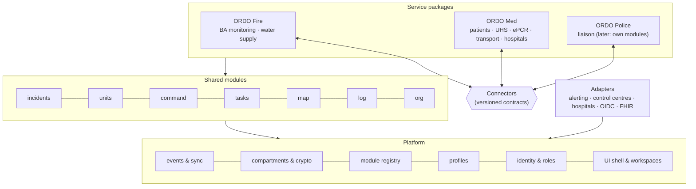
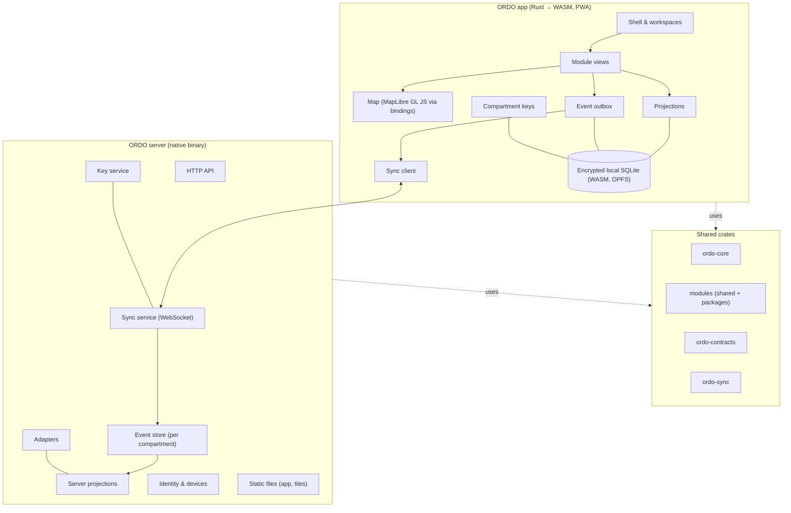

# 5. Building block view

> Part of the [ORDO architecture](README.md) (arc42).

## 5.1 Level 1: layers

ORDO is built in layers so that it is **composable**: organisations combine the
packages they need, and new packages can be added without touching existing ones.



| Layer | Contains | May depend on |
|---|---|---|
| **Platform** | Event envelope, sync, compartments and encryption, identities, roles, devices, module registry, profile loader, UI shell, design system, map engine | nothing above it |
| **Shared modules** | incidents, units, command, tasks, map, log, org | platform; other shared modules' public types |
| **Service packages** | Bundles of service-specific modules plus their workspaces, wording and default settings | platform, shared modules, **connectors** (never another package's internals) |
| **Connectors** | Versioned contracts for data that crosses package borders | platform |
| **Adapters** | Integrations with external systems | platform; the module they serve |

Rules that keep it modular:

1. Dependencies point **downwards only**. The platform knows nothing about fire or
   patients; shared modules know nothing about packages.
2. Packages never read each other's data. They talk **only through connectors**.
3. Everything country-specific lives in **profiles** (data), never in code.

## 5.2 Level 2: components

One **Cargo workspace**. Platform, modules and contracts are written once in Rust and
compiled both natively (server) and to WebAssembly (app).



| Component | Responsibility |
|---|---|
| **ordo-core** | Event envelope, compartments, incident lifecycle, identities, permission framework, module and package registry. No I/O. |
| **ordo-sync** | Sync protocol: messages, HLC, outbox, replay, conflict rules, compartment-scoped subscriptions. |
| **ordo-crypto** | Compartment keys, device keys, payload encryption, hash chains. |
| **ordo-contracts** | All connector contracts, versioned. |
| **ordo-profiles** | Profile format, loader, layering, validation (no data). |
| **ordo-store** | Storage abstraction: SQLite (native and WASM), PostgreSQL. |
| **Modules** | Functional areas ([5.3](#53-service-packages-and-workspaces)). |
| **ordo-app** | Leptos app shell, workspaces, design system. |
| **ordo-map** | Bindings to MapLibre GL JS. |
| **ordo-server** | axum server: API, sync service, key service, adapters, static files, CLI. |

## 5.3 Service packages and workspaces

### 5.3.1 Modules

A module owns one functional area and declares:

| Part | Example (`med.uhs`) |
|---|---|
| **Events** in its own namespace | `uhs.created`, `uhs.patientAdmitted`, `uhs.patientDischarged` |
| **Compartments** it writes to | `med.clinical` (patient-related), `med.ops` (staffing) |
| **Projection** | UHS board: patients, status, waiting times |
| **Permissions** | Which roles may emit which events |
| **Profile catalogues** it reads | `triage-categories`, `discharge-outcomes` |
| **Views** for the app | UHS board, admission dialog |
| **Public types** others may reference | `UhsId`, `PatientId` |

Modules are Rust crates implementing a common `Module` trait and are compiled in.
Each organisation switches them on or off at runtime. Loading third-party modules at
runtime (e.g. as sandboxed WebAssembly components) is possible later, but not planned.

### 5.3.2 Service packages

A **service package** is a bundle: a set of modules, the **workspaces** for its roles,
its connectors, and default settings. Example:

```toml
# packages/med/package.toml
id = "med"
name = "ORDO Med"
modules = ["med.patients", "med.uhs", "med.epcr", "med.transport", "med.hospitals"]
uses_shared = ["incidents", "units", "command", "tasks", "map", "log"]
compartments = ["med.clinical", "med.ops"]
connectors_provided = ["med.patientCounts.v1", "med.transportStatus.v1"]
connectors_consumed = ["fire.responderInjured.v1", "command.dangerZones.v1"]
```

### 5.3.3 Workspaces

A **workspace** is what a role sees when it opens ORDO: a set of views, a layout and
the package's wording — similar to role-based launchpads in business software.

| Workspace | Package | Main views |
|---|---|---|
| Fire command | Fire | Units, sectors, tasks, map, log |
| Medical incident lead | Med | Patient counts, UHS load, transport board, map |
| UHS | Med | UHS board, patient admission, ePCR |
| Medic | Med | My patients, ePCR quick entry |
| Transport | Med | Transport requests, transport units, hospitals |
| Police liaison | Police | Map, cordons, shared information |

Workspaces are defined as data (package + profile), so organisations can adjust them
without code.

## 5.4 Repository structure

```
ordo/
├── Cargo.toml                 # workspace
├── platform/
│   ├── ordo-core/             # envelope, compartments, identities, registry
│   ├── ordo-sync/             # sync protocol, HLC, outbox
│   ├── ordo-crypto/           # keys, encryption, hash chains
│   ├── ordo-store/            # SQLite (native/WASM), PostgreSQL
│   ├── ordo-profiles/         # profile format, loader, layering, validation
│   ├── ordo-contracts/        # connector contracts (versioned)
│   ├── ordo-app/              # Leptos shell, workspaces
│   ├── ordo-ui/               # design system: accessible components
│   ├── ordo-tokens/           # DTCG tokens → CSS, contrast checks
│   ├── ordo-map/              # MapLibre bindings + accessible list view
│   └── ordo-server/           # axum server, CLI
├── modules/                   # shared modules
│   ├── incidents/ units/ command/ tasks/ map/ log/ org/
├── packages/
│   ├── fire/                  # package.toml + modules: ba/, water/
│   ├── med/                   # package.toml + modules: patients/, uhs/, epcr/, transport/, hospitals/
│   └── police/                # package.toml (liaison workspace first)
├── adapters/                  # alerting, OIDC, FHIR, IVENA, EMSI, …
├── profiles/
│   └── de/                    # data only
├── design/
│   ├── tokens/                # primitive, semantic, component tokens (DTCG JSON)
│   ├── themes/                # day, night, high-contrast (DTCG JSON)
│   └── assets/                # fonts (OFL), icons (ISC), with licence files
├── spec/                      # open specifications (CC BY 4.0 / Apache-2.0)
│   ├── client-server/         # OpenAPI
│   ├── sync/                  # AsyncAPI + CDDL
│   ├── federation/            # OpenAPI + AsyncAPI
│   ├── connectors/            # CDDL
│   ├── profiles/              # JSON Schema
│   └── conformance/           # test suite
├── docs/
│   ├── requirements/          # OpenFastTrace items (req), EARS; acceptance/ (Gherkin)
│   ├── architecture/          # arc42 chapters; design items (dsn)
│   ├── adr/                   # decisions (MADR 4)
│   ├── glossary.md
│   └── roadmap.md
├── AGENTS.md                  # instructions for AI agents (CLAUDE.md imports it)
└── deploy/
    ├── Containerfile          # multi-arch, minimal image
    ├── compose/
    │   ├── minimal/           # ORDO + Caddy (SQLite)
    │   └── full/              # ORDO + PostgreSQL + Caddy
    ├── systemd/
    └── helm/                  # later
```

## 5.5 Module designs

### 5.5.1 Shared module `units`

#### Lost-update detection
`dsn~lost-update-detection~1`

Unit status uses *last writer wins* by hybrid logical clock. Every status change records the timestamp of the change it replaces, as its author knew it. When the changes of a unit are sorted by timestamp and a change does not replace its predecessor, the predecessor was overwritten without being seen: ORDO keeps the later value and reports a lost update. The result depends only on the set of events, not on the order of arrival, so all devices reach the same state.

Covers:

* [req~off-4~1](../requirements/07-quality.md#off-4--no-lost-changes)

Needs: impl, itest

Tags: must, m1

#### Unit register
`dsn~unit-register~2`

Units (vehicles, teams, other resources) are events of the module `units` in the shared
`incident` compartment; every device computes the same register from them.

* **Join** (`units.added`, schema version 2): call sign, type, organisation, service and
  crew strength (Führer, Unterführer, Mannschaft; the total is computed, shown in
  tactical notation as 0/1/8/9). Services come from the profile (`units/catalogue.toml`).
  Version 1 payloads decode without service and strength.
* **From master data:** the installation's vehicles (call sign, type, organisation,
  service, default strength) are a server file (`ORDO_VEHICLES_FILE`) until an admin view
  exists (ORG-1). Devices ask with `listVehicles` (sync protocol 1.1); the server answers
  planners and those who may edit units, others get an empty list. The add form suggests
  the call signs and fills in the rest; units can still be added ad hoc.
* **Status:** status codes from the profile; the lost-update-aware board keeps when and
  by whom each status was set, and the card shows since when.
* **Crew** (`units.crewSet`, the whole list): names (suggesting the incident's people) and
  qualifications from the profile; the latest list counts.
* **Release** (`units.released`): the unit leaves the incident and is no longer counted;
  it stays in the history. Adding it again brings it back, with its attributes as given.
* **Strength on scene:** the units present, and their strength in total, per organisation
  and per service.

Covers:

* [req~unit-1~1](../requirements/02-shared.md#unit-1--add-units)
* [req~unit-2~1](../requirements/02-shared.md#unit-2--unit-attributes)
* [req~unit-3~1](../requirements/02-shared.md#unit-3--unit-status)
* [req~unit-4~1](../requirements/02-shared.md#unit-4--strength-on-scene)
* [req~unit-5~1](../requirements/02-shared.md#unit-5--crew-members)
* [req~unit-6~1](../requirements/02-shared.md#unit-6--release-units)

Needs: impl, utest, itest

Tags: must, m29

### 5.5.1a Shared module `tasks`

#### Tasks
`dsn~tasks~1`

Crate `ordo-tasks`, module `tasks`, in the shared `incident` compartment. `tasks.given`
gives a task a new ID (ULID): to a unit (call sign; sectors follow with the command
structure, CMD-1), as free text, optionally from a template of the profile
(`tasks/templates.toml`), and optionally with a time to follow up. `tasks.updated` moves
it on (open → in progress → done, or cancelled; never back) and may set a new follow-up
time; the latest update by hybrid logical clock counts, every update stays in its history
with who and when. A follow-up is due once its time has passed and the task is open.

Only the incident command gives and updates tasks (Cedar: medical roles may not write the
module). Because the command workspace has its four views, the open tasks are a panel at
the top of every command view (TASK-3): due follow-ups first, then by age, each with its
unit and next steps; the panel also gives new tasks. Each unit card lists its open tasks.
"Due" is shown in words and with an icon, not by colour alone.

Covers:

* [req~task-1~1](../requirements/02-shared.md#task-1--give-tasks)
* [req~task-2~1](../requirements/02-shared.md#task-2--task-status)
* [req~task-3~1](../requirements/02-shared.md#task-3--open-tasks-always-visible)
* [req~task-4~1](../requirements/02-shared.md#task-4--reminders)

Needs: impl, utest, itest

Tags: must, m31

### 5.5.1b Shared module `command`

#### Command structure
`dsn~command-structure~1`

Crate `ordo-command`, module `command`, in the shared `incident` compartment, following
[ADR-0031](../adr/0031-command-structure-from-doctrine.md). Positions grow with the incident:
`command.positionCreated` (new ID, a kind from the profile file `command/structure.toml`,
name, parent position, optionally service and organisation) and `command.positionClosed`.
Kinds carry a core meaning after ISO 22320 (command, sector, staff, liaison); the DE
profile names them after FwDV 100 and the medical response (*Einsatzleitung*,
*Einsatzabschnitt*, *Unterabschnitt*, *Sanitätseinsatzleitung*, *Patientenablage*,
*Behandlungsplatz*, *Transportorganisation*, staff functions S1–S6, *Verbindungsperson*).
`command.leaderSet` names the leader; each one after the first is a handover, kept with
time and both people (CMD-4). `command.assigned` puts a unit (call sign) or a UHS under a
position, or takes it out; the latest assignment counts. Everything is ordered by hybrid
logical clock, so every device computes the same tree.

The command workspace's view *Führung* shows the tree as nested lists with the leader,
units and UHS of each position, and the roster below; it points out a position with more
than five direct subordinates (span of control) without enforcing anything. Each unit
card offers its position in one choice (two taps, CMD-2); tasks can go to a position.
Only the command writes the module (Cedar). Positions giving roles, and so access, follow
in a later step (ADR-0031).

Covers:

* [req~cmd-1~1](../requirements/02-shared.md#cmd-1--sectors)
* [req~cmd-2~1](../requirements/02-shared.md#cmd-2--assign-units-to-sectors)
* [req~cmd-3~1](../requirements/02-shared.md#cmd-3--command-structure-view)
* [req~cmd-4~1](../requirements/02-shared.md#cmd-4--hand-over-leadership)

Needs: impl, utest, itest

Tags: must, m32

### 5.5.2 Med module `med.patients`

#### UHS registry
`dsn~uhs-registry~1`

On-site care units are set up with `uhs.created` events (module `med.uhs`: ID, name,
kind, capacity) in the shared `incident` compartment, because they are not clinical and
command needs names and capacities next to the patient counts. Patients and the
`med.patientCounts.v1` connector refer to the UHS by ID. The Med workspace lists every
UHS with its load (patients / capacity); registration asks for the UHS explicitly; the
command workspace shows counts and load per UHS.

Covers:

* [req~uhs-4~1](../requirements/04-med.md#uhs-4--several-uhs)

Needs: impl, itest

Tags: must, m4

#### UHS details
`dsn~uhs-details~1`

A unit is set up with name, kind and capacity (`uhs.created`). `uhs.updated` (module
`med.uhs`, shared `incident` compartment, no clinical data) changes its location (free
text, e.g. "Bühne Nord, Zelt 2"), its capacity and its assigned staff (names or user IDs,
the whole list); a field left out keeps its value, and the latest change of each field
counts (hybrid logical clock). *UHS verwalten* shows location and staff per unit and
changes them in a details panel, with the incident's people suggested; the overview and
the command's counts use the current capacity.

Covers:

* [req~uhs-1~1](../requirements/04-med.md#uhs-1--on-site-care-units)

Needs: impl, utest, itest

Tags: must, m30

#### UHS overview
`dsn~uhs-overview~2`

The Med workspace's view *Übersicht* shows one card per on-site care unit, computed on
the device from what it already holds (clinical and shared incident events): the patients
in the unit by triage category and the load against capacity (the same category row as
the command's counts), free treatment places, open orders of its patients, its open and
planned transports, and how many it discharged. A first card adds up all units, so the
medical lead sees the whole incident at a glance (MANV). The Med package computes the summary
(`overview`), so the numbers are tested apart from the page. Only people who read the
clinical compartment have the workspace; the command keeps its counts without clinical
details. It shows numbers only and ranks nothing.

Covers:

* [req~uhs-8~2](../requirements/04-med.md#uhs-8--overview-for-the-medical-lead)

Needs: impl, utest, itest

Tags: should, m22

#### Patient triage history
`dsn~patient-triage-history~1`

Registration and re-triage are separate events in `med.clinical`, never overwritten. The register sorts them by timestamp: the first registration of a triage tag creates the patient, every later decision is appended to the history with category, time and author, and the current category is the latest entry. A second registration of the same tag and a re-triage of an unknown tag are reported as notices.

Covers:

* [req~pat-3~1](../requirements/04-med.md#pat-3--re-triage-with-history)

Needs: impl, itest

Tags: must, m1

#### Patient care record
`dsn~patient-care-record~1`

Module `med.epcr` in the same package. The forms come from the profile catalogue
`epcr-forms`, an HL7 FHIR Questionnaire in a documented subset, checked at build time
([ADR-0027](../adr/0027-epcr-forms-from-the-profile.md), [ADR-0037](../adr/0037-epcr-forms-as-fhir-questionnaire.md)).
Saving a form records one `epcr.entryRecorded` event in `med.clinical` with the triage
tag number, the form ID and the checked values. Snapshot forms show the latest value per
field and keep earlier ones; series forms list timed entries, and a correction names the
entry it replaces, which stays visible as corrected. The only calculation is a sum of
documented values defined by the profile (e.g. GCS). In the app, the record is a page with
its own address; forms open in place, unsaved input survives switching views
([ADR-0029](../adr/0029-edit-records-in-place.md)).

Covers:

* [req~epcr-1~1](../requirements/04-med.md#epcr-1--one-record-per-patient)
* [req~epcr-2~1](../requirements/04-med.md#epcr-2--record-structure-from-profile)
* [req~epcr-3~1](../requirements/04-med.md#epcr-3--quick-entry)
* [req~epcr-4~1](../requirements/04-med.md#epcr-4--append-only-record)

Needs: impl, utest, itest

Tags: must, m6

#### Patient photo
`dsn~patient-photo~2`

The device takes a photo with HTML media capture or reads an uploaded image, downscales
it and re-encodes it as JPEG, which drops camera and location metadata: the full photo
(longest side at most 1600 px, at most 1 MiB) and a preview (at most 240 px, 16 KiB). An
`epcr.photoAttached` event in `med.clinical` carries the preview and refers to the full
photo, an encrypted attachment (design item "Attachment transfer", chapter 8;
[ADR-0033](../adr/0033-attachments-in-an-object-store.md)). The module rejects larger
photos and other media types. The record shows the latest photo: the full photo once the
device has it, the preview with a note until then. Older `epcr.photoAdded` events (photo
inside the event, at most 160 KiB, ADR-0028) are still shown.

Covers:

* [req~pat-8~1](../requirements/04-med.md#pat-8--photo-for-identification)

Needs: impl, utest, itest

Tags: should, m6

### 5.5.3 Web app `ordo-app`

Leptos, client-side rendered, compiled to WebAssembly with Trunk and served by `ordo serve`
(`ORDO_APP_DIR`). Prototype workspaces: Med (registration, UHS board) and command
(patient counts), resources, the patient care record (`patients.rs`) and the command
palette (`palette.rs`). Texts in German (DE profile) in one file, to move to Fluent later.

#### Local persistence
`dsn~local-persistence~1`

The app saves the replica state (ordered events, outbox, data keys) after every change and loads it on start; hash chains are checked again when loading. New input goes into the outbox and is shown at once; the connection reconnects automatically every few seconds and then sends the outbox. Storage is encrypted (ADR-0041) and kept in the device database (design item "Device storage", chapter 8).

Covers:

* [req~ux-5~1](../requirements/07-quality.md#ux-5--no-lost-input)

Needs: impl, itest

Tags: must, m3

#### Triage badge
`dsn~triage-badge~1`

Every triage category is shown as a badge with colour (safety tokens), the profile label as text and a distinct shape (diamond, triangle, circle, square, cross); a visually hidden description gives screen-reader users the meaning. The connection status combines a coloured dot with text. In forced-colours mode the shape and border remain.

Covers:

* [req~a11y-3~1](../requirements/07-quality.md#a11y-3--not-colour-alone)

Needs: impl, itest

Tags: must, m3

#### Offline app shell
`dsn~offline-app-shell~1`

A service worker keeps the app shell on the device: on installation it stores
`index.html` and every file it references (Trunk's content-hashed assets). Page loads go
to the network first and fall back to the stored shell; hashed assets come from the store
first. So ORDO starts and shows the locally stored data even when the server is
unreachable, e.g. after the browser was restarted at the scene. Sync traffic (WebSocket)
and health endpoints are not intercepted. A web app manifest makes the app installable.

Covers:

* [req~ux-5~1](../requirements/07-quality.md#ux-5--no-lost-input)

Needs: impl, itest

Tags: must, m3

#### Workspace navigation
`dsn~workspace-navigation~3`

Workspaces (package, label, required compartments, views) are defined as data. A menu
(launcher) switches workspaces; it lists every workspace of the packages in use and keeps
unavailable ones in place, disabled, with the reason. On wide screens the menu button sits
in the header and a rail on the left holds the views of the current workspace; on phones
and tablets in portrait, one bar at the bottom holds the views and the menu, which opens
upwards; the content never lies beneath the bar. The header shows the workspace as page
heading, the incident, search, connection and the signed-in person (see "Header and
profile menu"). The route (workspace, view, record) is the URL path, handled by Leptos'
router, so the back button works; a device opens the last used workspace, or the first
one the user may use ([ADR-0025](../adr/0025-workspace-navigation.md),
[ADR-0026](../adr/0026-navigation-at-the-bottom-on-phones.md),
[ADR-0049](../adr/0049-header-layout-and-handedness.md)).

Covers:

* [req~ux-8~1](../requirements/07-quality.md#ux-8--role-workspaces)

Needs: impl, itest

Tags: must, m5

#### Header and profile menu
`dsn~header-layout~1`

The header is a grid of three columns: menu button, page heading and incident on the left,
the search in the middle column, connection state and the person's button on the right;
the outer columns share the remaining width equally, so the search stays centred. Up to
48 rem the heading, connection and person share the first row and the search takes the
second; the menu button of the header is hidden and the one in the bottom bar shown. Both
buttons control the same panel (`aria-controls`, `aria-expanded`), and only the visible
one is in the accessibility tree. The person's button (picture and name, disclosure)
opens the profile menu with who is signed in, profile picture, appearance, handedness,
change incident and unpair; Escape closes either menu and returns the focus to its
button. Handedness ("right" by default, or "left") is kept on the device like the theme
and set as `data-hand` on `<html>`; with "left", the bottom bar puts the menu first.

Covers:

* [req~ux-11~1](../requirements/07-quality.md#ux-11--header-and-reach-for-both-hands)

Needs: impl, itest

Tags: should, m16

#### Compact navigation
`dsn~compact-navigation~2`

Every view has an icon (Lucide, `design/assets/icons/lucide`, ISC) next to its label in the
rail and above a short label in the bottom bar, as on the platforms people know (Material
navigation bar and rail, iOS tab bar): the same icon in both places, never an icon alone.
A workspace has at most four views, so the bar holds five places with the menu; a unit
test checks every workspace. On every screen the connection state is a disclosure button:
an icon whose shape differs per state and whose colour repeats it — connected and all
sent (green), sending or connecting (blue), offline (amber: inputs are kept, not lost) —
and the number of unsent inputs; it opens the full state. The colours are the feedback
tokens, checked at 3:1 against the button (WCAG 1.4.11). Error messages stay outside the
disclosure, always visible. The profile menu shows the person's roles in this
incident. Menus, profile menu and connection share one disclosure component (`ui.rs`), as
do icons, history lists, action buttons and choice chips.

Covers:

* [req~ux-12~2](../requirements/07-quality.md#ux-12--compact-navigation-on-phones)

Needs: impl, utest, itest

Tags: should, m16

#### Person suggestions
`dsn~person-suggestions~1`

A form field that names a member of the crew is, in the profile's questionnaire, a
`reference` item limited to `Practitioner` (extension `questionnaire-referenceResource`,
[subset](../../spec/profiles/questionnaire-subset.md)); the DE forms mark "Durchgeführt
von", "Angeordnet durch" and "Verabreicht durch" so. The answer stays text, as typed or
chosen. Such a field suggests the people on the incident's roster, the person using the
device first: data every participant's device already has. Granting a role suggests the
people the installation knows (with a paired device or a role in any incident): the device
asks the server (`listPeople`), which answers only those who may grant roles somewhere and
sends others an empty list. Suggestions are a native `datalist` behind one shared input
component (`ui.rs`); any other name is accepted, and the server still decides on the grant.

Covers:

* [req~ux-13~1](../requirements/07-quality.md#ux-13--suggest-people-in-person-fields)

Needs: impl, utest, itest

Tags: should, m20

#### List keys
`dsn~list-keys~1`

Lists whose items people move through are marked `data-keys="list"` (patients,
discharged patients, orders, transports, hospitals, units, roster, devices, incidents).
One window key handler (`ui.rs`) moves the focus to the first link, button or summary of
the next or previous item on `j`/Arrow Down or `k`/Arrow Up, but only when the focus is
on such an element inside an item and no modifier is held; at either end the focus stays.
The palette's own key handler adds Ctrl+J and Ctrl+K (⌘ on Apple devices) to its arrow
keys; the window handler opens the palette with Ctrl+K only while it is closed
([ADR-0051](../adr/0051-vim-movement-keys.md)).

Covers:

* [req~ux-14~1](../requirements/07-quality.md#ux-14--move-through-lists-with-the-keyboard)

Needs: impl, utest, itest

Tags: should, m23

#### Command palette
`dsn~command-palette~1`

Ctrl+K or ⌘K, or the search button, opens a modal dialog with a combobox and a listbox
(WAI-ARIA Authoring Practices). Entries are views, commands, patients (by triage tag
number only) and units (by call sign), built from the current state; matching ignores
case and umlauts and ranks word starts first. Choosing a patient or unit shows its quick
actions (open the record, new entry, photo, re-triage; unit status). Entries the user may
not use are disabled with the reason. Arrow keys, Enter, Backspace and Escape work as
expected; focus returns to where it was; the number of results is announced
([ADR-0030](../adr/0030-command-palette.md)).

Covers:

* [req~ux-10~1](../requirements/07-quality.md#ux-10--keyboard-command-palette)

Needs: impl, utest, itest

Tags: should, m6
