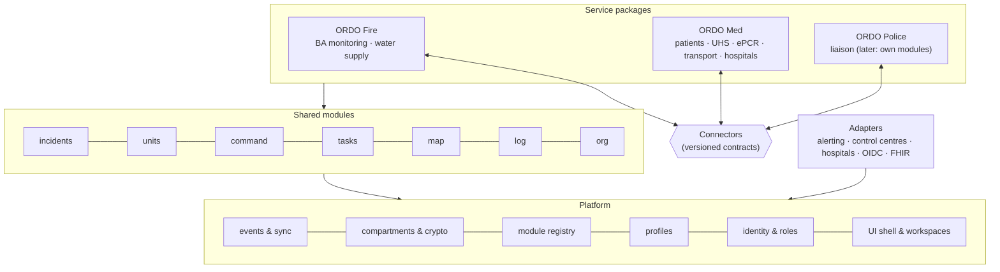
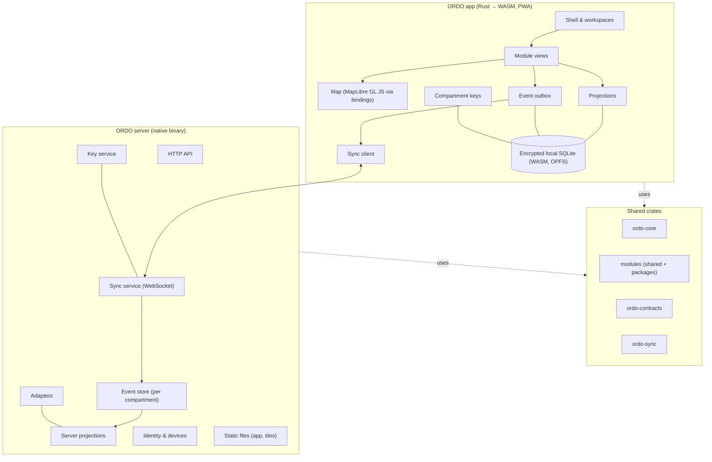

# 5. Building block view

> Part of the [ORDO architecture](README.md) (arc42).

## 5.1 Level 1: layers

ORDO is built in layers so that it is **composable**: organisations combine the
packages they need, and new packages can be added without touching existing ones.



| Layer | Contains | May depend on |
|---|---|---|
| **Platform** | Event envelope, sync, compartments and encryption, identities, roles, devices, module registry, profile loader, UI shell, design system, map engine | nothing above it |
| **Shared modules** | incidents, units, command, tasks, map, log, org | platform; other shared modules' public types |
| **Service packages** | Bundles of service-specific modules plus their workspaces, wording and default settings | platform, shared modules, **connectors** (never another package's internals) |
| **Connectors** | Versioned contracts for data that crosses package borders | platform |
| **Adapters** | Integrations with external systems | platform; the module they serve |

Rules that keep it modular:

1. Dependencies point **downwards only**. The platform knows nothing about fire or
   patients; shared modules know nothing about packages.
2. Packages never read each other's data. They talk **only through connectors**.
3. Everything country-specific lives in **profiles** (data), never in code.

## 5.2 Level 2: components

One **Cargo workspace**. Platform, modules and contracts are written once in Rust and
compiled both natively (server) and to WebAssembly (app).



| Component | Responsibility |
|---|---|
| **ordo-core** | Event envelope, compartments, incident lifecycle, identities, permission framework, module and package registry. No I/O. |
| **ordo-sync** | Sync protocol: messages, HLC, outbox, replay, conflict rules, compartment-scoped subscriptions. |
| **ordo-crypto** | Compartment keys, device keys, payload encryption, hash chains. |
| **ordo-contracts** | All connector contracts, versioned. |
| **ordo-profiles** | Profile format, loader, layering, validation (no data). |
| **ordo-store** | Storage abstraction: SQLite (native and WASM), PostgreSQL. |
| **Modules** | Functional areas ([5.3](#53-service-packages-and-workspaces)). |
| **ordo-app** | Leptos app shell, workspaces, design system. |
| **ordo-map** | Bindings to MapLibre GL JS. |
| **ordo-server** | axum server: API, sync service, key service, adapters, static files, CLI. |

## 5.3 Service packages and workspaces

### 5.3.1 Modules

A module owns one functional area and declares:

| Part | Example (`med.uhs`) |
|---|---|
| **Events** in its own namespace | `uhs.created`, `uhs.patientAdmitted`, `uhs.patientDischarged` |
| **Compartments** it writes to | `med.clinical` (patient-related), `med.ops` (staffing) |
| **Projection** | UHS board: patients, status, waiting times |
| **Permissions** | Which roles may emit which events |
| **Profile catalogues** it reads | `triage-categories`, `discharge-outcomes` |
| **Views** for the app | UHS board, admission dialog |
| **Public types** others may reference | `UhsId`, `PatientId` |

Modules are Rust crates implementing a common `Module` trait and are compiled in.
Each organisation switches them on or off at runtime. Loading third-party modules at
runtime (e.g. as sandboxed WebAssembly components) is possible later, but not planned.

### 5.3.2 Service packages

A **service package** is a bundle: a set of modules, the **workspaces** for its roles,
its connectors, and default settings. Example:

```toml
# packages/med/package.toml
id = "med"
name = "ORDO Med"
modules = ["med.patients", "med.uhs", "med.epcr", "med.transport", "med.hospitals"]
uses_shared = ["incidents", "units", "command", "tasks", "map", "log"]
compartments = ["med.clinical", "med.ops"]
connectors_provided = ["med.patientCounts.v1", "med.transportStatus.v1"]
connectors_consumed = ["fire.responderInjured.v1", "command.dangerZones.v1"]
```

### 5.3.3 Workspaces

A **workspace** is what a role sees when it opens ORDO: a set of views, a layout and
the package's wording — similar to role-based launchpads in business software.

| Workspace | Package | Main views |
|---|---|---|
| Fire command | Fire | Units, sectors, tasks, map, log |
| Medical incident lead | Med | Patient counts, UHS load, transport board, map |
| UHS | Med | UHS board, patient admission, ePCR |
| Medic | Med | My patients, ePCR quick entry |
| Transport | Med | Transport requests, transport units, hospitals |
| Police liaison | Police | Map, cordons, shared information |

Workspaces are defined as data (package + profile), so organisations can adjust them
without code.

## 5.4 Repository structure

```
ordo/
├── Cargo.toml                 # workspace
├── platform/
│   ├── ordo-core/             # envelope, compartments, identities, registry
│   ├── ordo-sync/             # sync protocol, HLC, outbox
│   ├── ordo-crypto/           # keys, encryption, hash chains
│   ├── ordo-store/            # SQLite (native/WASM), PostgreSQL
│   ├── ordo-profiles/         # profile format, loader, layering, validation
│   ├── ordo-contracts/        # connector contracts (versioned)
│   ├── ordo-app/              # Leptos shell, workspaces
│   ├── ordo-ui/               # design system: accessible components
│   ├── ordo-tokens/           # DTCG tokens → CSS, contrast checks
│   ├── ordo-map/              # MapLibre bindings + accessible list view
│   └── ordo-server/           # axum server, CLI
├── modules/                   # shared modules
│   ├── incidents/ units/ command/ tasks/ map/ log/ org/
├── packages/
│   ├── fire/                  # package.toml + modules: ba/, water/
│   ├── med/                   # package.toml + modules: patients/, uhs/, epcr/, transport/, hospitals/
│   └── police/                # package.toml (liaison workspace first)
├── adapters/                  # alerting, OIDC, FHIR, IVENA, EMSI, …
├── profiles/
│   └── de/                    # data only
├── design/
│   ├── tokens/                # primitive, semantic, component tokens (DTCG JSON)
│   ├── themes/                # day, night, high-contrast (DTCG JSON)
│   └── assets/                # fonts (OFL), icons (ISC), with licence files
├── spec/                      # open specifications (CC BY 4.0 / Apache-2.0)
│   ├── client-server/         # OpenAPI
│   ├── sync/                  # AsyncAPI + CDDL
│   ├── federation/            # OpenAPI + AsyncAPI
│   ├── connectors/            # CDDL
│   ├── profiles/              # JSON Schema
│   └── conformance/           # test suite
├── docs/
│   ├── requirements/          # OpenFastTrace items (req), EARS; acceptance/ (Gherkin)
│   ├── architecture/          # arc42 chapters; design items (dsn)
│   ├── adr/                   # decisions (MADR 4)
│   ├── glossary.md
│   └── roadmap.md
├── AGENTS.md                  # instructions for AI agents (CLAUDE.md imports it)
└── deploy/
    ├── Containerfile          # multi-arch, minimal image
    ├── compose/
    │   ├── minimal/           # ORDO + Caddy (SQLite)
    │   └── full/              # ORDO + PostgreSQL + Caddy
    ├── systemd/
    └── helm/                  # later
```

## 5.5 Module designs

### 5.5.1 Shared module `units`

#### Lost-update detection
`dsn~lost-update-detection~1`

Unit status uses *last writer wins* by hybrid logical clock. Every status change records the timestamp of the change it replaces, as its author knew it. When the changes of a unit are sorted by timestamp and a change does not replace its predecessor, the predecessor was overwritten without being seen: ORDO keeps the later value and reports a lost update. The result depends only on the set of events, not on the order of arrival, so all devices reach the same state.

Covers:

* [req~off-4~1](../requirements/07-quality.md#off-4--no-lost-changes)

Needs: impl, itest

Tags: must, m1

#### Unit register
`dsn~unit-register~1`

Units (vehicles, teams, other resources) join an incident with `units.added` (call sign,
type, organisation) in the `incident` compartment; their status follows the
lost-update-aware status board. Every device computes the same register. Still missing
for UNIT-1…6: units from master data, crew strength, status codes from the profile,
releasing units — the item is therefore not yet part of a milestone.

Covers:

* [req~unit-1~1](../requirements/02-shared.md#unit-1--add-units)

Needs: impl, itest

Tags: must

### 5.5.2 Med module `med.patients`

#### UHS registry
`dsn~uhs-registry~1`

On-site care units are set up with `uhs.created` events (module `med.uhs`: ID, name,
kind, capacity) in the shared `incident` compartment, because they are not clinical and
command needs names and capacities next to the patient counts. Patients and the
`med.patientCounts.v1` connector refer to the UHS by ID. The Med workspace lists every
UHS with its load (patients / capacity); registration asks for the UHS explicitly; the
command workspace shows counts and load per UHS.

Covers:

* [req~uhs-4~1](../requirements/04-med.md#uhs-4--several-uhs)

Needs: impl, itest

Tags: must, m4

#### Patient triage history
`dsn~patient-triage-history~1`

Registration and re-triage are separate events in `med.clinical`, never overwritten. The register sorts them by timestamp: the first registration of a triage tag creates the patient, every later decision is appended to the history with category, time and author, and the current category is the latest entry. A second registration of the same tag and a re-triage of an unknown tag are reported as notices.

Covers:

* [req~pat-3~1](../requirements/04-med.md#pat-3--re-triage-with-history)

Needs: impl, itest

Tags: must, m1

#### Patient care record
`dsn~patient-care-record~1`

Module `med.epcr` in the same package. The forms come from the profile catalogue
`epcr-forms`, an HL7 FHIR Questionnaire in a documented subset, checked at build time
([ADR-0027](../adr/0027-epcr-forms-from-the-profile.md), [ADR-0037](../adr/0037-epcr-forms-as-fhir-questionnaire.md)).
Saving a form records one `epcr.entryRecorded` event in `med.clinical` with the triage
tag number, the form ID and the checked values. Snapshot forms show the latest value per
field and keep earlier ones; series forms list timed entries, and a correction names the
entry it replaces, which stays visible as corrected. The only calculation is a sum of
documented values defined by the profile (e.g. GCS). In the app, the record is a page with
its own address; forms open in place, unsaved input survives switching views
([ADR-0029](../adr/0029-edit-records-in-place.md)).

Covers:

* [req~epcr-1~1](../requirements/04-med.md#epcr-1--one-record-per-patient)
* [req~epcr-2~1](../requirements/04-med.md#epcr-2--record-structure-from-profile)
* [req~epcr-3~1](../requirements/04-med.md#epcr-3--quick-entry)
* [req~epcr-4~1](../requirements/04-med.md#epcr-4--append-only-record)

Needs: impl, utest, itest

Tags: must, m6

#### Patient photo
`dsn~patient-photo~1`

The device takes a photo with HTML media capture or reads an uploaded image, downscales
it (longest side at most 800 px) and re-encodes it as JPEG, which drops camera and
location metadata. An `epcr.photoAdded` event in `med.clinical` carries at most 160 KiB;
the module rejects larger photos and other media types. The record shows the latest
photo ([ADR-0028](../adr/0028-patient-photos-in-sealed-events.md)).

Covers:

* [req~pat-8~1](../requirements/04-med.md#pat-8--photo-for-identification)

Needs: impl, utest, itest

Tags: should, m6

### 5.5.3 Web app `ordo-app`

Leptos, client-side rendered, compiled to WebAssembly with Trunk and served by `ordo serve`
(`ORDO_APP_DIR`). Prototype workspaces: Med (registration, UHS board) and command
(patient counts), resources, the patient care record (`patients.rs`) and the command
palette (`palette.rs`). Texts in German (DE profile) in one file, to move to Fluent later.

#### Local persistence
`dsn~local-persistence~1`

The app saves the replica state (ordered events, outbox, data keys) after every change and loads it on start; hash chains are checked again when loading. New input goes into the outbox and is shown at once; the connection reconnects automatically every few seconds and then sends the outbox. Storage is encrypted (ADR-0041) and kept in the device database (design item "Device storage", chapter 8).

Covers:

* [req~ux-5~1](../requirements/07-quality.md#ux-5--no-lost-input)

Needs: impl, itest

Tags: must, m3

#### Triage badge
`dsn~triage-badge~1`

Every triage category is shown as a badge with colour (safety tokens), the profile label as text and a distinct shape (diamond, triangle, circle, square, cross); a visually hidden description gives screen-reader users the meaning. The connection status combines a coloured dot with text. In forced-colours mode the shape and border remain.

Covers:

* [req~a11y-3~1](../requirements/07-quality.md#a11y-3--not-colour-alone)

Needs: impl, itest

Tags: must, m3

#### Offline app shell
`dsn~offline-app-shell~1`

A service worker keeps the app shell on the device: on installation it stores
`index.html` and every file it references (Trunk's content-hashed assets). Page loads go
to the network first and fall back to the stored shell; hashed assets come from the store
first. So ORDO starts and shows the locally stored data even when the server is
unreachable, e.g. after the browser was restarted at the scene. Sync traffic (WebSocket)
and health endpoints are not intercepted. A web app manifest makes the app installable.

Covers:

* [req~ux-5~1](../requirements/07-quality.md#ux-5--no-lost-input)

Needs: impl, itest

Tags: must, m3

#### Workspace navigation
`dsn~workspace-navigation~2`

Workspaces (package, label, required compartments, views) are defined as data. A menu
(launcher) switches workspaces; it lists every workspace of the packages in use and keeps
unavailable ones in place, disabled, with the reason. On wide screens a rail holds the
menu at its top and the views of the current workspace below; on phones and tablets in
portrait, one bar at the bottom holds the views and, at its end, the menu, which opens
upwards; the content never lies beneath the bar. The header shows the workspace as page
heading, search, incident and connection. The route (workspace, view, record) is the URL
path, handled by Leptos' router, so the back button works; a device opens the last used workspace, or the
first one the user may use ([ADR-0025](../adr/0025-workspace-navigation.md),
[ADR-0026](../adr/0026-navigation-at-the-bottom-on-phones.md)).

Covers:

* [req~ux-8~1](../requirements/07-quality.md#ux-8--role-workspaces)

Needs: impl, itest

Tags: must, m5

#### Command palette
`dsn~command-palette~1`

Ctrl+K or ⌘K, or the search button, opens a modal dialog with a combobox and a listbox
(WAI-ARIA Authoring Practices). Entries are views, commands, patients (by triage tag
number only) and units (by call sign), built from the current state; matching ignores
case and umlauts and ranks word starts first. Choosing a patient or unit shows its quick
actions (open the record, new entry, photo, re-triage; unit status). Entries the user may
not use are disabled with the reason. Arrow keys, Enter, Backspace and Escape work as
expected; focus returns to where it was; the number of results is announced
([ADR-0030](../adr/0030-command-palette.md)).

Covers:

* [req~ux-10~1](../requirements/07-quality.md#ux-10--keyboard-command-palette)

Needs: impl, utest, itest

Tags: should, m6
