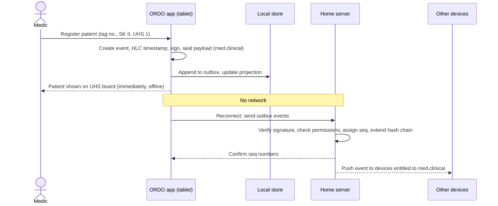
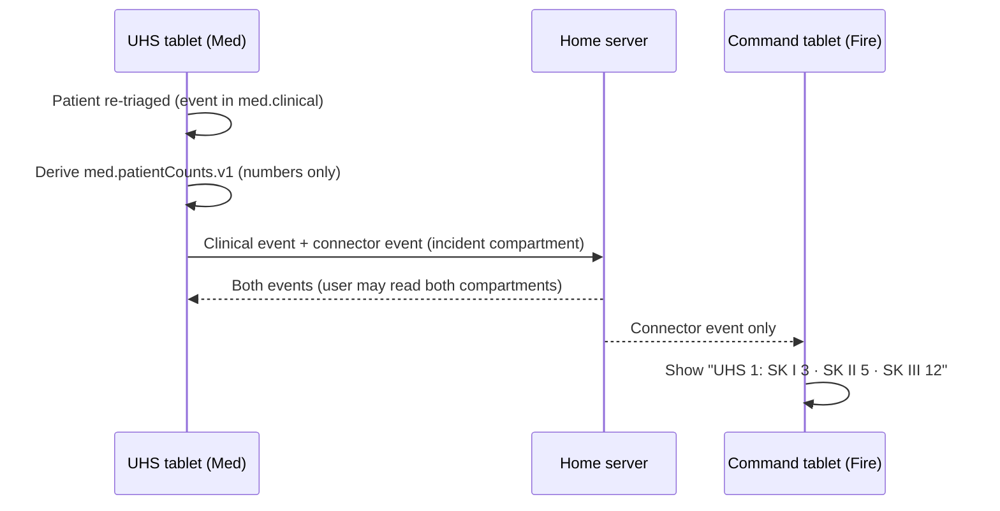

# 6. Runtime view

> Part of the [ORDO architecture](README.md) (arc42).

## 6.1 Recording an event offline and syncing it later



Concepts: [8.1 Events and ordering](08-concepts.md#81-events-and-ordering),
[8.2 Data compartments](08-concepts.md#82-data-compartments).

## 6.2 Patient counts reach command without patient data



Concept: [8.3 Connectors](08-concepts.md#83-connectors). Requirements: PAT-6, SEC-9,
CONN-3.

## 6.3 Concurrent changes while disconnected

```mermaid
sequenceDiagram
  participant A as Tablet A
  participant B as Tablet B
  participant Server as Home server

  Note over A,B: Both offline
  A->>A: unit RTW 1 → status 4 (HLC t1)
  B->>B: unit RTW 1 → status 3 (HLC t2 > t1)
  A->>Server: event (t1)
  B->>Server: event (t2)
  Server-->>A: both events in sequence order
  Server-->>B: both events in sequence order
  A->>A: Projection: last writer by HLC wins → status 3; conflict noted in log
  B->>B: Same result
```

Concept: [8.1.1 Ordering and conflicts](08-concepts.md#811-ordering-and-conflicts).
Requirement: OFF-4.
