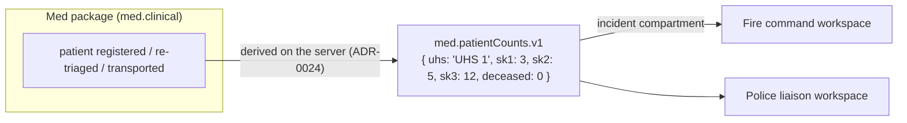
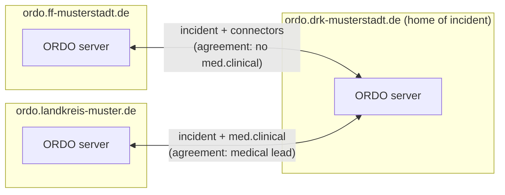
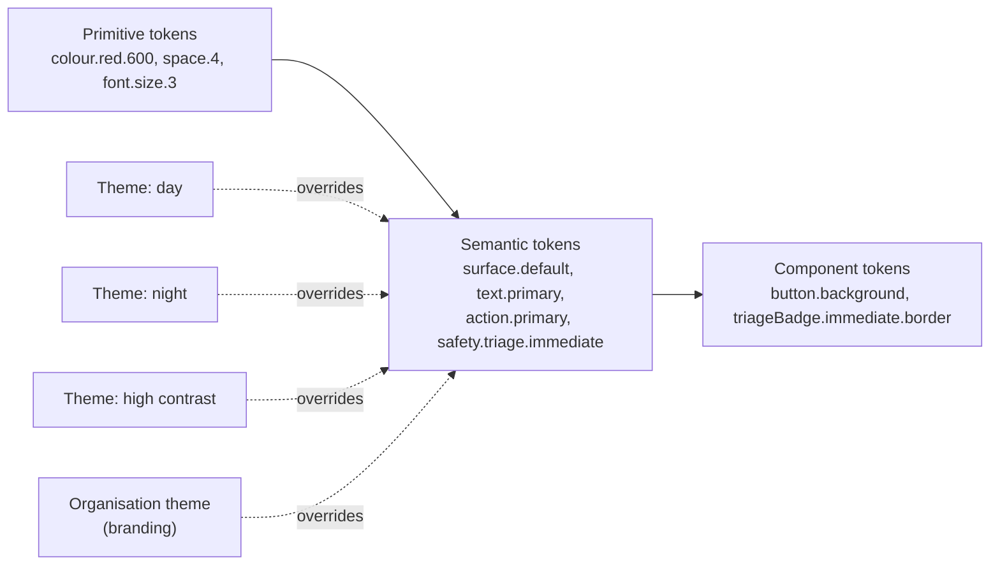

# 8. Crosscutting concepts

> Part of the [ORDO architecture](README.md) (arc42).

## 8.1 Events and ordering

Every change is stored as an immutable **event**. Shown as JSON for readability; on the
wire and in storage it is **CBOR**.

```json
{
  "id": "01JC8Z6K4Q8M3N2P1R0S9T8V7W",
  "incident": "01JC8Z5…@ordo.drk-musterstadt.de",
  "origin": "ordo.drk-musterstadt.de",
  "compartment": "med.clinical",
  "module": "med.epcr",
  "type": "epcr.vitalsRecorded",
  "schemaVersion": 1,
  "author": { "user": "anna@ordo.drk-musterstadt.de", "device": "01JC7…" },
  "hlc": "2026-11-08T14:02:11.480Z-0001-device12",
  "payload": "<encrypted with the compartment key>",
  "signature": "<Ed25519 signature of origin>"
}
```

- The **envelope** (IDs, origin, compartment, module, type, author, clock) is small and
  readable by the server, so it can order, route and check permissions.
- Identifiers are **globally unique and qualified with their server**, and every event
  is **signed**, from day one, so that installations can federate later without
  migrating data ([8.4](#84-federation)).
- The **payload** of protected compartments is encrypted with that compartment's key
  ([8.2](#82-data-compartments)).
- The current state is a **projection** of the events, built per module.

### 8.1.1 Ordering and conflicts

- Each event carries a **hybrid logical clock** (HLC): close to real time but
  consistently ordered even when device clocks differ.
- The incident's **home server** ([8.4](#84-federation)) assigns a **sequence number** per incident and
  compartment. Clients replay
  their unconfirmed local events on top of it.

| Kind of data | Rule | Example |
|---|---|---|
| Log entries, radio messages, ePCR entries | Never conflict, all are kept | Two medics document at the same time |
| Simple fields | Last writer wins (by HLC), per field | Unit status changed on two tablets |
| Collections | Add and remove are separate events | Two units added to a sector at once |
| Critical changes | Last writer wins **and** a visible notice | Two people re-triage the same patient |

Events of modules a device doesn't know (older version, module switched off) are
stored and forwarded untouched, so mixed versions in the field never lose data.

### 8.1.2 Design items

#### Qualified identifiers
`dsn~qualified-identifiers~1`

Identifiers are validated value types in `ordo-core`. Users, incidents and keys are qualified with their server name (`localpart@server`, `ULID@server`, `name@server`); organisations are identified by their server name; events and devices use ULIDs (16 bytes). Values are validated when they are created and when they are decoded, following `spec/sync/event.cddl`, so an invalid identifier cannot exist in memory.

Covers:

* [req~fed-7~1](../requirements/06-federation-and-interfaces.md#fed-7--globally-unique-identifiers)

Needs: impl, utest

Tags: must, m0

#### Signed events
`dsn~signed-events~1`

Events travel as `[body bytes, signature]`. The Ed25519 signature covers the context `ORDO event v1`, a zero byte and the body bytes exactly as sent. Receivers verify before accepting and forward the body bytes unchanged, so signatures stay valid across relays and across versions that add fields ([spec §4](../../spec/sync/event.md)).

Covers:

* [req~fed-6~1](../requirements/06-federation-and-interfaces.md#fed-6--verifiable-origin-and-integrity)

Needs: impl, utest

Tags: must, m0

#### Hash chain
`dsn~hash-chain~1`

The home server orders events per incident and compartment and chains them: chain = BLAKE3 derive-key `ORDO chain v1` over previous chain ‖ event hash, starting from 32 zero bytes. Anyone holding the sequence can recompute the chain and detect changed, removed or reordered events ([spec §6](../../spec/sync/event.md)).

Covers:

* [req~fed-6~1](../requirements/06-federation-and-interfaces.md#fed-6--verifiable-origin-and-integrity)

Needs: impl, utest

Tags: must, m0

#### Outbox and resend
`dsn~outbox-and-resend~1`

A device records every new event in its outbox and shows it at once. After connecting, it sends `hello` with the last sequence number it has per stream, receives what it missed, and then sends its outbox in pushes of at most 4 MiB, the next as the server confirms the last. The server ignores events it has already ordered (by event ID), so resending after a lost confirmation never duplicates anything, and accepts messages of at most 16 MiB. An event leaves the outbox when it comes back ordered from the server, or when the server rejects it for what it is (forbidden, malformed, wrongly signed or sealed); a rejection for the moment (no session yet, login expired, clock ahead) keeps it for the next connection, so no input is lost.

Covers:

* [req~off-3~1](../requirements/07-quality.md#off-3--automatic-sync)

Needs: impl, itest

Tags: must, m1

#### Connection liveness
`dsn~connection-liveness~1`

A network can vanish without closing the connection, e.g. when a tablet leaves the Wi-Fi:
the WebSocket then looks open for minutes, and the device would show "connected" while
nothing arrives. So the app watches the line itself. When it has heard nothing from the
server for 10 s, it sends `ping`, which the server answers with `pong` (protocol 1.2).
When it has heard nothing for 25 s, or a connection attempt hangs that long, it gives the
connection up, shows "offline" and connects anew; late events of the abandoned connection
are ignored. The outbox keeps every input meanwhile. Found by the field-near test.

Covers:

* [req~off-3~1](../requirements/07-quality.md#off-3--automatic-sync)

Needs: impl, utest, itest

Tags: must, m47

## 8.2 Data compartments

A **compartment** is a separately protected part of an incident's data. Every event
belongs to exactly one.

| Compartment | Content | Who can read | Retention (default, DE) |
|---|---|---|---|
| `incident` | Units, sectors, tasks, map, log, connector data | Everyone taking part in the incident | Configurable (e.g. 1–3 years) |
| `med.clinical` | Patient identity, triage details, ePCR, transport details | Assigned medical staff, medical leads | ≥ 10 years (medical documentation) |
| `med.ops` | UHS staff planning, internal med logistics | Med package users | As `incident` |
| `police.restricted` | Police-only information (later) | Police users | Per police rules |
| `fire.ops` | Fire-internal data, e.g. BA monitoring details | Fire package users | As `incident` |

Each compartment has its own:

- **Access rules** — checked on the server for every event and every read.
- **Sync scope** — the server sends a device only the compartments its user may read.
  A fire tablet never receives, and therefore never stores, patient records.
- **Encryption key** — one data key per incident and compartment. Keys are given to
  authorised devices encrypted for that device's own key (X25519), and are removed when
  a device is revoked or a role ends.
- **Retention** — closed incidents are deleted or anonymised per compartment, so ePCR
  data can be kept 10 years while operational data is deleted earlier.

**Trust model (proposed, ADR 014):** the server is trusted and can decrypt (needed for
reports, PDF handover, FHIR export and backups), but keeps compartment keys separate
and logs every decryption. Full end-to-end encryption (server can't read clinical data)
is possible later with the same structure, at the cost of server-side features.

### 8.2.1 Design items

#### Compartment-scoped sync
`dsn~compartment-scoped-sync~1`

On `hello`, the server grants only the streams (incident × compartment) the user may read and lists the others as denied; it never delivers events of a denied stream to that session, and the device discards deliveries for streams it was not granted. When a device pushes an event, the server checks author, signature, write permission and sealing before ordering it.

Covers:

* [req~sec-9~1](../requirements/07-quality.md#sec-9--compartment-scoped-sync)

Needs: impl, itest

Tags: must, m1

#### Sealed payloads
`dsn~sealed-payloads~1`

Payloads of protected compartments are encrypted with XChaCha20-Poly1305 using the data key of the incident compartment ([spec §5](../../spec/sync/event.md)). The server creates the key on first use and grants it only to devices whose user may read the compartment. Server and devices store only the sealed form; the server rejects unsealed events in protected compartments and sealed events in unprotected ones.

Covers:

* [req~sec-10~2](../requirements/07-quality.md#sec-10--health-data-protection)

Needs: impl, utest, itest

Tags: must, m1

## 8.3 Connectors

A **connector** is a versioned contract for information that crosses a package border.
Technically, a connector is a set of **published events** in the shared `incident`
compartment:



- Connector events are derived by the **server that orders the source compartment**
  (the home server; later also the edge server in the command vehicle), with a deriver
  provided by the package ([ADR-0024](../adr/0024-server-derived-connectors.md)). It has
  the complete, ordered view, so there is exactly one consistent source.
- Connector events contain **only what the contract allows**: counts and statuses,
  never clinical details (CONN-3).
- **Consuming** packages depend only on the contract crate (`ordo-contracts`), never on
  the providing package.
- Contracts are **versioned** (`.v1`, `.v2`); a provider can publish several versions
  during a transition.
- Requests across services (e.g. Fire → Med "responder injured") are connector events
  that create a **task** visible to both sides (CONN-4).
- The list of all connectors with their fields and purpose is generated from the
  contract crate and shown to administrators (CONN-2).

First contracts:

| Contract | From → to | Content |
|---|---|---|
| `med.patientCounts.v1` | Med → all | Counts per triage category and location, and the number discharged |
| `med.transportStatus.v1` | Med → all | Transports: unit, destination hospital, status — no patient data |
| `fire.responderInjured.v1` | Fire → Med | Request for care: location, unit, urgency |
| `command.dangerZones.v1` | Command → all | Danger zones, staging areas, sectors |
| `command.routes.v1` | Command/Police → all | Cordons, access and exit routes |

### 8.3.1 Design items

#### Server-derived connectors
`dsn~server-derived-connectors~1`

A package registers a deriver for its source compartment with the server. For every newly ordered event of that compartment, the server passes the decrypted event to the deriver and publishes what it returns — signed by the server — into the target compartment. The Med deriver publishes `med.patientCounts.v1` for every on-site care unit whose counts changed; the payload contains only the unit name, one number per triage category (patients in the unit) and the number discharged.

Covers:

* [req~pat-6~1](../requirements/04-med.md#pat-6--patient-counts-for-command)
* [req~conn-3~1](../requirements/05-police-and-connectors.md#conn-3--minimum-necessary-data)

Needs: impl, itest

Tags: must, m1

## 8.4 Federation

**Goal:** ORDO installations run by different organisations work together on the same
incident, without a central server — in the spirit of Matrix, but focused on what
emergency services need.

### 8.4.1 Why not build directly on Matrix?

Matrix is a serious option: proven, federated, end-to-end encrypted, with Rust server
implementations; in Germany it is the basis of the health sector's TI-Messenger and of
the Bundeswehr's BwMessenger. But for ORDO's core data the fit is poor:

| Aspect | Matrix | ORDO needs |
|---|---|---|
| Who can federate | Open by default | Closed: only explicitly trusted partners |
| Ordering | Event graph with state resolution, no single authority | A simple, clear order per incident — an incident has a lead organisation anyway |
| Data model | Rooms and messages; app data as custom events | Compartments, projections, retention per compartment, offline-first devices |
| Resources | Homeservers are comparatively heavy | Must run on a Raspberry Pi in a vehicle |

**Proposal (ADR 016):** an own, focused federation protocol that borrows Matrix's good
ideas (server identity via domain names, signed events, open specification). Plus a
**Matrix adapter** later for messaging with TI-Messenger, BwMessenger or Element — where
Matrix is strongest.

### 8.4.2 Model



- **Server identity:** each installation has a domain name and a signing key pair
  (Ed25519), published at `https://<domain>/.well-known/ordo`.
- **Global identifiers:** users and organisations are qualified with their server
  (e.g. `anna@ordo.drk-musterstadt.de`); incidents and events have globally unique IDs.
- **Signed events:** every event is signed by its origin, so every installation can
  verify where an event comes from and that it is unchanged — even when relayed.
- **Home per incident:** the leading organisation's server is the incident's *home* and
  assigns the order. Other servers replicate the incident for the compartments their
  users may read. The home can be handed over (e.g. the county takes over command);
  the handover is an event like any other.
- **Same protocol as devices:** to the home, a partner server behaves like a large
  client — with an outbox, continuing to work when the home is unreachable and catching
  up later. A network split between organisations is the same case as a tablet without
  coverage, which ORDO handles anyway.
- **Closed by default:** a federation agreement per partner states which compartments
  and roles may cross. Compartment keys are given only to partner servers that host
  authorised users; `med.clinical` normally stays with medical organisations.

- **Different rules on each side:** every state (and country) has its own doctrine and
  catalogues. Work within one's own jurisdiction comes first; across borders, servers
  agree on core meanings, show their own labels and keep the sender's original entry
  ([ADR-0044](../adr/0044-federation-across-profiles.md)).

### 8.4.3 Now vs later

| Built now (cheap, avoids migrations later) | Built later (phase 4) |
|---|---|
| Globally unique, server-qualified identifiers | Server discovery and key exchange |
| Server signing keys; signed events | Federation agreements (admin UI) |
| "Home" concept in the sync protocol | Server-to-server endpoints |
| Sync protocol that doesn't distinguish device vs server peers | Home handover; conformance tests |

## 8.5 Security

- **Transport:** TLS everywhere; ACME / Let's Encrypt or local certificates; hybrid
  post-quantum key exchange (X25519MLKEM768) first
  ([ADR-0042](../adr/0042-post-quantum-readiness.md), which also lists every algorithm
  ORDO uses).
- **Compartments:** separate access rules, sync scope, keys and retention ([8.2](#82-data-compartments)).
- **Devices:** own key pair per device, paired via QR code; revocation removes keys and
  stops sync. Data on the device is stored encrypted
  ([ADR-0041](../adr/0041-encryption-at-rest-on-devices.md)). Devices with clinical data
  lock automatically (PIN / biometrics, SEC-13).
- **Permissions** are checked on the server for every event; the client checks them only
  for quick feedback.
- **Guests** get a time-limited link for one incident, `incident` compartment only.
- **Integrity:** events hash-chained per incident and compartment (BLAKE3).
- **Access logging:** every read of a clinical record is an audit event.
- **Memory safety:** no `unsafe` in ORDO's own code except reviewed FFI; `cargo audit`
  and `cargo deny` in CI.
- **Login:** OpenID Connect with the organisation's identity provider, device keys and QR
  pairing ([ADR-0038](../adr/0038-login-and-device-pairing.md)).

### 8.5.1 Design items

#### Post-quantum transport
`dsn~pq-transport~1`

The TLS endpoint ORDO ships (Caddy in the Compose bundle) names its key exchange groups
explicitly: X25519MLKEM768 first, then X25519, P-256 and P-384 for older clients. The
container workflow starts that Caddy with the bundle's Caddyfile and runs
`tests/tls/check_hybrid_tls.py` with OpenSSL 3.5, which offers only X25519MLKEM768 and
fails unless the endpoint agrees on it. Operators with their own proxy run the same
script. The algorithms and the plan to replace them are kept in
[ADR-0042](../adr/0042-post-quantum-readiness.md).

Covers:

* [req~sec-14~1](../requirements/07-quality.md#sec-14--protection-against-later-decryption)

Needs: itest

Tags: must, m27

#### Software bill of materials
`dsn~sbom~1`

The container workflow makes a CycloneDX 1.6 bill of materials for the server and the web
app with `cargo-cyclonedx` (pinned version) on every build. `tests/sbom/check_sbom.py`
fails the build unless each is CycloneDX 1.6, names its component, lists every dependency
with version and package URL, and contains the crates ORDO's security rests on
(signatures, sealing, hashing, TLS). The bills are kept as a build artifact; publishing
them with releases, signed and with provenance, is the release workflow's job
(architecture 7.7, [ADR-0043](../adr/0043-supply-chain.md)).

Covers:

* [req~sec-15~1](../requirements/07-quality.md#sec-15--software-bill-of-materials)

Needs: itest

Tags: must, m28

#### Content Security Policy
`dsn~content-security-policy~1`

Every response of the server carries a strict Content Security Policy. `default-src`,
`script-src`, `style-src`, `connect-src` and `worker-src` are `'self'`. Scripts may also
compile WebAssembly (`'wasm-unsafe-eval'`). Images may be `data:` and `blob:` URLs
(symbols, photos). Frames, objects, other base URIs and other form targets are not
allowed. The app has no inline code of its own:
- the boot script is a file;
- MapLibre's styles come in through `app.css`;
- the map module is imported through a wasm-bindgen module snippet instead of `new Function`.

The only inline script is Trunk's loader, which changes with every build; the server reads
the built page at start and allows exactly that script by its SHA-256 hash. The browser test
records every policy violation and expects none.

Covers:

* [req~sec-18~1](../requirements/07-quality.md#sec-18--only-ordos-own-code-runs-in-the-app)

Needs: impl, utest, itest

Tags: must, m42

#### Fuzzing
`dsn~fuzzing~1`

`tests/fuzz` is a cargo-fuzz workspace (nightly Rust, excluded from the main workspace)
with one target per kind of untrusted input:

* `client_message`: what the server receives from devices.
* `server_message`: what devices receive from the server.
* `signed_event`: signed events and their bodies.
* `payloads`: the payload of every event type and connector, as derivers and write guards
  decode them.

Each target decodes the input; whatever decodes must encode again to bytes that decode to
the same value. libFuzzer with AddressSanitizer reports panics, hangs and memory
exhaustion. A seed program writes valid messages, events and payloads as starting corpora.
ClusterFuzzLite (`.clusterfuzzlite/`, workflow *Fuzzing*) builds the targets in OSS-Fuzz's
Rust image and runs them for 5 minutes on every change and 30 minutes every day, keeping
the corpus between runs ([ADR-0059](../adr/0059-fuzzing-with-cargo-fuzz-and-clusterfuzzlite.md)).

Covers:

* [req~sec-17~1](../requirements/07-quality.md#sec-17--robust-against-malformed-input)

Needs: itest

Tags: must, m42

#### Container image
`dsn~container-image~1`

The server image (`deploy/Containerfile`) is a static musl binary on distroless, non-root,
with a read-only file system. Its base images are pinned by the digest of their
multi-architecture index. CI builds it on every change for `linux/amd64` and, on a native
arm64 runner, for `linux/arm64`, and smoke-tests both with `tests/container/smoke.sh`: it
starts read-only, answers health, readiness and metrics, runs as user 65532, and Docker
reports it healthy. A release builds each architecture natively, smoke-tests and pushes it
by digest, then joins both into one image index with the version tags. That index is signed
keyless with cosign (`--recursive`, so each architecture is signed too), and the build
provenance and bill of materials are attested on it
([ADR-0043](../adr/0043-supply-chain.md)).

Covers:

* [req~ops-5~1](../requirements/07-quality.md#ops-5--container-image)

Needs: itest

Tags: must, m41

#### Licence notices
`dsn~licence-notices~1`

Every screen ends with a footer linking to *Lizenzen und Quellcode* (`/notices`). The page
shows ORDO's licence (AGPL-3.0-or-later) and the source code address of the build: the
workspace's `repository` field, so whoever changes ORDO and builds it points to their own
source. Below come the notices of the third-party parts, in two groups:

* **Rust crates** of the server and the app: `cargo-about` (pinned version) lists them
  with their licence texts as found in each crate, at build time: the app's pre-build
  step runs `tools/notices/notices.sh`, which writes an HTML fragment (escaped by its
  template); development and build dependencies are left out, as they are not shipped. A build without `cargo-about` says so on the page; CI and
  release builds require it ([ADR-0055](../adr/0055-licence-notices.md)).
* **Other parts** the app ships: the vendored map libraries, the map fonts, the icons,
  the profile's tactical symbols, and the map data, each with its copyright and licence;
  the licence texts come from `LICENSES/`, served with the app.

The page loads the notices only when it opens, so the app does not grow.

Covers:

* [req~lic-1~1](../requirements/08-constraints.md#lic-1--licence-notices-and-source-code)

Needs: impl, utest, itest

Tags: must, m35

#### Device proof
`dsn~device-proof~1`

On every connection the hub sends a fresh 32-byte challenge. The device answers with its
hello, which carries an Ed25519 signature with the device key over `ORDO hello v1`, a zero
byte, the challenge, the device ID and the user ID (sync protocol draft 1). The hub uses
each challenge once, checks the signature against the device's registered key, and
refuses the connection otherwise; a refused connection gets no data and no key.

Covers:

* [req~sec-11~1](../requirements/07-quality.md#sec-11--authenticated-connections)

Needs: impl, itest

Tags: must, m7

#### Role policies
`dsn~role-policies~1`

The server decides every read and write of a compartment with Cedar
([ADR-0035](../adr/0035-authorization-with-cedar.md)): principal the user, resource the
compartment, context the user's roles and the incident. Packages ship default policies
(`medic`: incident and clinical data; `commander`: incident data); an organisation adds
roles and policies as `*.cedar` files in `ORDO_POLICY_DIR`. All policies are validated
against the schema at start; an invalid file stops the server. No permission is ever
given to a person directly.

Covers:

* [req~sec-2~1](../requirements/07-quality.md#sec-2--role-based-access)

Needs: impl, utest, itest

Tags: must, m7

#### OpenID Connect login
`dsn~oidc-login~1`

The ORDO server is the relying party (backend for frontend); the browser never sees a
token. The pairing page creates a device key pair, keeps the private key on the device and
sends the public key to `GET /auth/login`. The server starts the authorization code flow
with PKCE and binds it to the browser with a cookie; on return it verifies the ID token
(issuer, audience, signature, nonce), maps the provider's subject to a stable ORDO user ID
(preferred user name or e-mail), takes the `groups` claim as roles, stores the device key
and registers it with the hub. The provider is discovered on first use, so a field server
also starts without it ([ADR-0038](../adr/0038-login-and-device-pairing.md)).

Covers:

* [req~sec-3~2](../requirements/07-quality.md#sec-3--login-and-single-sign-on)

Needs: impl, itest

Tags: must, m8

#### QR pairing
`dsn~qr-pairing~1`

A shared device sends its public key to `POST /auth/device`; the server starts the OAuth
2.0 Device Authorization Grant (RFC 8628) at the identity provider and returns the user
code and verification address. The device shows them as QR code (rendered by the server)
and as text with a link; a logged-in person opens it on their phone and approves. The
server waits for the approval in the background, verifies the ID token, and registers the
device key as for a login; the device polls `GET /auth/device/{id}` until it is paired.

Covers:

* [req~org-3~2](../requirements/02-shared.md#org-3--device-pairing)

Needs: impl, itest

Tags: must, m8

#### Access timeout
`dsn~access-timeout~1`

Every device paired by login has an end of its login, stored with the device: "now +
access timeout" (default 48 h, 24–720 h) after each successful verification. A login on
any of the person's devices, or a background renewal of the identity provider's renewal
token (every 15 minutes, `offline_access`), sets it for all their devices; only
`invalid_grant` ends it at once, every other failure leaves it unchanged. The hub refuses
expired devices at hello and cuts their open sessions (`loginExpired`, checked every minute
and before each push). The welcome carries `valid_until`; the device keeps it and locks
itself at that time, also offline, offering to log in again with the same device key
([ADR-0040](../adr/0040-access-ends-only-on-positive-evidence.md)).

Covers:

* [req~sec-12~1](../requirements/07-quality.md#sec-12--access-timeout)

Needs: impl, utest, itest

Tags: must, m9

#### Device revocation
`dsn~device-revocation~1`

A person sees and revokes their own devices; the role permission `manage_devices` (Cedar,
default role `admin`) extends this to all devices of the organisation. The welcome lists
such permissions, so the app knows which view to offer. The sync connection carries the
requests (`listDevices`, `revokeDevice`) and the answer (`devices`), so they need the same
device proof as everything else. Revoking removes the device key from the hub, records the
revocation in the store (it survives restarts), and cuts the device's open connections
with `revoked`. A revoked device that connects again is told `revoked` before its proof is
checked, deletes its key and all local data (remote wipe), and stops reconnecting.
Unpairing a device revokes it as well, if the server can be reached.

Limits: a device that never connects again keeps its data until the screen lock (SEC-13)
or the access timeout (SEC-12) makes it unusable; the key cannot be copied off the device
once it is stored non-extractably (next step).

Covers:

* [req~sec-4~2](../requirements/07-quality.md#sec-4--device-revocation)

Needs: impl, utest, itest

Tags: must, m9

#### Display names
`dsn~display-names~2`

People are shown by a display name. At every login the server stores the identity
provider's `name` (OpenID Connect) with the person (table `people`, migration 0003).
People who have not logged in yet get the name of their local account: with Dex's API
configured ([ADR-0060](../adr/0060-local-accounts-managed-in-ordo.md)), the server reads
the accounts every minute and fills in the name where it has none. The person is found
by the account's login identity, or, before the first login, by the user ID the login
would give (from the e-mail address), unless another login already holds that ID. A
name from a login or a chosen name always wins. In the
profile menu a person may set their own name, which wins while it is set, or clear it
(`setName`); then the provider's name shows again. Names go to devices with the profile
pictures: `avatars` carries an optional `name` per person, and the app asks for the people
it shows, as for pictures. The server remembers who each connection asked about and sends
it a changed name or picture at once, e.g. after a person's first login. The app redraws
names when they arrive. The app shows the name wherever it
names a person: the roster, the device list, histories, orders, the incident log, staff
lists and the header. Where it knows no name, it shows the user ID. Suggestions for person
fields show the name and keep the user ID as their value, so references stay exact.

Covers:

* [req~org-7~1](../requirements/02-shared.md#org-7--display-names)

Needs: impl, utest, itest

Tags: should, m44

#### Device names
`dsn~device-names~1`

The pairing page suggests a name for the device from the browser and operating system ("Firefox
auf Android", "Safari auf iPad"); the person may change it. The name goes with the device key
to `/auth/login` and `POST /auth/device` and is stored with the device (migration 0002).
Logging in again without a name keeps the stored one. The server trims it to at most 60
characters without control characters. `devices` carries it as `name`, so the device list
shows "Firefox auf Android · 4F2A9C" instead of only the short ID.

Covers:

* [req~org-8~1](../requirements/02-shared.md#org-8--device-names)

Needs: impl, utest, itest

Tags: should, m43

#### Organisation roles
`dsn~organisation-roles~1`

Organisation roles (`admin`, `planner`) give organisation-wide permissions through the
Cedar policies (`admin.cedar`). Roles from the configuration (`ORDO_ADMINS`, the
development seed) stay fixed. Administrators (action `manage_roles`) grant further ones in
the organisation workspace (*Rollen*), each optionally valid until the end of a chosen day.
The server stores grants in the table `organisation_roles` (migration 0004) and reads
them at start. A role whose date has passed no longer counts. When a grant changes or
lapses (checked every minute), the person's connections are cut with `rolesChanged`, as
for roles in an incident: the devices reconnect and receive what they may do now. An
administrator cannot withdraw their own administrator role, so no installation loses its
last one by accident. Protocol: `getOrganisationRoles`, `setOrganisationRole`,
`organisationRoles`.

Covers:

* [req~org-9~1](../requirements/02-shared.md#org-9--organisation-roles)

Needs: impl, utest, itest

Tags: should, m45

#### Local accounts
`dsn~local-accounts~1`

Administrators (organisation action `manage_accounts`) manage Dex's local accounts in the
workspace *Administration – Zugriff* (*Konten*), see [ADR-0060](../adr/0060-local-accounts-managed-in-ordo.md).
The app asks over the sync connection (`getAccounts`, `changeAccount`, answered with
`accounts`); the server calls Dex's gRPC API (`ORDO_DEX_API`) with a TLS client
certificate. Creating an account takes the e-mail address, the name and a first password;
resetting takes a new password. The server checks the password's length (12 characters to
72 bytes), hashes it with bcrypt and does not keep it. Deleting an account removes it in
Dex and revokes its renewal tokens for ORDO. ORDO then finds the person by the login's
subject (Dex's `sub`: account ID and connector `local`) and ends their login at once, so
their devices lock. Accounts from `dex.yaml` are listed; Dex refuses to change them, and the app
shows Dex's answer. Without `ORDO_DEX_API` the server answers that accounts are not
managed here.

Covers:

* [req~org-10~1](../requirements/02-shared.md#org-10--local-accounts)

Needs: impl, utest, itest

Tags: should, m46

#### Login providers
`dsn~login-providers~1`

Administrators (organisation action `manage_accounts`) connect OpenID Connect providers in
*Administration – Zugriff – Anmeldung*, see
[ADR-0063](../adr/0063-upstream-login-configured-in-ordo.md). The app asks over the sync
connection (`getLoginProviders`, `testLoginProvider`, `saveLoginProvider`,
`deleteLoginProvider`, answered with `loginProviders`); the server calls Dex's connector API
over the connection of *Local accounts*. The list holds Dex's connectors: OpenID Connect
ones with name, issuer and client ID (never the secret), others only by name, not
changeable. A test writes a temporary connector `ordo-test-<random>` with Dex's `oidc`
configuration (issuer, client ID and secret, redirect URI `<Dex issuer>/callback`, scopes
`openid profile email`, optionally `insecureSkipEmailVerified`) and answers with a link
`/auth/test/<token>`. That link starts a login at Dex with `connector_id` set to the test
connector; the callback reads the ID token, keeps the user ID ORDO would derive, the name
and the e-mail address as the test's result, and shows a page saying the tab can be
closed, without pairing a device. The app asks again until the result is there. Saving
(after a confirmation) writes the tested configuration as the connector `<slug of the
name>` (created, or updated in place when changing one), deletes the temporary one and
logs who saved which provider; a change without a new secret takes the old one from Dex.
Temporary connectors are deleted after 10 minutes and at start. Dex's defaults stay: at a
real login Dex asks the provider for a renewal token (`prompt=consent`), so the provider
may ask the person to agree; the test asks for none. Without `ORDO_DEX_API` the server
answers that login providers are not managed here.

Covers:

* [req~org-11~1](../requirements/02-shared.md#org-11--upstream-login-providers)

Needs: impl, utest, itest

Tags: should, m52

#### Field-near test
`dsn~field-test~1`

A test close to an operation runs what an organisation installs: the Compose bundle
(Caddy, the ORDO image, Dex) with its TLS from the organisation's own certificate
authority, as on a field server without internet. Two tablets join it, each a browser in
its own container on the bundle's network: an Android tablet (Chromium) and an iPad
(WebKit). The test (`tests/e2e/field/`) checks and measures:

* **Propagation (PERF-2):** a patient registered on one tablet appears on the other within
  2 s, five times in a row.
* **Network cut:** a tablet loses its network (`docker network disconnect`); what it
  documents meanwhile arrives on the other tablet after it reconnects.
* **Server restart:** both tablets reconnect by themselves; nothing is lost.
* **Resources (PERF-5):** the app's download as served (compressed), the WebAssembly
  memory of both tablets and the JavaScript heap of the Android one, and the memory of the
  server's containers, each against a budget in `budgets.json`.

It writes the numbers as a report. CI runs it weekly and on demand (`field.yml`).

Covers:

* [req~perf-2~1](../requirements/07-quality.md#perf-2--fast-propagation)
* [req~perf-5~1](../requirements/07-quality.md#perf-5--resource-efficiency)

Needs: itest

Tags: must, m47

#### Large incident in the field-near test
`dsn~large-incident~1`

The field-near test also runs an incident of the size PERF-3 names. A load device
(`tests/load`, `ordo-load`) pairs as a shared tablet does (QR pairing): a person with the
roles of incident command and physician approves it. It joins the incident by name and
writes over the sync protocol, with the modules' payloads and the profile's position kinds
and status codes: an incident command with 50 sectors, 5 UHS, 100 units each assigned to a
sector, and 500 patients. Unit status changes (each naming the status it replaces) and
re-triages fill it up to 10,000 events. It uses no interface a tablet does not use.

Then two tablets that have never seen the incident join it. The test measures and checks
against `budgets.json`:

* **Joining:** the time until a tablet shows all 500 patients.
* **Incident log:** the time until the Android tablet's log shows all entries.
* **Propagation (PERF-2):** patients registered on one tablet appear on the other within
  2 s, also in the large incident.
* **Memory:** WebAssembly memory of both tablets, the JavaScript heap of the Android one,
  and ORDO's memory.

The numbers go into the field-near test's report.

Covers:

* [req~perf-3~1](../requirements/07-quality.md#perf-3--large-incidents)

Needs: itest

Tags: must, m48

#### Decoded events on the device
`dsn~decoded-events~1`

The app's views compute what they show from the incident's events, again on every change.
The replica therefore decodes each event's body and decrypts its payload once, and keeps
the result per stream: `Replica::events_shared` returns the same shared list while the
stream and the device's unconfirmed events in it are unchanged, and after a change only
the new events are decoded. A stream that was replaced (e.g. after access was lost) is
decoded anew. In the large incident of the field-near test, each change had decoded and
decrypted all 10,000 events once per view.

Covers:

* [req~perf-2~1](../requirements/07-quality.md#perf-2--fast-propagation)
* [req~perf-3~1](../requirements/07-quality.md#perf-3--large-incidents)

Needs: impl, itest

Tags: must, m48

#### Device storage encryption
`dsn~device-storage-encryption~1`

The app stores nothing in plain text: pairing, pending pairing and replica are encrypted
with a storage key (XChaCha20-Poly1305, the item's name as associated data, format
`enc1:`). The storage key is wrapped by a non-extractable AES-256-GCM WebCrypto key kept in
IndexedDB, and unwrapped at start; without a secure context the app stores nothing.
Unpairing and revocation replace the storage key, so leftovers cannot be decrypted. Older
plain-text items are encrypted on first load. Network traffic uses TLS, terminated by the
bundled reverse proxy ([ADR-0041](../adr/0041-encryption-at-rest-on-devices.md)).

Covers:

* [req~sec-1~2](../requirements/07-quality.md#sec-1--encryption-in-transit-and-at-rest)

Needs: impl, utest, itest

Tags: must, m10

#### Incident roles
`dsn~incident-roles~1`

Incidents and rosters are events in the incident's `incident` compartment (module
`incidents`: `planned`, `stateChanged`, `roleGranted`, `roleWithdrawn`); the hub and the
devices compute the same registry from them. Access decisions pass the person's roles in
the incident to the policy, which adds the organisation roles (administrators from
`ORDO_ADMINS`) and asks Cedar. Only planners (`manage_incidents`) plan incidents; planners
and holders of a role with `assign_role` (default: `commander`) grant and withdraw roles
and change the state. When someone's roles change, the server ends their connections
(`refused: rolesChanged`); the devices reconnect, get the streams they may read now, and
delete the data of streams they lost. After logging in, the app lists the person's
incidents (`listIncidents`); a planner's device plans one by recording `planned` and the
planner's `commander` role once it may write to it
([ADR-0046](../adr/0046-roles-granted-per-incident.md)).

Covers:

* [req~org-6~1](../requirements/02-shared.md#org-6--incidents-planned-ahead-roles-per-incident)

Needs: impl, utest, itest

Tags: must, m11

#### Transport priority and "Betroffene"
`dsn~transport-priority~1`

The triage contract has a core meaning `uninjured` ("Betroffene"), shown without a triage
colour (neutral badge, a ring as shape) and counted apart in `patientCounts`; the patient
events carry schema version 2 since then. Transport priority is its own event
(`patients.transportPriority`, level or none) in the clinical compartment. The profile file
`med/transport-priority.toml` names the categories that may get it and its levels; the app
embeds it at build time. The register keeps the level and when it was set; a later triage
to a category without transport priority ends it for good. The record offers the levels
only for allowed categories; the patient list shows a badge (arrow and label, never colour
alone).

Covers:

* [req~pat-9~1](../requirements/04-med.md#pat-9--unharmed-affected-people)
* [req~pat-10~1](../requirements/04-med.md#pat-10--transport-priority)

Needs: impl, utest, itest

Tags: must, m12

#### Triage references
`dsn~triage-reference~1`

The profile file `med/triage-algorithms.toml` lists the algorithms in use: ID, name, stage
(pre-triage or triage), publisher, edition and the address of the official source (DE:
PRIOR of the BBK and mSTaRT, both for pre-triage). Next to the triage input (registration
and re-triage), *Sichtungshilfe* opens them with their source; the person chooses the
algorithm used, which the device remembers, and always the category. `patients.registered`
and `patients.retriaged` carry the algorithm's ID (schema version 3; older payloads decode
without one), and the triage history shows it ("SK II nach PRIOR"). ORDO does not ship the
charts: no licence for redistribution is stated. An organisation may add a local copy for
offline use once its rights are clear. ORDO never proposes, pre-selects or checks a
category ([ADR-0045](../adr/0045-triage-algorithms-as-reference.md)).

Covers:

* [req~pat-11~1](../requirements/04-med.md#pat-11--triage-algorithms-as-reference)

Needs: impl, utest, itest

Tags: should, m26

#### Transport requests
`dsn~transport-request~1`

A UHS crew requests a transport on the patient's record: transport type, priority and
special needs, chosen from the profile file `med/transport-requests.toml` (DE: KTW, RTW,
ITW, RTH; needs such as physician escort, child, intensive care, infectious, heavy
patient). The device writes two events:

* `transport.requested` (module `med.transport`) in the `incident` compartment: a new
  request ID (ULID), the UHS, type, priority and needs. It carries no patient data, not
  even the tag number: the incident command plans the vehicle, the UHS hands over the
  patient (CONN-3). The needs are what the transport crew must know to bring the right
  vehicle and protect itself.
* `patients.transportRequested` in `med.clinical`: tag number and request ID, so the
  record and the patient list show the transport.

The incident command assigns a unit of the incident and a destination (a hospital of the
list or free text, see [Hospital list](#hospital-list)) with `transport.updated`, which also moves the status on:
requested → assigned → loading → departed → arrived → handed over, or cancelled. Both
the UHS and the command may set the next status; ORDO records who set it and when. The
current state of a request is the latest update by hybrid logical clock; every update
stays in its history. A status that skips steps is accepted (radio messages arrive late),
a step back is not offered. The command workspace lists the open requests in its view
*Transporte*, by priority (as the profile orders it), then oldest first; the record shows status, unit, destination
and history. ORDO never proposes a vehicle, a destination or an order of transports.

Covers:

* [req~trans-1~1](../requirements/04-med.md#trans-1--transport-request)
* [req~trans-3~1](../requirements/04-med.md#trans-3--transport-assignment-and-status)

Needs: impl, utest, itest

Tags: must, m14

#### Planned transports
`dsn~planned-transports~1`

A UHS crew can request a transport for a later time (a relocation, a planned return at
the end of an event): the request form has an optional date and time, and
`transport.requested` (schema version 2) carries it as `planned`, a Unix time in
milliseconds; version 1 payloads decode unchanged as "now". A planned request is like any
other: the command assigns it and it moves through the same steps. The board lists the
planned requests apart, the earliest first, with the time; the other open requests stay
sorted by priority. The time carries no patient data. ORDO shows the time; it never
starts, reminds or reorders on its own.

Covers:

* [req~trans-5~1](../requirements/04-med.md#trans-5--planned-transports)

Needs: impl, utest, itest

Tags: should, m19

#### Hospital list
`dsn~hospital-list~1`

Module `med.hospitals`, in the shared `incident` compartment: hospitals carry no patient
data, and the incident command keeps them. `hospitals.set` adds a hospital (a new ID, a
ULID) or replaces its entry: name, departments and capabilities, chosen from the profile
file `med/hospitals.toml` (DE: departments such as trauma surgery or paediatrics,
capabilities such as a shock room, stroke unit or burns centre). `hospitals.capacitySet`
records the current capacity as the number of patients the hospital takes now per triage
category; the profile names the categories (DE: SK I to SK III). The latest entry and the
latest capacity count, by hybrid logical clock; the board shows who entered the capacity
and when. Capacity is entered by hand from what the hospital reports; an interface to a
capacity system (e.g. IVENA eHealth) can write the same event later
([ADR-0050](../adr/0050-hospital-capacity-sources.md)). The fields follow
HL7 FHIR `Location` and `HealthcareService`, so a list can later be imported from them.
Medical staff read the list, but only the command writes it (Cedar).

When the command assigns a transport, the destination is a hospital of the list or, for
anything else, free text. `transport.updated` (schema version 2) carries the hospital's
ID next to the destination's name; version 1 payloads decode unchanged.

Covers:

* [req~trans-2~1](../requirements/04-med.md#trans-2--hospital-list)

Needs: impl, utest, itest

Tags: must, m18

#### Transport board
`dsn~transport-board~1`

The command's view *Transporte* is the transport board: the open requests (as before),
the available transport units, and the hospitals with their capacity and the number of
patients sent to each. A unit is available when its type is a transport type of the
profile, its status is one the profile marks as available (DE: FMS status 1 and 2, in
`units/status-codes.toml`), and no open transport has it. A patient counts as sent to a
hospital once a transport to it has departed and was not cancelled. ORDO shows capacity
and patients sent side by side; it never proposes a hospital or a unit (TRANS-6 stays a
person's decision).

Covers:

* [req~trans-4~1](../requirements/04-med.md#trans-4--transport-board)

Needs: impl, utest, itest

Tags: must, m18

#### Medical orders
`dsn~medical-orders~2`

Module `med.orders`, in `med.clinical`. A physician or paramedic gives an order on the
patient's record: a medication (substance and dose as free text, route from the profile
file `med/orders.toml`) or a measure (free text), with an optional note. The device writes
`orders.given` with a new order ID (ULID) and the triage tag number. The crew moves it on
with `orders.updated`: acknowledged, done, or withdrawn; the status of an order is its
latest update by hybrid logical clock, and every update stays in its history with who and
when. Reporting an order done names who carried it out, the reporting person unless
another one is chosen (`performedBy`, schema version 2): a physician's order given by a
paramedic and documented by a third person keeps all three apart. Steps only go forward: given → acknowledged → done; withdrawn ends an order that is
not done. The record lists the patient's orders, open ones first; the Med workspace has a
view *Anordnungen* with the open orders of every UHS the person may read, oldest first,
with tag number and UHS. ORDO shows what was ordered and by whom; it checks no dose and
suggests nothing (EPCR-9).

Covers:

* [req~order-1~1](../requirements/04-med.md#order-1--give-orders)
* [req~order-2~2](../requirements/04-med.md#order-2--carry-out-orders)
* [req~order-4~1](../requirements/04-med.md#order-4--open-orders-across-all-uhs)

Needs: impl, utest, itest

Tags: must, m15

#### Order documentation
`dsn~order-documentation~3`

The profile file `med/orders.toml` names, in `[record]`, the series form of the ePCR
forms where an administration is documented and which of its fields take the substance,
the dose and its unit, the route, who ordered and who gave it (DE: the form "Medikation").
The build checks that the form and fields exist with fitting types, and that every route
of the order catalogue is an option of the form's route field, so the two catalogues
cannot drift apart. A done medication order on the record offers "In Dokumentation
übernehmen": it opens a new entry of that form, filled in with the substance, the dose
(split into number and unit when the ordered dose is a number followed by a unit of the
form, otherwise left for the crew), the route, the person who gave the order (for a
spoken order the person named, see *Recorded orders*), the person who carried it out (not
the person using the device) and the time it was reported done. The crew checks, completes
and saves it like any entry; ORDO saves nothing on its own and converts no dose.

The entry keeps the order's ID (`order` in `epcr.entryRecorded`, schema version 2), and a
correction keeps it too. The field for who ordered is read-only: it is filled only from the
order, and a new entry without an order leaves it empty. The record shows who ordered from
the linked order (its author, whose role the server checked, or the giver named in a
recorded order) with the order's time; a name in that field without an order, from older
entries, is marked "ohne Anordnung in ORDO". The server cannot read the entry, so this is
the app's rule; the link makes a mismatch visible.

Covers:

* [req~order-5~2](../requirements/04-med.md#order-5--document-a-done-medication-order)
* [req~order-7~1](../requirements/04-med.md#order-7--who-ordered-comes-from-the-order)

Needs: impl, utest, itest

Tags: should, m21, m50

#### Recorded orders
`dsn~recorded-orders~1`

An order given by voice, radio, phone or telemedicine is recorded by the crew as
`orders.recorded` ([ADR-0053](../adr/0053-verbal-orders.md)): the same content as
`orders.given` plus `orderedBy` (a user ID of the incident or a name as typed, e.g.
"Telenotarzt Dr. M."), `channel` (`inPerson`, `radio`, `phone`, `telemedicine`) and
`readBack` (repeated back and confirmed). Every role that writes `med.clinical` may write
it; its author is the person who recorded it. It then follows the same steps as a given
order and is listed with the open orders. `orders.confirmed` (order ID) confirms it; the
Med policies accept it only from `physician` or `paramedic`, like `orders.given`. The first
confirmation after the order counts; confirmations of given orders are ignored. The record's
order form offers "Mündlich, per Funk oder Telefon angeordnet" next to "Ich ordne an" to
those who give orders, and only the first to the rest of the crew. The order card shows who
gave it, how and whether it was read back, apart from who recorded it, and "Noch nicht
bestätigt" until confirmed. The app offers "Bestätigen" to the person named, when that is
their user ID and their roles give orders. The UHS overview counts the unconfirmed ones.
The server cannot check that the confirmer is the person named (it does not read the
payload); the record shows both names. ORDO never judges whether an order was permitted,
needed or correct (EPCR-9).

Covers:

* [req~order-6~1](../requirements/04-med.md#order-6--record-spoken-orders)

Needs: impl, utest, itest

Tags: must, m50

#### Order permission
`dsn~order-permission~1`

The server's write check passes the event type to the policy next to the module (Cedar
context `event_type`, [ADR-0035](../adr/0035-authorization-with-cedar.md)). The Med
policies let roles `medic`, `physician` and `paramedic` read and write `med.clinical`, but
`orders.given` only with `physician` or `paramedic`; organisations change this in their own
policy files. The incident permission `give_orders` tells the app whether to offer the
order form; the server's check is what counts, so a device that writes an order anyway is
rejected.

Covers:

* [req~order-3~1](../requirements/04-med.md#order-3--only-permitted-roles-give-orders)

Needs: impl, utest, itest

Tags: must, m15

#### Device storage
`dsn~device-storage~1`

The web app keeps the replica in SQLite on the browser's file system (OPFS) in a dedicated
worker, `platform/ordo-store` ([ADR-0034](../adr/0034-device-storage-sqlite-opfs.md)): a
key-value table, one row per event (`e/<incident>/<compartment>/<seq>`) and one for the rest
of the replica (`state`). The app encrypts every value with the vault's storage key before
it leaves the main thread (ADR-0041), so the worker sees only ciphertext. After a change
only the new events and the state row are written; streams the device lost are deleted.
At start the app waits for the worker's `ready`, opens and loads the database (time limit
ten seconds). Browsers without OPFS in workers keep the replica in `localStorage`
(encrypted); once such a browser can use the worker, the replica moves there with the first
write. The worker is its own Cargo
workspace (own lockfile): its SQLite for the browser cannot share the dependency graph with
the server's SQLite yet.

Covers:

* [req~off-7~1](../requirements/07-quality.md#off-7--device-storage)

Needs: impl, itest

Tags: must, m13

#### Attachments
`dsn~attachments~1`

Attachments are encrypted on the device and named by the BLAKE3 hash of their ciphertext
([ADR-0033](../adr/0033-attachments-in-an-object-store.md)). A device asks over its
authenticated sync connection for a ticket (`blobTicket`: incident, compartment, hash,
size, direction); the server grants it if the user may write (upload) or read (download)
that stream, and for downloads only if the attachment was uploaded to that stream. The
bytes travel over HTTP, `PUT`/`GET /blobs/<hash>` with `Authorization: Bearer <ticket>`;
tickets are valid ten minutes, upload tickets once. The server checks size and hash, stores
the bytes with `object_store` under `blobs/<2 hex>/<hash>` (local directory
`<ORDO_DATA_DIR>/blobs`, or an S3-compatible bucket with `ORDO_S3_BUCKET`, tested with
Garage; the server checks at start that the bucket answers) and records the stream in the
`blobs` table. Largest attachment: `ORDO_MAX_BLOB_MB` (default 20).

Covers:

* [req~off-6~1](../requirements/07-quality.md#off-6--attachments)

Needs: impl, utest, itest

Tags: must, m13

#### Attachment transfer
`dsn~attachment-transfer~1`

On the device ([ADR-0033](../adr/0033-attachments-in-an-object-store.md)): a new
attachment is encrypted with its own random key (`ordo_crypto::attachment`, AAD bound to
the media type), kept in the device database as `b/<hash>` and put into the upload queue
(`uploads`, encrypted with the storage key). The event only carries the reference (hash,
size, media type, key). While connected, the device asks for an upload ticket for every
queued attachment and sends it; the queue keeps it until the server answered `201`,
after a failure it tries again after ten seconds, after a reconnect at once. The status
line counts queued attachments as unsent input. A device that shows an attachment it
lacks looks in its database first, then asks for a download ticket; it checks the hash of
what it receives and keeps it. If the server does not have it yet, the app shows the
preview with a note and asks again ten seconds later. Without the device database (no
OPFS in workers) attachments are kept in memory only.

Covers:

* [req~off-6~1](../requirements/07-quality.md#off-6--attachments)

Needs: impl, itest

Tags: must, m13

#### Treatment places
`dsn~treatment-places~1`

A unit's treatment places are a list (`uhs.placesSet`: ID and label per place) in the
shared incident compartment, created with the unit (one per patient it can take) and
changed in *UHS verwalten*; the latest list counts. Assignments (`patients.placeAssigned`,
place or none) are clinical events; the register keeps each patient's place. The record
offers the places of the patient's unit and disables those taken by others; the patient
list shows the place; *UHS verwalten* shows free places. Labels come from the app (DE:
"Platz 1"), never from the package.

Covers:

* [req~uhs-7~1](../requirements/04-med.md#uhs-7--treatment-places)

Needs: impl, itest

Tags: must, m12

#### Patient pathway
`dsn~patient-pathway~1`

A patient's way through the on-site units (in a MANV: collection point → treatment area,
or a UHS) is recorded as it happens. Registration places the patient in a unit; a crew
moves them on with `patients.moved` (the new unit, clinical compartment), which frees the
treatment place. The register keeps the current unit and the whole way with time and
person, next to admission and discharge (see *Discharge from the UHS*, which takes them
out of the unit with the outcome and the transport). Counts and load follow the current unit, so a
moved patient counts where they are. Moving a discharged patient changes nothing: they
are readmitted first. The record shows the way as the section *Patientenweg*, with a
choice of the incident's other units to move to.

Covers:

* [req~pat-5~1](../requirements/04-med.md#pat-5--patient-pathway)

Needs: impl, utest, itest

Tags: must, m25

#### Discharge from the UHS
`dsn~uhs-discharge~1`

Registration admits a patient to their unit. The crew discharges with an outcome on the
record (`patients.discharged`: released on site, transported, refused treatment or
transport, deceased) and, if transported, the ID of the transport request; once the
patient's transport has departed, the record has "transported" chosen already. A patient
who comes back, or was discharged by mistake, is readmitted (`patients.readmitted`):
events are never changed. Both are clinical events; the register keeps every admission and
discharge with time and person, ordered by hybrid logical clock, and the latest discharge
states the outcome. A discharge frees the treatment place. `patientCounts` count by
category only the patients in the unit, so the load shows who is there, and carry the
number discharged as a field of its own (absent in older counts, read as zero); command
sees how many left, never who. The patient list shows discharged patients apart,
collapsed, with the outcome. ORDO records the outcome; it never decides it.

Covers:

* [req~uhs-3~1](../requirements/04-med.md#uhs-3--admission-and-discharge)

Needs: impl, utest, itest

Tags: must, m17

#### Views by role
`dsn~views-by-role~1`

What a person sees follows their roles in the incident, decided by Cedar on the server:
the welcome lists, per incident, the app's views and functions the roles allow
(`view_situation`, `edit_units`). The incident command's workspaces (counts and load of
every UHS, units, roster, see dsn~workspaces-by-phase~1) need `view_situation`; the list of
all devices needs the organisation permission `manage_devices`; adding units and setting
their status needs `edit_units`. The server enforces it for every event: the Cedar request carries the event's
module, so the default policies let medics write the shared compartment except `units`.
Default roles: `commander` sees the whole incident without clinical details; `medic` works
in the UHS views only. Organisations widen or narrow this in their own policies.

Covers:

* [req~org-6~1](../requirements/02-shared.md#org-6--incidents-planned-ahead-roles-per-incident)

Needs: impl, utest, itest

Tags: must, m11

#### Workspaces by phase
`dsn~workspaces-by-phase~1`

The incident command's pages are grouped by phase in the package *Einsatzleitung*
([ADR-0061](../adr/0061-workspaces-by-phase-and-administration-apart.md)): *Führung*, the
running incident (overview, situation map, dispatch with the orders, transports),
*Vorbereitung*, what is set up before and adjusted during it (the incident with its
location, map region, start and close; units; people with their roles; the command
structure), and the incident log, which everyone in the incident opens. The overview, the
first view of *Führung*, has one card per page with a short summary (e.g. units and persons on scene, open
and due orders), a link to the page and quick actions (start the incident). Every
main function is so at most two taps from it (UX-1).

*Administration* is apart from the incident: its workspace *Zugriff* (accounts,
permissions, all devices) opens only with organisation permissions, never with a role in
an incident, and each of its views needs its own permission. A view's own permission
(e.g. `manage_map` for the map region) comes from the roles in the incident or an
organisation role; views without it are not offered in the rail or the palette.

Covers:

* [req~org-6~1](../requirements/02-shared.md#org-6--incidents-planned-ahead-roles-per-incident)
* [req~ux-1~1](../requirements/07-quality.md#ux-1--three-taps)

Needs: impl, itest

Tags: must, m49

## 8.6 Design system and accessibility

Target: **EN 301 549 / WCAG 2.2 AA** for everything ORDO produces ([requirements §5.8](../requirements/07-quality.md#58-accessibility)).
The design system is the main tool to get there: if the shared components are
accessible, every module built from them is too.

### 8.6.1 Why the UI technology matters

Leptos renders **real HTML elements** into the page. Screen readers, keyboard
navigation, browser zoom and operating-system contrast settings therefore work as on
any good website. UI frameworks that paint everything onto a canvas would make most of
this impossible; this rules them out for ORDO.

The one canvas ORDO needs is the **map** (MapLibre). It gets an accessible companion:
every map object also appears in a list view with the same actions (A11Y-5), and map
objects can be reached by keyboard.

### 8.6.2 Building blocks (open source)

| Area | Choice | Licence | Why |
|---|---|---|---|
| Token format | **W3C Design Tokens format (DTCG 2025.10)**, JSON | open specification | Tool-independent standard; also read by Style Dictionary, Tokens Studio (Figma) and Terrazzo, so designers can work with their own tools |
| Token build | Small Rust tool **`ordo-tokens`**: DTCG → CSS custom properties (+ Rust constants), with contrast checks | AGPL-3.0 | Keeps the build Rust-only; because the format is standard, Style Dictionary can be used instead at any time |
| Typeface | **Atkinson Hyperlegible Next** and **Mono** (Braille Institute) | SIL OFL 1.1 | Designed for low-vision readers; clearly distinguishes 0/O and 1/l/I — important for call signs and triage tag numbers |
| Icons | **Lucide** | ISC | Large, consistent, actively maintained set. Tactical symbols (DV 102) come from the profiles, not from the icon set |
| Components | Own components in **`ordo-ui`**, built to the **WAI-ARIA Authoring Practices**. Headless Leptos libraries (e.g. RustForWeb's Radix port, Leptix) are evaluated in the prototype and adopted only if maintained and passing our tests | AGPL-3.0 | The Rust UI ecosystem is young; accessibility must not depend on an unmaintained crate |
| Styling | Plain CSS: custom properties for tokens, cascade layers, no CSS framework | — | Small and fast; themes are just different property values |
| Automated tests | **axe-core** run by **Playwright** in CI | MPL-2.0 / Apache-2.0 | Catches a large share of WCAG errors on every change |
| Manual tests | NVDA, Orca, VoiceOver, TalkBack per release; expert audit (e.g. BITV-Test) before the first release for public bodies | — | Automated checks find only part of the problems |
| Documents | **Typst ≥ 0.14**: tagged PDFs by default, PDF/UA-1 export | Apache-2.0 | EN 301 549 clause 10 (documents) |

### 8.6.3 Tokens and themes



- **Primitive** tokens are raw values (colours, spacing, sizes). **Semantic** tokens give
  them a meaning (`text.primary`, `action.danger`). **Component** tokens bind meanings to
  parts of components.
- **Themes override semantic tokens only.** ORDO ships *day*, *night* and *high
  contrast*. An organisation theme is one more layer on top, like profile layers ([8.8.3](#883-layering)).
- **Safety tokens are protected.** Tokens under `safety.*` (triage categories, alarms,
  unit-status meaning) keep their hue in every theme, and organisation themes can't
  change them. Their *lightness* may differ between day and night so that contrast
  holds in both.
- **Checked automatically:** `ordo-tokens` computes the contrast of every text/background
  and control/background pair defined in the system, for every theme, and fails the build
  below WCAG thresholds (4.5:1 text, 3:1 large text and UI parts). An organisation theme
  that fails is rejected when it is loaded.
- **Operating-system settings are respected:** `prefers-color-scheme` picks day or night,
  `prefers-contrast: more` picks high contrast, `forced-colors` (Windows contrast themes)
  falls back to system colours, `prefers-reduced-motion` turns off animation.
- The user can always override the choice in the app (e.g. force night mode in the
  command vehicle).

### 8.6.4 Rules every component follows

- Native HTML elements first (`button`, `input`, `table`, `dialog`); ARIA only where HTML
  has no equivalent.
- Visible focus indicator in every theme; logical focus order; focus moves sensibly
  after dialogs and actions.
- Every control has a visible label; error messages are text, linked to the field.
- Touch targets ≥ 12 mm (about 46 CSS px), well above the WCAG 2.5.8 minimum.
- **Colour plus text plus shape** for all status information. Example: a triage badge
  shows the colour, the label from the profile ("SK I") and a distinct shape per
  category.
- Live regions announce important changes (new patient in UHS, alarm) to screen-reader
  users without moving focus.
- Alarms: visual + sound + vibration, never flashing more than three times per second.
- Layouts reflow down to 320 CSS px and work at 200 % text size.
- All user-visible text comes from translation files (Fluent), with `lang` set
  correctly, including for patient-facing texts in other languages.

### 8.6.5 Design-system documentation

A component gallery (built with ORDO itself, served by `ordo serve --gallery`) shows
every component in every theme, with usage and accessibility notes. It is also the page
the automated accessibility tests run against.

### 8.6.6 Design items

#### Design-token layers
`dsn~design-token-layers~1`

`ordo-tokens` reads token files in the W3C Design Tokens format (DTCG 2025.10), resolves aliases with cycle and type checks, and layers them: base files (primitive and component tokens) plus one theme file, plus optionally an organisation layer on top. Theme files may only add semantic tokens, and all themes must define the same tokens.

Covers:

* [req~ds-2~1](../requirements/07-quality.md#ds-2--design-tokens)
* [req~ds-6~1](../requirements/07-quality.md#ds-6--layered-themes)

Needs: impl, utest

Tags: must, m0

#### Theme validation
`dsn~theme-validation~1`

For every theme, `ordo-tokens` checks all pairs in `design/contrast.toml` with the WCAG 2 contrast ratio, never rounding up; transparent colours are composited over their background. An organisation layer may only change existing semantic tokens of its base theme, never tokens in protected groups (`color.safety`), and must pass the same pairs; otherwise it is rejected.

Covers:

* [req~ds-4~1](../requirements/07-quality.md#ds-4--themes-cannot-break-accessibility-or-safety)

Needs: impl, utest

Tags: must, m0

#### CSS themes
`dsn~css-themes~1`

`ordo-tokens` generates CSS custom properties: base tokens and the default theme in `:root`, every other theme under `:root[data-theme="…"]`, automatic selection through `prefers-color-scheme` and `prefers-contrast` when the page sets no theme, and all durations set to 0 ms under `prefers-reduced-motion`. Aliases become `var()` references, so switching a theme switches only the semantic tokens.

Covers:

* [req~ds-3~1](../requirements/07-quality.md#ds-3--themes)

Needs: impl, utest

Tags: must, m0

## 8.7 Open specifications

All of ORDO's interfaces are published as **open, versioned specifications**,
separate from the code — like the Matrix specification — so other systems, including
commercial control-centre or hospital software, can talk to ORDO.

| Specification | Covers | Format |
|---|---|---|
| Client–server API | Login, master data, admin (HTTP) | OpenAPI 3.1 |
| Sync protocol | WebSocket messages, event envelope | AsyncAPI 3 + CDDL (RFC 8610) for the CBOR structures |
| Federation API | Discovery, keys, server-to-server sync | OpenAPI 3.1 + AsyncAPI 3 |
| Connector contracts | Data crossing package borders | CDDL; JSON Schema generated |
| Profile format | Regional profiles | JSON Schema (validates the TOML files) |

- **Spec-first** for the sync protocol, federation and connectors: the spec is the
  contract, the Rust code implements it, and CI checks that they match.
- **Conformance test suite** in the repository that any implementation can run.
- **Versioning:** each specification has its own `major.minor` version; servers announce
  the supported ranges in `/.well-known/ordo` and answer in the version a client asks for
  ([ADR-0052](../adr/0052-api-versions.md), design item below).
- **Licence:** CC BY 4.0 for spec texts, Apache-2.0 for schemas and the
  conformance suite. Permissive on purpose: anyone may implement the interfaces, while
  ORDO's own code stays AGPL.

### 8.7.1 Design items

#### Protocol versions
`dsn~protocol-versions~1`

`ordo-sync` defines the version type (`major.minor`, written as text) and the range the
server supports for the sync protocol; the server defines the range of its HTTP API. Sync:
the `challenge` carries `versions` (`min`, `max`); the device sends the newest version it
speaks within that range in `hello` (`version`), or none, which counts as `1.0`; the hub
refuses a version outside the range (`unsupportedVersion`), keeps the agreed version per
session and confirms it in `welcome`. HTTP: a middleware reads `ORDO-API-Version` (absent:
the oldest), answers `406` with the range for a version outside it, and sets the header on
every response. `GET /.well-known/ordo` returns both ranges as JSON. The app asks for its
version in both places and tells the person when the server does not support it. Tests
cover the oldest version, a missing version and versions outside the range.

Covers:

* [req~api-2~1](../requirements/06-federation-and-interfaces.md#api-2--independent-spec-versions)
* [req~api-5~1](../requirements/06-federation-and-interfaces.md#api-5--version-negotiation)

Needs: impl, utest, itest

Tags: must, m24

## 8.8 Regional profiles

Everything country- or organisation-specific is **configuration data**, packaged as a
profile. Core, modules and packages contain no regional data (I18N-4).

### 8.8.1 Profile packages

The first catalogue exists: `profiles/de/med/epcr-forms.json`, the ePCR forms as an HL7
FHIR Questionnaire ([ADR-0027](../adr/0027-epcr-forms-from-the-profile.md),
[ADR-0037](../adr/0037-epcr-forms-as-fhir-questionnaire.md)). The app checks it at build time and
embeds it; loading effective profiles from the server comes later.

```
profiles/de/
├── profile.toml               # manifest with sources
├── units/
│   ├── status-codes.toml      # FMS status codes, which count as available
│   └── catalogue.toml         # services, crew qualifications
├── tasks/
│   └── templates.toml         # task templates
├── command/
│   └── structure.toml         # position kinds (FwDV 100, medical response)
└── med/
    ├── epcr-forms.json        # ePCR forms: FHIR Questionnaire (DIVI MIND sections)
    ├── transport-priority.toml
    ├── transport-requests.toml
    ├── hospitals.toml         # departments, capabilities, capacity categories
    ├── orders.toml            # routes; where an order is documented
    └── triage-algorithms.toml # references (ADR-0045)
```

Planned: incident keywords, unit types with tactical symbols, UI wording (Fluent).

```toml
# profiles/de/profile.toml
id = "de"
name = "Deutschland"
version = "0.1.0"   # content version
format = 1          # profile format version (I18N-8)
extends = []        # a state profile says: extends = ["de"]
languages = ["de", "en"]

[[source]]          # documents the profile's content is taken from
topic = "command"
title = "FwDV 100 Führung und Leitung im Einsatz"
edition = "AFKzV, 10 March 1999"
url = "https://…"
```

State profiles exist for all 16 states (`profiles/de-bw` … `profiles/de-th`); so far they
list their sources ([German state sources](../standards-de-states.md)).

```toml
# profiles/de/med/triage-categories.toml
[[category]]
id = "de.triage.sk1"
label = "SK I"
colour = "red"
meaning = "immediate"      # core meaning used by the software
```

### 8.8.2 Catalogues are the extension points

Each catalogue type is defined (schema + meaning) by the module that uses it. A new
module brings its own catalogue types; the loader doesn't change.

| Catalogue | Module | Core meaning |
|---|---|---|
| `unit-types` | units | unit category (fire, EMS, police, technical, command, …) |
| `status-codes` | units | available, en_route, on_scene, deployed, unavailable, … |
| `command-structure` | command | level and role names |
| `incident-keywords` | incidents | incident category |
| `task-templates` | tasks | — |
| `symbols` | map | symbol per unit type, status, map object |
| `triage-categories` | med.patients | immediate, urgent, minor, expectant, deceased |
| `discharge-outcomes` | med.uhs | released, transported, refused, deceased |
| `epcr-forms` | med.epcr | form fields mapped to record fields |
| `hospital-types` | med.hospitals | capabilities (trauma centre, paediatrics, burns, …) |
| `terminology` | app | UI wording |
| `workspaces` | app | role → views and layout |

The software works with the core meaning (`immediate`); users see the regional label
("SK I", "T1", "P1", …). That is what lets one codebase serve many countries.

### 8.8.3 Layering

```
de  →  de-by (Bavaria)  →  org: e.g. a local medical service
```

- Every entry has a stable ID. A child layer can **add**, **override** or **hide**
  entries.
- The organisation layer is edited in the admin UI and stored as a profile layer.
- The resolver produces a versioned **effective profile** with a content hash; incidents
  record the hash they started with.
- `ordo profile validate` / `ordo profile resolve` check profiles locally and in CI.

### 8.8.4 First profile: Germany (DE)

| Item | DE profile |
|---|---|
| Command structure | FwDV 100: Einsatzleitung, Einsatzabschnitte, Untereinsatzabschnitte; introduced per state, partly as an extended DV 100 (state profiles `de-<state>`, [sources](../standards-de-states.md)) |
| Tactical symbols | *Taktische Zeichen im Bevölkerungsschutz* (BBK 2024, for FwDV/DV 102); licence open, see [roadmap](../roadmap.md) |
| Unit types | HLF, LF, TLF, DLK, ELW, RTW, NEF, KTW, … |
| Status codes | Status 1–9 (FMS/TMS) |
| Crew strength | Tactical notation, e.g. 1/8/**9** |
| Triage | *Sichtungskategorien* SK I–IV, plus deceased |
| Patient record | Based on DIVI MIND |
| Language | German (English UI available) |
