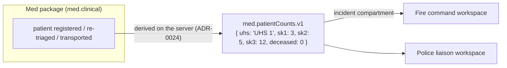
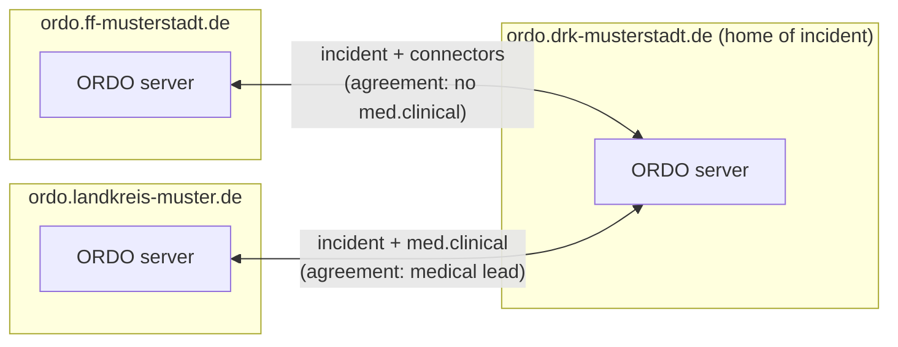
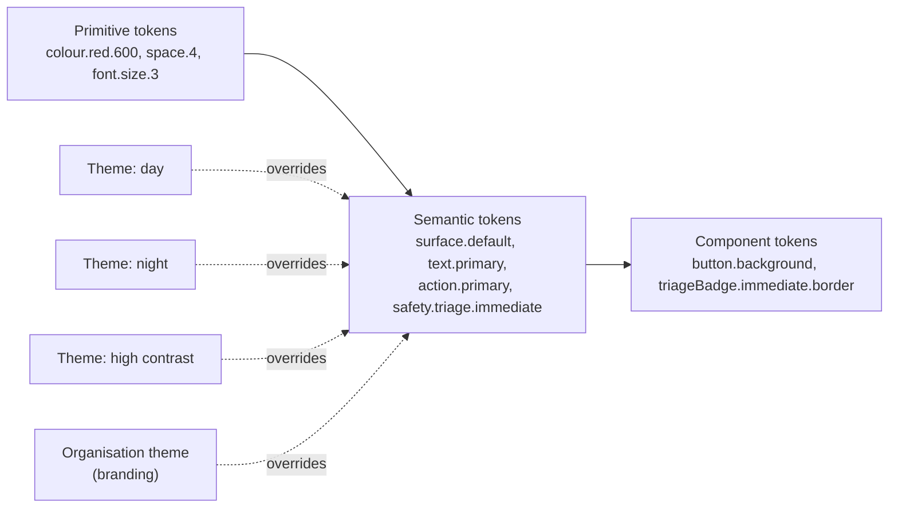

# 8. Crosscutting concepts

> Part of the [ORDO architecture](README.md) (arc42).

## 8.1 Events and ordering

Every change is stored as an immutable **event**. Shown as JSON for readability; on the
wire and in storage it is **CBOR**.

```json
{
  "id": "01JC8Z6K4Q8M3N2P1R0S9T8V7W",
  "incident": "01JC8Z5…@ordo.drk-musterstadt.de",
  "origin": "ordo.drk-musterstadt.de",
  "compartment": "med.clinical",
  "module": "med.epcr",
  "type": "epcr.vitalsRecorded",
  "schemaVersion": 1,
  "author": { "user": "anna@ordo.drk-musterstadt.de", "device": "01JC7…" },
  "hlc": "2026-11-08T14:02:11.480Z-0001-device12",
  "payload": "<encrypted with the compartment key>",
  "signature": "<Ed25519 signature of origin>"
}
```

- The **envelope** (IDs, origin, compartment, module, type, author, clock) is small and
  readable by the server, so it can order, route and check permissions.
- Identifiers are **globally unique and qualified with their server**, and every event
  is **signed**, from day one, so that installations can federate later without
  migrating data ([8.4](#84-federation)).
- The **payload** of protected compartments is encrypted with that compartment's key
  ([8.2](#82-data-compartments)).
- The current state is a **projection** of the events, built per module.

### 8.1.1 Ordering and conflicts

- Each event carries a **hybrid logical clock** (HLC): close to real time but
  consistently ordered even when device clocks differ.
- The incident's **home server** ([8.4](#84-federation)) assigns a **sequence number** per incident and
  compartment. Clients replay
  their unconfirmed local events on top of it.

| Kind of data | Rule | Example |
|---|---|---|
| Log entries, radio messages, ePCR entries | Never conflict, all are kept | Two medics document at the same time |
| Simple fields | Last writer wins (by HLC), per field | Unit status changed on two tablets |
| Collections | Add and remove are separate events | Two units added to a sector at once |
| Critical changes | Last writer wins **and** a visible notice | Two people re-triage the same patient |

Events of modules a device doesn't know (older version, module switched off) are
stored and forwarded untouched, so mixed versions in the field never lose data.

### 8.1.2 Design items

#### Qualified identifiers
`dsn~qualified-identifiers~1`

Identifiers are validated value types in `ordo-core`. Users, incidents and keys are qualified with their server name (`localpart@server`, `ULID@server`, `name@server`); organisations are identified by their server name; events and devices use ULIDs (16 bytes). Values are validated when they are created and when they are decoded, following `spec/sync/event.cddl`, so an invalid identifier cannot exist in memory.

Covers:

* [req~fed-7~1](../requirements/06-federation-and-interfaces.md#fed-7--globally-unique-identifiers)

Needs: impl, utest

Tags: must, m0

#### Signed events
`dsn~signed-events~1`

Events travel as `[body bytes, signature]`. The Ed25519 signature covers the context `ORDO event v1`, a zero byte and the body bytes exactly as sent. Receivers verify before accepting and forward the body bytes unchanged, so signatures stay valid across relays and across versions that add fields ([spec §4](../../spec/sync/event.md)).

Covers:

* [req~fed-6~1](../requirements/06-federation-and-interfaces.md#fed-6--verifiable-origin-and-integrity)

Needs: impl, utest

Tags: must, m0

#### Hash chain
`dsn~hash-chain~1`

The home server orders events per incident and compartment and chains them: chain = BLAKE3 derive-key `ORDO chain v1` over previous chain ‖ event hash, starting from 32 zero bytes. Anyone holding the sequence can recompute the chain and detect changed, removed or reordered events ([spec §6](../../spec/sync/event.md)).

Covers:

* [req~fed-6~1](../requirements/06-federation-and-interfaces.md#fed-6--verifiable-origin-and-integrity)

Needs: impl, utest

Tags: must, m0

#### Outbox and resend
`dsn~outbox-and-resend~1`

A device records every new event in its outbox and shows it at once. After connecting, it sends `hello` with the last sequence number it has per stream, receives what it missed, and then sends its whole outbox. The server ignores events it has already ordered (by event ID), so resending after a lost confirmation never duplicates anything. An event leaves the outbox when it comes back ordered from the server.

Covers:

* [req~off-3~1](../requirements/07-quality.md#off-3--automatic-sync)

Needs: impl, itest

Tags: must, m1

## 8.2 Data compartments

A **compartment** is a separately protected part of an incident's data. Every event
belongs to exactly one.

| Compartment | Content | Who can read | Retention (default, DE) |
|---|---|---|---|
| `incident` | Units, sectors, tasks, map, log, connector data | Everyone taking part in the incident | Configurable (e.g. 1–3 years) |
| `med.clinical` | Patient identity, triage details, ePCR, transport details | Assigned medical staff, medical leads | ≥ 10 years (medical documentation) |
| `med.ops` | UHS staff planning, internal med logistics | Med package users | As `incident` |
| `police.restricted` | Police-only information (later) | Police users | Per police rules |
| `fire.ops` | Fire-internal data, e.g. BA monitoring details | Fire package users | As `incident` |

Each compartment has its own:

- **Access rules** — checked on the server for every event and every read.
- **Sync scope** — the server sends a device only the compartments its user may read.
  A fire tablet never receives, and therefore never stores, patient records.
- **Encryption key** — one data key per incident and compartment. Keys are given to
  authorised devices encrypted for that device's own key (X25519), and are removed when
  a device is revoked or a role ends.
- **Retention** — closed incidents are deleted or anonymised per compartment, so ePCR
  data can be kept 10 years while operational data is deleted earlier.

**Trust model (proposed, ADR 014):** the server is trusted and can decrypt (needed for
reports, PDF handover, FHIR export and backups), but keeps compartment keys separate
and logs every decryption. Full end-to-end encryption (server can't read clinical data)
is possible later with the same structure, at the cost of server-side features.

### 8.2.1 Design items

#### Compartment-scoped sync
`dsn~compartment-scoped-sync~1`

On `hello`, the server grants only the streams (incident × compartment) the user may read and lists the others as denied; it never delivers events of a denied stream to that session, and the device discards deliveries for streams it was not granted. When a device pushes an event, the server checks author, signature, write permission and sealing before ordering it.

Covers:

* [req~sec-9~1](../requirements/07-quality.md#sec-9--compartment-scoped-sync)

Needs: impl, itest

Tags: must, m1

#### Sealed payloads
`dsn~sealed-payloads~1`

Payloads of protected compartments are encrypted with XChaCha20-Poly1305 using the data key of the incident compartment ([spec §5](../../spec/sync/event.md)). The server creates the key on first use and grants it only to devices whose user may read the compartment. Server and devices store only the sealed form; the server rejects unsealed events in protected compartments and sealed events in unprotected ones.

Covers:

* [req~sec-10~2](../requirements/07-quality.md#sec-10--health-data-protection)

Needs: impl, utest, itest

Tags: must, m1

## 8.3 Connectors

A **connector** is a versioned contract for information that crosses a package border.
Technically, a connector is a set of **published events** in the shared `incident`
compartment:



- Connector events are derived by the **server that orders the source compartment**
  (the home server; later also the edge server in the command vehicle), with a deriver
  provided by the package ([ADR-0024](../adr/0024-server-derived-connectors.md)). It has
  the complete, ordered view, so there is exactly one consistent source.
- Connector events contain **only what the contract allows**: counts and statuses,
  never clinical details (CONN-3).
- **Consuming** packages depend only on the contract crate (`ordo-contracts`), never on
  the providing package.
- Contracts are **versioned** (`.v1`, `.v2`); a provider can publish several versions
  during a transition.
- Requests across services (e.g. Fire → Med "responder injured") are connector events
  that create a **task** visible to both sides (CONN-4).
- The list of all connectors with their fields and purpose is generated from the
  contract crate and shown to administrators (CONN-2).

First contracts:

| Contract | From → to | Content |
|---|---|---|
| `med.patientCounts.v1` | Med → all | Counts per triage category and location |
| `med.transportStatus.v1` | Med → all | Transports: unit, destination hospital, status — no patient data |
| `fire.responderInjured.v1` | Fire → Med | Request for care: location, unit, urgency |
| `command.dangerZones.v1` | Command → all | Danger zones, staging areas, sectors |
| `command.routes.v1` | Command/Police → all | Cordons, access and exit routes |

### 8.3.1 Design items

#### Server-derived connectors
`dsn~server-derived-connectors~1`

A package registers a deriver for its source compartment with the server. For every newly ordered event of that compartment, the server passes the decrypted event to the deriver and publishes what it returns — signed by the server — into the target compartment. The Med deriver publishes `med.patientCounts.v1` for every on-site care unit whose counts changed; the payload contains only the unit name and one number per triage category.

Covers:

* [req~pat-6~1](../requirements/04-med.md#pat-6--patient-counts-for-command)
* [req~conn-3~1](../requirements/05-police-and-connectors.md#conn-3--minimum-necessary-data)

Needs: impl, itest

Tags: must, m1

## 8.4 Federation

**Goal:** ORDO installations run by different organisations work together on the same
incident, without a central server — in the spirit of Matrix, but focused on what
emergency services need.

### 8.4.1 Why not build directly on Matrix?

Matrix is a serious option: proven, federated, end-to-end encrypted, with Rust server
implementations; in Germany it is the basis of the health sector's TI-Messenger and of
the Bundeswehr's BwMessenger. But for ORDO's core data the fit is poor:

| Aspect | Matrix | ORDO needs |
|---|---|---|
| Who can federate | Open by default | Closed: only explicitly trusted partners |
| Ordering | Event graph with state resolution, no single authority | A simple, clear order per incident — an incident has a lead organisation anyway |
| Data model | Rooms and messages; app data as custom events | Compartments, projections, retention per compartment, offline-first devices |
| Resources | Homeservers are comparatively heavy | Must run on a Raspberry Pi in a vehicle |

**Proposal (ADR 016):** an own, focused federation protocol that borrows Matrix's good
ideas (server identity via domain names, signed events, open specification). Plus a
**Matrix adapter** later for messaging with TI-Messenger, BwMessenger or Element — where
Matrix is strongest.

### 8.4.2 Model



- **Server identity:** each installation has a domain name and a signing key pair
  (Ed25519), published at `https://<domain>/.well-known/ordo`.
- **Global identifiers:** users and organisations are qualified with their server
  (e.g. `anna@ordo.drk-musterstadt.de`); incidents and events have globally unique IDs.
- **Signed events:** every event is signed by its origin, so every installation can
  verify where an event comes from and that it is unchanged — even when relayed.
- **Home per incident:** the leading organisation's server is the incident's *home* and
  assigns the order. Other servers replicate the incident for the compartments their
  users may read. The home can be handed over (e.g. the county takes over command);
  the handover is an event like any other.
- **Same protocol as devices:** to the home, a partner server behaves like a large
  client — with an outbox, continuing to work when the home is unreachable and catching
  up later. A network split between organisations is the same case as a tablet without
  coverage, which ORDO handles anyway.
- **Closed by default:** a federation agreement per partner states which compartments
  and roles may cross. Compartment keys are given only to partner servers that host
  authorised users; `med.clinical` normally stays with medical organisations.

- **Different rules on each side:** every state (and country) has its own doctrine and
  catalogues. Work within one's own jurisdiction comes first; across borders, servers
  agree on core meanings, show their own labels and keep the sender's original entry
  ([ADR-0044](../adr/0044-federation-across-profiles.md)).

### 8.4.3 Now vs later

| Built now (cheap, avoids migrations later) | Built later (phase 4) |
|---|---|
| Globally unique, server-qualified identifiers | Server discovery and key exchange |
| Server signing keys; signed events | Federation agreements (admin UI) |
| "Home" concept in the sync protocol | Server-to-server endpoints |
| Sync protocol that doesn't distinguish device vs server peers | Home handover; conformance tests |

## 8.5 Security

- **Transport:** TLS everywhere (rustls); ACME / Let's Encrypt or local certificates.
- **Compartments:** separate access rules, sync scope, keys and retention ([8.2](#82-data-compartments)).
- **Devices:** own key pair per device, paired via QR code; revocation removes keys and
  stops sync. Data on the device is stored encrypted
  ([ADR-0041](../adr/0041-encryption-at-rest-on-devices.md)). Devices with clinical data
  lock automatically (PIN / biometrics, SEC-13).
- **Permissions** are checked on the server for every event; the client checks them only
  for quick feedback.
- **Guests** get a time-limited link for one incident, `incident` compartment only.
- **Integrity:** events hash-chained per incident and compartment (BLAKE3).
- **Access logging:** every read of a clinical record is an audit event.
- **Memory safety:** no `unsafe` in ORDO's own code except reviewed FFI; `cargo audit`
  and `cargo deny` in CI.
- **Login:** OpenID Connect with the organisation's identity provider, device keys and QR
  pairing ([ADR-0038](../adr/0038-login-and-device-pairing.md)).

### 8.5.1 Design items

#### Device proof
`dsn~device-proof~1`

On every connection the hub sends a fresh 32-byte challenge. The device answers with its
hello, which carries an Ed25519 signature with the device key over `ORDO hello v1`, a zero
byte, the challenge, the device ID and the user ID (sync protocol draft 1). The hub uses
each challenge once, checks the signature against the device's registered key, and
refuses the connection otherwise; a refused connection gets no data and no key.

Covers:

* [req~sec-11~1](../requirements/07-quality.md#sec-11--authenticated-connections)

Needs: impl, itest

Tags: must, m7

#### Role policies
`dsn~role-policies~1`

The server decides every read and write of a compartment with Cedar
([ADR-0035](../adr/0035-authorization-with-cedar.md)): principal the user, resource the
compartment, context the user's roles and the incident. Packages ship default policies
(`medic`: incident and clinical data; `commander`: incident data); an organisation adds
roles and policies as `*.cedar` files in `ORDO_POLICY_DIR`. All policies are validated
against the schema at start; an invalid file stops the server. No permission is ever
given to a person directly.

Covers:

* [req~sec-2~1](../requirements/07-quality.md#sec-2--role-based-access)

Needs: impl, utest, itest

Tags: must, m7

#### OpenID Connect login
`dsn~oidc-login~1`

The ORDO server is the relying party (backend for frontend); the browser never sees a
token. The pairing page creates a device key pair, keeps the private key on the device and
sends the public key to `GET /auth/login`. The server starts the authorization code flow
with PKCE and binds it to the browser with a cookie; on return it verifies the ID token
(issuer, audience, signature, nonce), maps the provider's subject to a stable ORDO user ID
(preferred user name or e-mail), takes the `groups` claim as roles, stores the device key
and registers it with the hub. The provider is discovered on first use, so a field server
also starts without it ([ADR-0038](../adr/0038-login-and-device-pairing.md)).

Covers:

* [req~sec-3~2](../requirements/07-quality.md#sec-3--login-and-single-sign-on)

Needs: impl, itest

Tags: must, m8

#### QR pairing
`dsn~qr-pairing~1`

A shared device sends its public key to `POST /auth/device`; the server starts the OAuth
2.0 Device Authorization Grant (RFC 8628) at the identity provider and returns the user
code and verification address. The device shows them as QR code (rendered by the server)
and as text with a link; a logged-in person opens it on their phone and approves. The
server waits for the approval in the background, verifies the ID token, and registers the
device key as for a login; the device polls `GET /auth/device/{id}` until it is paired.

Covers:

* [req~org-3~2](../requirements/02-shared.md#org-3--device-pairing)

Needs: impl, itest

Tags: must, m8

#### Access timeout
`dsn~access-timeout~1`

Every device paired by login has an end of its login, stored with the device: "now +
access timeout" (default 48 h, 24–720 h) after each successful verification. A login on
any of the person's devices, or a background renewal of the identity provider's renewal
token (every 15 minutes, `offline_access`), sets it for all their devices; only
`invalid_grant` ends it at once, every other failure leaves it unchanged. The hub refuses
expired devices at hello and cuts their open sessions (`loginExpired`, checked every minute
and before each push). The welcome carries `valid_until`; the device keeps it and locks
itself at that time, also offline, offering to log in again with the same device key
([ADR-0040](../adr/0040-access-ends-only-on-positive-evidence.md)).

Covers:

* [req~sec-12~1](../requirements/07-quality.md#sec-12--access-timeout)

Needs: impl, utest, itest

Tags: must, m9

#### Device revocation
`dsn~device-revocation~1`

A person sees and revokes their own devices; the role permission `manage_devices` (Cedar,
default role `admin`) extends this to all devices of the organisation. The welcome lists
such permissions, so the app knows which view to offer. The sync connection carries the
requests (`listDevices`, `revokeDevice`) and the answer (`devices`), so they need the same
device proof as everything else. Revoking removes the device key from the hub, records the
revocation in the store (it survives restarts), and cuts the device's open connections
with `revoked`. A revoked device that connects again is told `revoked` before its proof is
checked, deletes its key and all local data (remote wipe), and stops reconnecting.
Unpairing a device revokes it as well, if the server can be reached.

Limits: a device that never connects again keeps its data until the screen lock (SEC-13)
or the access timeout (SEC-12) makes it unusable; the key cannot be copied off the device
once it is stored non-extractably (next step).

Covers:

* [req~sec-4~2](../requirements/07-quality.md#sec-4--device-revocation)

Needs: impl, utest, itest

Tags: must, m9

#### Device storage encryption
`dsn~device-storage-encryption~1`

The app stores nothing in plain text: pairing, pending pairing and replica are encrypted
with a storage key (XChaCha20-Poly1305, the item's name as associated data, format
`enc1:`). The storage key is wrapped by a non-extractable AES-256-GCM WebCrypto key kept in
IndexedDB, and unwrapped at start; without a secure context the app stores nothing.
Unpairing and revocation replace the storage key, so leftovers cannot be decrypted. Older
plain-text items are encrypted on first load. Network traffic uses TLS, terminated by the
bundled reverse proxy ([ADR-0041](../adr/0041-encryption-at-rest-on-devices.md)).

Covers:

* [req~sec-1~2](../requirements/07-quality.md#sec-1--encryption-in-transit-and-at-rest)

Needs: impl, utest, itest

Tags: must, m10

#### Incident roles
`dsn~incident-roles~1`

Incidents and rosters are events in the incident's `incident` compartment (module
`incidents`: `planned`, `stateChanged`, `roleGranted`, `roleWithdrawn`); the hub and the
devices compute the same registry from them. Access decisions pass the person's roles in
the incident to the policy, which adds the organisation roles (administrators from
`ORDO_ADMINS`) and asks Cedar. Only planners (`manage_incidents`) plan incidents; planners
and holders of a role with `assign_role` (default: `commander`) grant and withdraw roles
and change the state. When someone's roles change, the server ends their connections
(`refused: rolesChanged`); the devices reconnect, get the streams they may read now, and
delete the data of streams they lost. After logging in, the app lists the person's
incidents (`listIncidents`); a planner's device plans one by recording `planned` and the
planner's `commander` role once it may write to it
([ADR-0046](../adr/0046-roles-granted-per-incident.md)).

Covers:

* [req~org-6~1](../requirements/02-shared.md#org-6--incidents-planned-ahead-roles-per-incident)

Needs: impl, utest, itest

Tags: must, m11

#### Transport priority and "Betroffene"
`dsn~transport-priority~1`

The triage contract has a core meaning `uninjured` ("Betroffene"), shown without a triage
colour (neutral badge, a ring as shape) and counted apart in `patientCounts`; the patient
events carry schema version 2 since then. Transport priority is its own event
(`patients.transportPriority`, level or none) in the clinical compartment. The profile file
`med/transport-priority.toml` names the categories that may get it and its levels; the app
embeds it at build time. The register keeps the level and when it was set; a later triage
to a category without transport priority ends it for good. The record offers the levels
only for allowed categories; the patient list shows a badge (arrow and label, never colour
alone).

Covers:

* [req~pat-9~1](../requirements/04-med.md#pat-9--unharmed-affected-people)
* [req~pat-10~1](../requirements/04-med.md#pat-10--transport-priority)

Needs: impl, utest, itest

Tags: must, m12

#### Device storage
`dsn~device-storage~1`

The web app keeps the replica in SQLite on the browser's file system (OPFS) in a dedicated
worker, `platform/ordo-store` ([ADR-0034](../adr/0034-device-storage-sqlite-opfs.md)): a
key-value table, one row per event (`e/<incident>/<compartment>/<seq>`) and one for the rest
of the replica (`state`). The app encrypts every value with the vault's storage key before
it leaves the main thread (ADR-0041), so the worker sees only ciphertext. After a change
only the new events and the state row are written; streams the device lost are deleted.
At start the app waits for the worker's `ready`, opens and loads the database (time limit
ten seconds); data of older versions moves over from `localStorage` with the first write;
without OPFS in workers the app keeps using `localStorage`. The worker is its own Cargo
workspace (own lockfile): its SQLite for the browser cannot share the dependency graph with
the server's SQLite yet.

Covers:

* [req~off-7~1](../requirements/07-quality.md#off-7--device-storage)

Needs: impl, itest

Tags: must, m13

#### Attachments
`dsn~attachments~1`

Attachments are encrypted on the device and named by the BLAKE3 hash of their ciphertext
([ADR-0033](../adr/0033-attachments-in-an-object-store.md)). A device asks over its
authenticated sync connection for a ticket (`blobTicket`: incident, compartment, hash,
size, direction); the server grants it if the user may write (upload) or read (download)
that stream, and for downloads only if the attachment was uploaded to that stream. The
bytes travel over HTTP, `PUT`/`GET /blobs/<hash>` with `Authorization: Bearer <ticket>`;
tickets are valid ten minutes, upload tickets once. The server checks size and hash, stores
the bytes with `object_store` under `blobs/<2 hex>/<hash>` (local directory
`<ORDO_DATA_DIR>/blobs`, or an S3-compatible bucket with `ORDO_S3_BUCKET`, tested with
Garage; the server checks at start that the bucket answers) and records the stream in the
`blobs` table. Largest attachment: `ORDO_MAX_BLOB_MB` (default 20).

Covers:

* [req~off-6~1](../requirements/07-quality.md#off-6--attachments)

Needs: impl, utest, itest

Tags: must, m13

#### Attachment transfer
`dsn~attachment-transfer~1`

On the device ([ADR-0033](../adr/0033-attachments-in-an-object-store.md)): a new
attachment is encrypted with its own random key (`ordo_crypto::attachment`, AAD bound to
the media type), kept in the device database as `b/<hash>` and put into the upload queue
(`uploads`, encrypted with the storage key). The event only carries the reference (hash,
size, media type, key). While connected, the device asks for an upload ticket for every
queued attachment and sends it; the queue keeps it until the server answered `201`,
after a failure it tries again after ten seconds, after a reconnect at once. The status
line counts queued attachments as unsent input. A device that shows an attachment it
lacks looks in its database first, then asks for a download ticket; it checks the hash of
what it receives and keeps it. If the server does not have it yet, the app shows the
preview with a note and asks again ten seconds later. Without the device database (no
OPFS in workers) attachments are kept in memory only.

Covers:

* [req~off-6~1](../requirements/07-quality.md#off-6--attachments)

Needs: impl, itest

Tags: must, m13

#### Treatment places
`dsn~treatment-places~1`

A unit's treatment places are a list (`uhs.placesSet`: ID and label per place) in the
shared incident compartment, created with the unit (one per patient it can take) and
changed in *UHS verwalten*; the latest list counts. Assignments (`patients.placeAssigned`,
place or none) are clinical events; the register keeps each patient's place. The record
offers the places of the patient's unit and disables those taken by others; the patient
list shows the place; *UHS verwalten* shows free places. Labels come from the app (DE:
"Platz 1"), never from the package.

Covers:

* [req~uhs-7~1](../requirements/04-med.md#uhs-7--treatment-places)

Needs: impl, itest

Tags: must, m12

#### Views by role
`dsn~views-by-role~1`

What a person sees follows their roles in the incident, decided by Cedar on the server:
the welcome lists, per incident, the app's views and functions the roles allow
(`view_situation`, `edit_units`). The situation view (counts and load of every UHS, units,
roster) and the device list need `view_situation` (the device list also opens with the
organisation permission `manage_devices`); adding units and setting their status needs
`edit_units`. The server enforces it for every event: the Cedar request carries the event's
module, so the default policies let medics write the shared compartment except `units`.
Default roles: `commander` sees the whole incident without clinical details; `medic` works
in the UHS views only. Organisations widen or narrow this in their own policies.

Covers:

* [req~org-6~1](../requirements/02-shared.md#org-6--incidents-planned-ahead-roles-per-incident)

Needs: impl, utest, itest

Tags: must, m11

## 8.6 Design system and accessibility

Target: **EN 301 549 / WCAG 2.2 AA** for everything ORDO produces ([requirements §5.8](../requirements/07-quality.md#58-accessibility)).
The design system is the main tool to get there: if the shared components are
accessible, every module built from them is too.

### 8.6.1 Why the UI technology matters

Leptos renders **real HTML elements** into the page. Screen readers, keyboard
navigation, browser zoom and operating-system contrast settings therefore work as on
any good website. UI frameworks that paint everything onto a canvas would make most of
this impossible; this rules them out for ORDO.

The one canvas ORDO needs is the **map** (MapLibre). It gets an accessible companion:
every map object also appears in a list view with the same actions (A11Y-5), and map
objects can be reached by keyboard.

### 8.6.2 Building blocks (open source)

| Area | Choice | Licence | Why |
|---|---|---|---|
| Token format | **W3C Design Tokens format (DTCG 2025.10)**, JSON | open specification | Tool-independent standard; also read by Style Dictionary, Tokens Studio (Figma) and Terrazzo, so designers can work with their own tools |
| Token build | Small Rust tool **`ordo-tokens`**: DTCG → CSS custom properties (+ Rust constants), with contrast checks | AGPL-3.0 | Keeps the build Rust-only; because the format is standard, Style Dictionary can be used instead at any time |
| Typeface | **Atkinson Hyperlegible Next** and **Mono** (Braille Institute) | SIL OFL 1.1 | Designed for low-vision readers; clearly distinguishes 0/O and 1/l/I — important for call signs and triage tag numbers |
| Icons | **Lucide** | ISC | Large, consistent, actively maintained set. Tactical symbols (DV 102) come from the profiles, not from the icon set |
| Components | Own components in **`ordo-ui`**, built to the **WAI-ARIA Authoring Practices**. Headless Leptos libraries (e.g. RustForWeb's Radix port, Leptix) are evaluated in the prototype and adopted only if maintained and passing our tests | AGPL-3.0 | The Rust UI ecosystem is young; accessibility must not depend on an unmaintained crate |
| Styling | Plain CSS: custom properties for tokens, cascade layers, no CSS framework | — | Small and fast; themes are just different property values |
| Automated tests | **axe-core** run by **Playwright** in CI | MPL-2.0 / Apache-2.0 | Catches a large share of WCAG errors on every change |
| Manual tests | NVDA, Orca, VoiceOver, TalkBack per release; expert audit (e.g. BITV-Test) before the first release for public bodies | — | Automated checks find only part of the problems |
| Documents | **Typst ≥ 0.14**: tagged PDFs by default, PDF/UA-1 export | Apache-2.0 | EN 301 549 clause 10 (documents) |

### 8.6.3 Tokens and themes



- **Primitive** tokens are raw values (colours, spacing, sizes). **Semantic** tokens give
  them a meaning (`text.primary`, `action.danger`). **Component** tokens bind meanings to
  parts of components.
- **Themes override semantic tokens only.** ORDO ships *day*, *night* and *high
  contrast*. An organisation theme is one more layer on top, like profile layers ([8.8.3](#883-layering)).
- **Safety tokens are protected.** Tokens under `safety.*` (triage categories, alarms,
  unit-status meaning) keep their hue in every theme, and organisation themes can't
  change them. Their *lightness* may differ between day and night so that contrast
  holds in both.
- **Checked automatically:** `ordo-tokens` computes the contrast of every text/background
  and control/background pair defined in the system, for every theme, and fails the build
  below WCAG thresholds (4.5:1 text, 3:1 large text and UI parts). An organisation theme
  that fails is rejected when it is loaded.
- **Operating-system settings are respected:** `prefers-color-scheme` picks day or night,
  `prefers-contrast: more` picks high contrast, `forced-colors` (Windows contrast themes)
  falls back to system colours, `prefers-reduced-motion` turns off animation.
- The user can always override the choice in the app (e.g. force night mode in the
  command vehicle).

### 8.6.4 Rules every component follows

- Native HTML elements first (`button`, `input`, `table`, `dialog`); ARIA only where HTML
  has no equivalent.
- Visible focus indicator in every theme; logical focus order; focus moves sensibly
  after dialogs and actions.
- Every control has a visible label; error messages are text, linked to the field.
- Touch targets ≥ 12 mm (about 46 CSS px), well above the WCAG 2.5.8 minimum.
- **Colour plus text plus shape** for all status information. Example: a triage badge
  shows the colour, the label from the profile ("SK I") and a distinct shape per
  category.
- Live regions announce important changes (new patient in UHS, alarm) to screen-reader
  users without moving focus.
- Alarms: visual + sound + vibration, never flashing more than three times per second.
- Layouts reflow down to 320 CSS px and work at 200 % text size.
- All user-visible text comes from translation files (Fluent), with `lang` set
  correctly, including for patient-facing texts in other languages.

### 8.6.5 Design-system documentation

A component gallery (built with ORDO itself, served by `ordo serve --gallery`) shows
every component in every theme, with usage and accessibility notes. It is also the page
the automated accessibility tests run against.

### 8.6.6 Design items

#### Design-token layers
`dsn~design-token-layers~1`

`ordo-tokens` reads token files in the W3C Design Tokens format (DTCG 2025.10), resolves aliases with cycle and type checks, and layers them: base files (primitive and component tokens) plus one theme file, plus optionally an organisation layer on top. Theme files may only add semantic tokens, and all themes must define the same tokens.

Covers:

* [req~ds-2~1](../requirements/07-quality.md#ds-2--design-tokens)
* [req~ds-6~1](../requirements/07-quality.md#ds-6--layered-themes)

Needs: impl, utest

Tags: must, m0

#### Theme validation
`dsn~theme-validation~1`

For every theme, `ordo-tokens` checks all pairs in `design/contrast.toml` with the WCAG 2 contrast ratio, never rounding up; transparent colours are composited over their background. An organisation layer may only change existing semantic tokens of its base theme, never tokens in protected groups (`color.safety`), and must pass the same pairs; otherwise it is rejected.

Covers:

* [req~ds-4~1](../requirements/07-quality.md#ds-4--themes-cannot-break-accessibility-or-safety)

Needs: impl, utest

Tags: must, m0

#### CSS themes
`dsn~css-themes~1`

`ordo-tokens` generates CSS custom properties: base tokens and the default theme in `:root`, every other theme under `:root[data-theme="…"]`, automatic selection through `prefers-color-scheme` and `prefers-contrast` when the page sets no theme, and all durations set to 0 ms under `prefers-reduced-motion`. Aliases become `var()` references, so switching a theme switches only the semantic tokens.

Covers:

* [req~ds-3~1](../requirements/07-quality.md#ds-3--themes)

Needs: impl, utest

Tags: must, m0

## 8.7 Open specifications

All of ORDO's interfaces are published as **open, versioned specifications**,
separate from the code — like the Matrix specification — so other systems, including
commercial control-centre or hospital software, can talk to ORDO.

| Specification | Covers | Format |
|---|---|---|
| Client–server API | Login, master data, admin (HTTP) | OpenAPI 3.1 |
| Sync protocol | WebSocket messages, event envelope | AsyncAPI 3 + CDDL (RFC 8610) for the CBOR structures |
| Federation API | Discovery, keys, server-to-server sync | OpenAPI 3.1 + AsyncAPI 3 |
| Connector contracts | Data crossing package borders | CDDL; JSON Schema generated |
| Profile format | Regional profiles | JSON Schema (validates the TOML files) |

- **Spec-first** for the sync protocol, federation and connectors: the spec is the
  contract, the Rust code implements it, and CI checks that they match.
- **Conformance test suite** in the repository that any implementation can run.
- **Versioning:** each specification has its own semantic version; servers announce
  supported versions in `/.well-known/ordo`.
- **Licence:** CC BY 4.0 for spec texts, Apache-2.0 for schemas and the
  conformance suite. Permissive on purpose: anyone may implement the interfaces, while
  ORDO's own code stays AGPL.

## 8.8 Regional profiles

Everything country- or organisation-specific is **configuration data**, packaged as a
profile. Core, modules and packages contain no regional data (I18N-4).

### 8.8.1 Profile packages

The first catalogue exists: `profiles/de/med/epcr-forms.json`, the ePCR forms as an HL7
FHIR Questionnaire ([ADR-0027](../adr/0027-epcr-forms-from-the-profile.md),
[ADR-0037](../adr/0037-epcr-forms-as-fhir-questionnaire.md)). The app checks it at build time and
embeds it; loading effective profiles from the server comes later.

```
profiles/de/
├── profile.toml               # manifest
├── unit-types.toml
├── status-codes.toml
├── command-structure.toml
├── incident-keywords.csv
├── task-templates.toml
├── med/
│   ├── triage-categories.toml
│   ├── discharge-outcomes.toml
│   ├── epcr-forms.json        # ePCR forms: FHIR Questionnaire (DIVI MIND sections)
│   └── hospital-types.toml
├── terminology/
│   ├── de.ftl                 # UI wording (Fluent)
│   └── en.ftl
└── symbols/                   # tactical symbols (SVG)
```

```toml
# profiles/de/profile.toml
id = "de"
name = "Deutschland"
version = "0.1.0"   # content version
format = 1          # profile format version (I18N-8)
extends = []        # a state profile says: extends = ["de"]
languages = ["de", "en"]

[[source]]          # documents the profile's content is taken from
topic = "command"
title = "FwDV 100 Führung und Leitung im Einsatz"
edition = "AFKzV, 10 March 1999"
url = "https://…"
```

State profiles exist for all 16 states (`profiles/de-bw` … `profiles/de-th`); so far they
list their sources ([German state sources](../standards-de-states.md)).

```toml
# profiles/de/med/triage-categories.toml
[[category]]
id = "de.triage.sk1"
label = "SK I"
colour = "red"
meaning = "immediate"      # core meaning used by the software
```

### 8.8.2 Catalogues are the extension points

Each catalogue type is defined (schema + meaning) by the module that uses it. A new
module brings its own catalogue types; the loader doesn't change.

| Catalogue | Module | Core meaning |
|---|---|---|
| `unit-types` | units | unit category (fire, EMS, police, technical, command, …) |
| `status-codes` | units | available, en_route, on_scene, deployed, unavailable, … |
| `command-structure` | command | level and role names |
| `incident-keywords` | incidents | incident category |
| `task-templates` | tasks | — |
| `symbols` | map | symbol per unit type, status, map object |
| `triage-categories` | med.patients | immediate, urgent, minor, expectant, deceased |
| `discharge-outcomes` | med.uhs | released, transported, refused, deceased |
| `epcr-forms` | med.epcr | form fields mapped to record fields |
| `hospital-types` | med.hospitals | capabilities (trauma centre, paediatrics, burns, …) |
| `terminology` | app | UI wording |
| `workspaces` | app | role → views and layout |

The software works with the core meaning (`immediate`); users see the regional label
("SK I", "T1", "P1", …). That is what lets one codebase serve many countries.

### 8.8.3 Layering

```
de  →  de-by (Bavaria)  →  org: e.g. a local medical service
```

- Every entry has a stable ID. A child layer can **add**, **override** or **hide**
  entries.
- The organisation layer is edited in the admin UI and stored as a profile layer.
- The resolver produces a versioned **effective profile** with a content hash; incidents
  record the hash they started with.
- `ordo profile validate` / `ordo profile resolve` check profiles locally and in CI.

### 8.8.4 First profile: Germany (DE)

| Item | DE profile |
|---|---|
| Command structure | FwDV 100: Einsatzleitung, Einsatzabschnitte, Untereinsatzabschnitte; introduced per state, partly as an extended DV 100 (state profiles `de-<state>`, [sources](../standards-de-states.md)) |
| Tactical symbols | *Taktische Zeichen im Bevölkerungsschutz* (BBK 2024, for FwDV/DV 102); licence open, see [roadmap](../roadmap.md) |
| Unit types | HLF, LF, TLF, DLK, ELW, RTW, NEF, KTW, … |
| Status codes | Status 1–9 (FMS/TMS) |
| Crew strength | Tactical notation, e.g. 1/8/**9** |
| Triage | *Sichtungskategorien* SK I–IV, plus deceased |
| Patient record | Based on DIVI MIND |
| Language | German (English UI available) |
